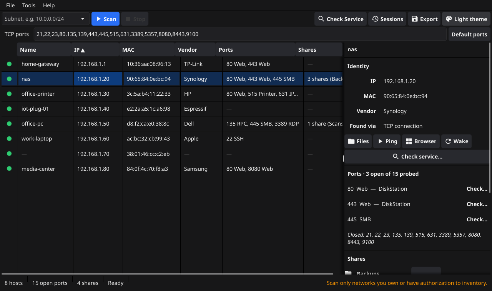

# LanCartographer

LanCartographer is a local network inventory and change-verification tool for
macOS 14 or later and Windows 10/11. Scan an authorized IPv4 range, save a
baseline, and compare it with a later scan of the same scope and ports.

The desktop app streams results as it scans. The CLI shares the scan engine
and can write JSON to a file or a pipe. Both run on demand, with no
LanCartographer account, background service, or telemetry.

[Quick start](#quick-start) · [Screenshots](docs/screenshots/) ·
[CLI reference](#cli-reference) · [Features](#features) ·
[User Guide](docs/USER-GUIDE.md) · [Roadmap](docs/network-workbench-roadmap.md)




The screenshots show a fabricated sample inventory (192.168.1.0/24), not real
network data.

## Quick start

- Get a build:
   - **Tagged releases** (when published) on
     [GitHub Releases](https://github.com/cgfixit/LanCartographer/releases).
     Windows assets are `LanCartographer.exe`, `lancartographer-cli.exe`,
     `LICENSE` and `SHA256SUMS.txt`. macOS assets are
     `LanCartographer-macos-arm64.zip` (Apple Silicon) and
     `LanCartographer-macos-amd64.zip` (Intel); each contains
     `LanCartographer.app`, `lancartographer-cli`, `LICENSE` and `SHA256SUMS.txt`.
   - **macOS `main-<commit SHA>` prereleases**, published automatically after a
     merge to `main` passes CI, gitleaks and CodeQL. Same ZIP layout. There is
     no Windows equivalent.
   - Or [build from source](#build-from-source).

## Why LanCartographer

- **Find the right device.** Locate a printer or NAS on an authorized subnet
  by address, reported name or vendor, inspect its open ports, and jump to it
  with Browser or Finder/Explorer. Missing names or vendors are common when a
  device ignores an enrichment probe.
- **Diagnose one service.** When a NAS, printer or web app is unreachable,
  Check Service shows whether name resolution, the TCP connect, the TLS
  certificate or the HTTP answer failed, and why.
- **Verify maintenance.** Save a baseline before a firmware update or service
  move, scan the same scope afterward, and select just the port or host
  differences that matter. Preview the redacted report before attaching it to
  a ticket.
- **Run a repeatable inventory.** Pass an explicit range and port list to the
  CLI and pipe JSON into a script. The output records what the scanning
  computer observed; use GUI sessions when a handoff needs coverage,
  completion state and comparison context.

## Features

| Area | What you get |
|---|---|
| Live scan | Scan a selected or entered IPv4 range with an editable TCP port list (**Default ports** restores it; ranges and invalid values are rejected before scanning). Hosts and open ports stream into the table; the status bar counts hosts, open ports and shares next to the progress bar and elapsed time |
| Authorization gate | Ranges outside your local subnets, outside RFC 1918 space or broader than a `/22` need explicit confirmation (GUI dialog, CLI `--i-am-authorized`); Check Service and Wake-on-LAN confirm each target. No account, telemetry or update check |
| Host discovery | TCP connect, then ARP, then (macOS) one ICMP echo, so a host with every probed port closed still appears; see [How it works](#how-it-works) |
| Inventory table | Sort by status, name, IP, MAC, vendor, ports or shares. The selected row stays highlighted, ports read compactly (`22 SSH, 443 Web`), and values the scan did not learn show a dim `—` |
| Host details | Open ports first, each with **Check…**; closed and unanswered ports collapse into one line each; action buttons for the selected host |
| Port states | Every probed port reports `open`, `closed` or `timeout`. Open ports carry a service label (smb, http, rdp, …); web and unrecognized ports get a bounded HTTP/HTTPS title probe that can identify additional web services. Ports 443 and 8443 also show when the presented certificate expires, marked **not trusted** if this computer could not verify it |
| Share enumeration | Windows `NetShareEnum` or macOS `smbutil`; a host that denies enumeration shows an explicit "access denied" marker instead of an empty list |
| MAC and vendor | MAC from ARP (Windows `SendARP`, macOS ARP cache); vendor from an OUI database compiled into the binary, with no runtime download |
| Name resolution | NetBIOS, mDNS and reverse DNS run concurrently; the highest-priority answer wins and cancels the rest. Names persist in a MAC-keyed cache, so silent devices keep them across scans |
| Quick actions | Right-click a host for Copy IP/MAC/name, Finder/Explorer, Browser on the detected web port (including custom ports identified as Web), Remote Desktop (Windows), Ping, Wake-on-LAN and Check service…; right-click a share to copy its UNC path or name or open it |
| Export and favorites | CSV or JSON from **Export**, which confirms before replacing a file and keeps the old one if the write fails. CSV prefixes formula-like cells with an apostrophe; JSON keeps raw values. **File → Save/Load Favorites** keeps a host list for later viewing |
| Sessions and evidence | Explicitly save a scan with scope, port profile, source interfaces, timestamps and completion state; reopen it without probing; compare compatible completed sessions; export selected differences, redacted by default |
| Check Service | From the Tools menu, the toolbar, a host's right-click menu or a port's **Check…** (prefilling sends nothing): one confirmed IPv4 or IPv6 address and port, checked in separate resolve, connect, verified-TLS and HTTP stages. See [Check a service](#check-a-service) |
| Connections (macOS) | Inspect visible local TCP and UDP sockets, filter by endpoint or process, and select an exact peer match in the current inventory. [Connections guide](docs/USER-GUIDE.md#inspect-local-connections-on-macos) |
| Route & DNS (macOS) | Read the selected route for a numeric IPv4 or IPv6 destination and inspect configured resolver scopes without sending probes. [Route & DNS guide](docs/USER-GUIDE.md#inspect-routes-and-resolver-configuration-on-macos) |
| Internet Quality (macOS) | Apple's `networkQuality` capacity and responsiveness test, a Cloudflare speed test handed to your browser, and a Wi-Fi before/after comparison of signal, noise, channel, link rate and gateway latency |
| Themes and first run | A toolbar toggle switches light/dark and persists. The authorization notice appears on first launch; if the app cannot record that you saw it, it says so and shows the notice again next time. **Help → About** shows the version, license and build target |
| CLI | The same engine without a window: a table on stdout, `--json PATH` or `--json -` for pipes, and exit codes for scripts. See [CLI reference](#cli-reference) |
| Elevation (Windows) | An unelevated process offers an **Elevate** button and marks MAC lookups that need elevation; macOS reads the ARP cache without it |

## How it works

- **Subnet discovery:** local IPv4 subnets come from Windows adapter APIs or
  macOS network interfaces and expand into candidate host addresses.
- **Host liveness:** each address is dialed on 445, 80, 443, 135, 139, 22,
  3389, 8080 and 8443, plus the scan's selected ports (duplicates skipped).
  The first successful connect marks the host alive and cancels the other
  dials. ARP is the next fallback; on macOS, a host still undetected gets one
  ICMP echo through the system `ping` (one-second cap), so a host with no open
  TCP ports can still report alive.
- **Concurrency:** up to 64 host workers run at once, and a separate global
  dial budget (default 128, hard cap 256) bounds TCP dials in flight across
  liveness and port probes. Those are two different knobs.
- **Port probes:** a TCP connect per port with an exact result. HTTP/HTTPS
  probes are capped at one second and 32 KiB, follow no redirects, and verify
  TLS certificates.
- **Live events:** the engine streams per-host events over a channel, so the
  Fyne table fills in while the scan is still running.

## CLI reference

`lancartographer-cli.exe` (Windows) or `./lancartographer-cli` (macOS) drives
the same engine as the GUI and prints a table (IP, NAME, MAC, VENDOR, PORTS,
SHARES) to stdout. Diagnostics go to stderr. Any executable whose base name
contains "cli" (case-insensitive) starts in CLI mode; passing `--cli` as the
first argument does the same on either binary.

The table replaces control characters in discovered text with `�` so
network-supplied values cannot control the terminal or add rows. JSON keeps
the original values.

| Flag | Meaning | Default |
|---|---|---|
| `--range CIDR` | IPv4 prefix to scan, e.g. `192.168.1.0/24` | omitted: every local physical subnet |
| `--ports` | Comma-separated TCP ports to probe (1–65535) | `21,22,23,80,135,139,443,445,515,631,3389,5357,8080,8443,9100` |
| `--timeout` | Per-host dial timeout, greater than zero; the per-dial probe timeout is 2× this value | `400ms` |
| `--concurrency` | Global concurrent-dial budget (engine clamps to 256) | `128` |
| `--json PATH` | Also write JSON to `PATH`; `-` writes only JSON to stdout | off |
| `--i-am-authorized` | Confirm authorization for ranges that require confirmation | off |

A range requires confirmation, and therefore `--i-am-authorized`, when it is
outside your local subnets, **or** not RFC 1918 private space, **or** broader
than a `/22`. Every target is checked before anything is scanned, so a refusal
exits without touching the network.

Exit codes:

- `0` — scan completed (and any requested JSON export succeeded)
- `2` — bad arguments, an authorization refusal, a scan failure, or a failed `--json` export
- `3` — no usable local interfaces (only when `--range` is omitted)

Examples:

```bash
# Inventory every local subnet (no admin needed)
lancartographer-cli.exe

# Sweep one subnet, save JSON
lancartographer-cli.exe --range 192.168.1.0/24 --json inventory.json

# Wider sweep with explicit authorization
lancartographer-cli.exe --range 10.0.0.0/20 --i-am-authorized

# A few ports, faster timeout
lancartographer-cli.exe --range 192.168.1.0/24 --ports 22,80,443,3389 --timeout 250ms

# Same engine through the GUI binary
LanCartographer.exe --cli --range 192.168.1.0/24 --json inventory.json
```

Pipe a local development server's open ports into `jq`:

```bash
./lancartographer-cli --range 127.0.0.1/32 --ports 3000,5432,8080 \
  --i-am-authorized --json - | jq '.[].Ports[] | select(.State == "open")'
```

`--json -` prints one array after a successful scan (`[]` if no hosts were
observed), with no table and no file named `-` (use `--json ./-` for that
filename). It is the same unredacted inventory format as a JSON file, without
session coverage metadata. Scan and authorization failures leave stdout empty
and exit nonzero; a write failure can leave partial JSON, so check the exit
status (`set -o pipefail` helps in pipelines). See the
[verification record](docs/verification/cli-json-stdout-2026-11-13.md).

## Saved sessions and selected evidence

1. Complete an authorized GUI scan and open **Sessions**. Enter a site, project
   or network context and an optional label, then **Save after session…**.
   Nothing is saved automatically; replacing an existing file asks first.
2. Make the network or service change, scan the same scope with the same port
   list, choose **Use current scan**, enter the same context and save.
   **Open before…** loads the baseline; **Open after…** loads a saved second
   session instead of the current scan.
3. Select the relevant differences (**Select all** and **Clear selection**
   help), review the plain-text preview, add optional notes, and choose
   **Export selected evidence…**. The export writes exactly the preview you
   reviewed.


Comparison requires two completed sessions with matching context, requested
range, port profile, application version and recorded source
interfaces/platform; otherwise the view explains the mismatch and disables
export. An upgrade, or a build with a different probe profile, can therefore
require a new baseline. Cancelled or failed
scans can be saved with partial observations but cannot supply a comparison.

Differences are observations **at an IP address**, not device identity: an
absent address is **not observed**, not proven offline. A device that moved
to a new address is paired by its MAC only when that match is unambiguous.
Saved session JSON
holds the **full unredacted inventory and local interface addresses**; keep it
private. Report redaction (on by default) uses report-local aliases and is not
anonymization. See
[what is saved and shared](docs/USER-GUIDE.md#what-is-saved-and-what-is-shared).

Saving, opening, comparing and exporting never scan, contact a service or
upload anything. Files use a versioned schema with 8 MiB and 65,536-host
limits; malformed or inconsistent files are rejected. Favorites and CLI JSON
are not session files. Sessions are GUI-only.

## Check a service

Open **Tools → Check Service…** or the toolbar's **Check Service**, or
right-click a host and choose **Check service…** to prefill its address and
likely web port (prefilling sends nothing). Enter a name or address, a port
and a protocol: **TCP**, **TLS**, **HTTP** or **HTTPS**. For a name,
**Resolve** with this computer's resolver and pick one returned address (up to
16 shown). **Check…** asks for confirmation that names the exact address, port
and traffic, flags off-subnet or public addresses, and repeats the
authorization notice.


| Stage | Limit | Reports |
|---|---|---|
| Resolve | 5 s | Addresses returned, or a not-found/unreachable-resolver reason |
| Connect | 3 s | Source address used, or refused / no answer / no route |
| TLS | 3 s | Version, certificate names, issuer and expiry (warning within 14 days); untrusted, mismatched or expired certificates fail |
| HTTP | 1 s, 32 KiB | Status, `Server` header and page title; redirects are shown, not followed; 5xx is a warning |

Each stage reports Passed, Warning, Failed or Skipped with a plain-language
reason. The check opens one connection to the confirmed address, never
re-resolves the name, uses no proxy, and never skips TLS verification (the
entered name is the SNI and `Host`). Unlike the scan engine, it accepts IPv6,
including scoped link-local addresses. One check runs at a time; **Stop** or
closing the window cancels it. Results stay in the window and are copied only
with **Copy results**. See the [Check Service guide](docs/USER-GUIDE.md#check-a-service).

## Internet Quality on macOS

**Tools → Internet Quality…** measures download and upload capacity, idle
latency and responsiveness under load (RPM). Confirm **Run Apple test…** to
send measurement traffic to Apple through the built-in `networkQuality`
utility; use an unmetered link. The run is capped at 45 seconds, and **Stop**
or closing the window ends it. **Open Cloudflare in browser…** is a separate
action with its own provider disclosure.

On the **Wi-Fi** tab, **Capture baseline**, make one change, then **Capture
after** to compare signal, noise, band, channel, transmit link rate and
gateway latency. Each capture sends up to five pings to the gateway through
the Wi-Fi interface.


Measurements and captures run one at a time and not during a scan; starting an
authorized scan ends the current measurement first. Results stay in the
window. See the [Internet Quality guide](docs/USER-GUIDE.md#measure-internet-quality-on-macos).

## Build from source

Use the Go version in [go.mod](go.mod) and a CGO C compiler; both entry points
include Fyne.

- **macOS:** install the Xcode Command Line Tools, then run
  `bash build/build.sh`. It builds the native architecture with system clang
  (macOS 14 target), moves the checked-in Windows `resource.syso` aside and
  restores it, and writes an ad-hoc-signed `dist/LanCartographer.app`,
  `dist/lancartographer-cli` and `dist/LanCartographer-macos-<arch>.zip`.
- **Windows (Git Bash):** run `pacman -S mingw-w64-ucrt-x86_64-gcc` and
  `go install github.com/josephspurrier/goversioninfo/cmd/goversioninfo@v1.7.0`,
  then `bash build/build.sh` for `dist/LanCartographer.exe` and
  `dist/lancartographer-cli.exe` (`asInvoker` manifest).

`bash build/ci-gate.sh` runs the hosted CI gate locally on either platform.
To replace an existing build, see the [update guide](docs/update-guide.md).

## Security model

Review Project Security Rules in [INVARIANTS.md](INVARIANTS.md). Every push
and PR to `main` also runs gitleaks, govulncheck, actionlint and zizmor
(`.github/workflows/`).
Report vulnerabilities as described in [SECURITY.md](SECURITY.md).

## License

MIT — see [LICENSE](LICENSE).

For development and issue reporting, see [CONTRIBUTING.md](CONTRIBUTING.md)
and [SUPPORT.md](SUPPORT.md).
