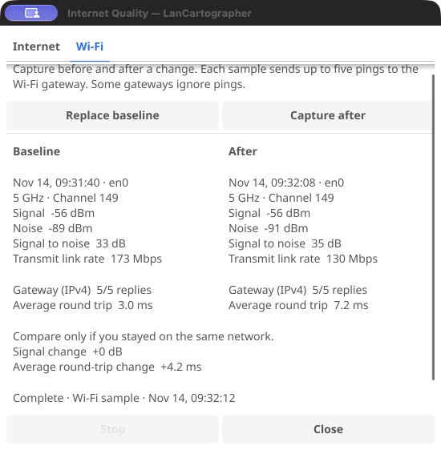

# LanCartographer

LanCartographer is a local network inventory and change-verification tool for
macOS and Windows. Use it to find a printer or NAS, inspect the TCP services a
lab host exposes, or check what changed after maintenance. Scan an authorized
IPv4 range, save a baseline in the GUI, and compare it with a later scan that
used the same scope and profile. The comparison lets you select the changes
you need and export a redacted report.

The desktop app streams results as it scans. The CLI shares the scan engine
and can write JSON for scripts. Both run on demand, with no LanCartographer
account, background service, or telemetry.

[Quick start](#quick-start) · [User Guide](USER-GUIDE.md) ·
[CLI reference](#cli-reference) · [Build from source](#build-from-source) ·
[Roadmap](#roadmap)


The screenshots above show a fabricated sample inventory (192.168.1.0/24) —
no real network data.

## Authorized use only

Scan only networks you own or have explicit authorization to inventory. Unauthorized access or scanning may violate the Computer Fraud and Abuse Act, 18 U.S.C. § 1030, and similar laws.

## Quick start

1. [Build from source](#build-from-source) or, when a tagged release is
   available, download its assets from
   [GitHub Releases](https://github.com/cgfixit/LanCartographer/releases).
   Windows assets are `LanCartographer.exe`, `lancartographer-cli.exe`,
   `LICENSE`, and `SHA256SUMS.txt`. Keep the license with redistributed binaries.
   macOS archives are `LanCartographer-macos-arm64.zip` for Apple Silicon and
   `LanCartographer-macos-amd64.zip` for Intel. Each Mac archive contains
   `LanCartographer.app`, `lancartographer-cli`, `LICENSE`, and `SHA256SUMS.txt`.
   The app also includes the license in `Contents/Resources`.
2. On Windows, run the GUI executable. On macOS, extract the matching archive
   and open `LanCartographer.app`. The Mac bundle is ad-hoc signed, **not
   Developer ID signed or notarized**; macOS may block a downloaded build.
   Verify its provenance and follow macOS Privacy & Security approval if you
   choose to trust it. Do not disable Gatekeeper.
3. Read the first-run notice, select or enter an authorized subnet, and click
   **Scan**. The GUI scans the selected range; the CLI discovers all local
   subnets when `--range` is omitted. **Stop** cancels the scan, including macOS
   `smbutil` share enumeration. On Windows, an in-flight `NetShareEnum` call
   can finish in the background; see the [User Guide](USER-GUIDE.md).
4. Select a row for details, use Finder/Explorer or Browser actions, save
   favorites, or use **File → Export…** for CSV/JSON.
5. Use **Sessions** to save a scan, compare it with a baseline and export
   selected evidence. See the workflow below.

Per-user data lives in `%AppData%\LanCartographer\` on Windows and
`~/Library/Application Support/LanCartographer/` on macOS:

- `settings.json` — theme preference
- `favorites.json` — saved host lists
- `names.json` — persistent MAC-keyed hostname cache
- `firstrun_seen` — first-run notice acknowledgment
- `sessions/` — default destination for explicitly saved sessions and evidence reports

An explicit absolute `APPDATA` overrides this location, including for isolated
verification fixtures. The app does not fall back to writing in its working
directory. New data directories use mode `0700` and files `0600` on macOS.
Favorites, hostname cache and theme saves write a temporary file before
replacing the destination. A failed save cleans up that attempt's temporary file.

## Why LanCartographer

- **Find the right device.** On an authorized subnet, locate a printer or NAS
  by its address, reported name, or vendor. Inspect its open ports and use the
  Browser or Finder/Explorer action when available. Missing names or vendors
  are common when a device does not respond to an enrichment probe.
- **Verify maintenance.** Save a baseline before a firmware update or service
  move. Scan the same scope afterward, compare the two sessions, and select
  just the port or host observations relevant to the change. Preview the
  report before attaching it to a ticket.
- **Run a repeatable inventory.** Pass an explicit range and port list to the
  CLI and save JSON for a local script. The output records what was observed
  from the scanning computer. Use GUI sessions when the handoff needs
  coverage, completion state and comparison context.

## Features

| Area | What you get |
|---|---|
| Live scan | Scan the selected IPv4 subnet (or an explicitly entered range); hosts and open ports appear in the table while the scan is still running, with a progress bar and per-host events |
| Sortable table | Sort by status, name, IP, MAC, vendor, ports or shares and select a host for details |
| Port states | Every probed port reports `open`, `closed`, or `timeout`; open ports carry a service label (smb, http, rdp, …), web ports receive a bounded HTTP/HTTPS title probe; unrecognized services receive an HTTP probe that can identify additional web devices |
| Share enumeration | SMB shares listed via Windows `NetShareEnum` or macOS `smbutil`; a host that denies the enumeration shows an explicit "access denied" marker instead of an empty list |
| Name resolution | NetBIOS, mDNS, and reverse DNS (PTR) run at the same time. The highest-priority answer wins (NetBIOS, then mDNS, then PTR) and the slower lookups are cancelled. Resolved names are persisted in a MAC-keyed cache so silent devices keep their names across scans |
| Right-click actions | Open host or share in Explorer (Windows) or Finder (macOS), open its web interface with the detected port, start Remote Desktop (Windows), run Ping, or send Wake-on-LAN (confirmation required) |
| Export | Save the inventory as CSV or JSON from the File menu (the CLI has a `--json` flag); CSV prefixes formula-like cells with an apostrophe for spreadsheet import, while JSON preserves raw values |
| Favorites | Save and reload the current host list as favorites |
| Saved sessions | Explicitly save a finished scan with scope, profile, source interfaces, timestamps and completion state; reopen it without sending probes |
| Before/after evidence | Compare compatible completed sessions, select individual differences, preview a plain-text report and export with identifiers and discovered text redacted by default |
| Themes | Switch between light and dark themes and retain the choice across launches |
| First-run notice | The authorization notice is shown in a dialog on first launch; a marker file records that you have seen it |
| Elevation button | Windows only: an unelevated process offers an Elevate button and marks failed MAC lookup as needing elevation; macOS reads the ARP cache without this button |

## How it works

- **Subnet discovery:** local IPv4 subnets are enumerated from your adapters via Windows adapter APIs or macOS network interfaces, then expanded into candidate host addresses.
- **Host liveness:** each address is dialed on ports 445, 80, 443, 135, 139, 22, 3389, 8080, and 8443, plus any extra ports selected for the scan. Duplicate ports are skipped. The first successful connect marks the host alive and cancels the other dials. ARP is the next fallback. On macOS, a host still undetected receives one ICMP echo request through the system `ping`; a reply reports it alive even with no open TCP ports.
- **Concurrent sweep:** the sweep runs up to 64 host workers at once, and a separate global dial budget (default 128, hard cap 256) bounds how many TCP dials may be in flight. Those are two different knobs.
- **Port probes:** each port gets a TCP connect with an exact result — `open`, `closed`, or `timeout`; open ports carry a service label, known web ports get an HTTP/HTTPS title probe, and unrecognized ones get an HTTP probe that can identify a web service. Each request is capped at one second and 32 KiB, follows no redirects, and verifies TLS certificates.
- **Enrichment:** SMB shares are listed via Windows `NetShareEnum` level 1 or macOS `smbutil`. Names come from NetBIOS, then mDNS, then DNS PTR. A higher-priority answer cancels the lookups still running. The chosen name is stored in a MAC-keyed cache.
- **Live events:** the engine streams per-host events over a channel, so the Fyne GUI table fills in while the scan is still running.

## CLI reference

`lancartographer-cli.exe` (Windows) or `./lancartographer-cli` (macOS) drives the same engine as the GUI and prints a table
(IP, NAME, MAC, VENDOR, PORTS, SHARES) to stdout by default. Use `--json -`
for JSON-only stdout suitable for pipes. Diagnostics go to stderr.
The CLI build auto-detects from its own file name (any executable whose base name
contains "cli", case-insensitive); passing `--cli` as the first argument also
selects CLI mode and is accepted on both binaries.

The displayed table replaces control characters in discovered text with `�`
to keep network-supplied values from controlling the terminal or adding rows.
JSON exports preserve the original inventory values.

| Flag | Meaning | Default |
|---|---|---|
| `--range CIDR` | IPv4 prefix to scan, e.g. `192.168.1.0/24` | omitted: every local physical subnet |
| `--ports` | Comma-separated TCP ports to probe (1–65535) | `21,22,23,80,135,139,443,445,515,631,3389,5357,8080,8443,9100` |
| `--timeout` | Per-host dial timeout; the per-dial probe timeout is 2× this value | `400ms` |
| `--concurrency` | Global concurrent-dial budget (engine clamps to 256) | `128` |
| `--json PATH` | Also write JSON to `PATH`; `-` writes only JSON to stdout | off |
| `--i-am-authorized` | Confirm authorization for ranges that require confirmation | off |

A range requires confirmation — and therefore `--i-am-authorized` — when it is
outside your local subnets, **or** not RFC 1918 private space, **or** broader
than a `/22`. Every target is checked before anything is scanned, so a refusal
exits without touching the network.

Exit codes:

- `0` — scan completed (JSON export, if requested, succeeded)
- `2` — bad arguments, an authorization-gate refusal, a scan failure, or a failed `--json` export
- `3` — no usable local interfaces (only reachable when `--range` is omitted)

Examples:

```bash
# Inventory every local subnet (no admin needed)
lancartographer-cli.exe --cli

# Sweep one subnet, save JSON
lancartographer-cli.exe --cli --range 192.168.1.0/24 --json inventory.json

# Wider sweep with explicit authorization
lancartographer-cli.exe --cli --range 10.0.0.0/20 --i-am-authorized

# Just a few ports, faster timeout
lancartographer-cli.exe --cli --range 192.168.1.0/24 --ports 22,80,443,3389 --timeout 250ms

# Same invocations via the GUI binary's --cli token
lancartographer.exe --cli --range 192.168.1.0/24 --json inventory.json
```

For a local development server, pipe the raw inventory into a JSON tool:

```bash
./lancartographer-cli --range 127.0.0.1/32 --ports 3000,5432,8080 \
  --i-am-authorized --json - | jq '.[].Ports[] | select(.State == "open")'
```

`--json -` emits one array after a successful scan, including `[]` if no hosts
were observed. It does not print a table or create a file named `-`; use
`--json ./-` if that filename is intended. It uses the same unredacted inventory
format as a JSON file, without session coverage metadata. Scan or authorization
failures leave stdout empty and report a nonzero exit status on stderr; an
output-write failure can leave partial JSON, so check the exit status. In shells
that support it, `set -o pipefail` also exposes scanner failures in pipelines.
See the [verification record](docs/verification/cli-json-stdout-2026-11-13.md)
for exercised entry points and platform limits.

## Saved sessions and selected evidence

1. Complete an authorized GUI scan and open **Sessions**. Enter a site,
   project or network context and an optional label, then **Save after session…**.
   The save form supplies an absolute path; change it if needed. Nothing is
   saved automatically. Existing destinations require a replacement confirmation.
2. Make the intended network or service change, then scan the same scope again.
   In the Sessions window, choose **Use current scan**, enter the same context,
   and save the new session. **Open before…** loads the baseline;
   **Open after…** can load a saved second session instead of the current scan.
3. Select the differences relevant to your investigation. Review the plain-text
   preview, add optional notes, and choose **Export selected evidence…**. The
   export writes the preview you reviewed. Clearing the selection disables export.


Comparison requires both sessions to have completed, with matching site/context,
requested range, probe profile, application version and recorded source
interfaces/platform. The view explains mismatches and disables evidence export.
Cancelled or failed scans can still be saved with their partial observations,
but cannot supply a completed comparison. Loading favorites does not create a
session or claim scan coverage.

Differences are observations **at an IP address**, not permanent device identity.
An address absent from a completed sweep is **not observed**, not proven offline;
missing enrichment is **not recorded**, not proof that a service was removed.
Names may come from the existing cache. Source metadata is a local interface
snapshot; sockets still use OS routing, and routes/DNS settings are not captured.
Session files are editable records, not independently authenticated attestations.

Saved session JSON contains the **full unredacted inventory and local interface
addresses**. Keep it private. The report's default redaction withholds those
identifiers and discovered text, using report-local aliases for selected changes.
It retains timestamps, counts, port numbers and coverage, so it is not
anonymization. Turning redaction off includes selected discovered values plus
site/scope/source metadata. Redaction applies to the report, not the on-screen
comparison list or saved session JSON. Operator notes are included as entered;
review them for identifiers before sharing. Labels/reports sanitize controls and bound long
values; raw session JSON retains the original observations.

Saving, opening, comparing and exporting do not scan, contact a service or upload
anything. Files use a versioned schema, an 8 MiB limit and a 65,536-host limit;
unsupported, malformed or inconsistent files are rejected. Existing favorites
and CLI inventory JSON do not carry the required metadata and are not session
files. This first slice is GUI-only; existing CLI flags and exports are unchanged.

## Internet Quality on macOS

Open **Tools → Internet Quality…** to measure download and upload capacity,
idle latency, and responsiveness under load. Confirm **Run Apple test…** to
send measurement traffic to Apple using the built-in macOS utility. Use an
unmetered connection. **Stop** and closing the window end the measurement.
The result stays in the window and the existing inventory and sessions
continue to operate independently.

Open the **Wi-Fi** tab and select **Capture baseline**. After making one change,
select **Capture after** to compare signal, noise, band, channel, transmit link
rate and gateway latency. Each capture sends up to five pings to the Wi-Fi
gateway. See the
[Wi-Fi comparison guide](USER-GUIDE.md#compare-wi-fi-before-and-after-a-change).



**Open Cloudflare in browser…** is a separate action with its own provider
disclosure. See the [Internet Quality guide](USER-GUIDE.md#measure-internet-quality-on-macos)
for what the numbers mean and how to handle a failed run.

## Build from source

Use the Go version and dependencies in [go.mod](go.mod) and a CGO C compiler.

**macOS:** install Xcode Command Line Tools, then run:

```bash
bash deploy/build.sh
open dist/LanCartographer.app
# CLI example against your own machine:
./dist/lancartographer-cli --range 127.0.0.1/32 --i-am-authorized --ports 8080
```

The script uses system clang with a macOS 13 deployment target, builds the
native architecture once, packages an
app bundle with icon and local-network usage description, verifies its ad-hoc
signature, and creates `dist/LanCartographer-macos-<arch>.zip`. It temporarily
moves the checked-in Windows COFF resource aside and restores it on exit.

**Windows:** install MSYS2 ucrt64 gcc and the version-resource generator,
then build from Git Bash:

```bash
pacman -S mingw-w64-ucrt-x86_64-gcc
go install github.com/josephspurrier/goversioninfo/cmd/goversioninfo@v1.7.0
bash deploy/build.sh
```

This regenerates the icon and Windows version resources and builds
`dist/LanCartographer.exe` (GUI subsystem) and `dist/lancartographer-cli.exe`
(console subsystem). The manifest remains `asInvoker`. Both platforms use
CGO because both entry points include Fyne. Build output stays under `dist/`
and is not committed.

## Security model

- **TCP connect port scans.** Port probes use `net.Dialer.DialContext`
  against specific ports, without SYN scans or application-crafted packets.
  macOS host discovery also uses `/sbin/ping` for one ICMP echo request when
  TCP and cached ARP discovery fail. The app remains unelevated; the OS utility
  handles ICMP. Windows uses its documented `SendARP` API as the fallback.
- **Fail-closed authorization gate.** A scan target must be confirmed when it
  is outside your local subnets, non-RFC1918, or broader than a `/22` — in the
  GUI via a confirmation dialog, in the CLI via `--i-am-authorized`. Refusal
  means nothing is scanned. The engine also refuses IPv6 and anything broader
  than a `/12` outright.
- **No application credential store.** Share enumeration uses the current
  Windows token or macOS SMB session; the app does not collect or save
  passwords. Finder and Explorer handle authentication when you open shares.
- **Bounded external actions.** Browser and file-manager actions pass
  arguments separately. Windows uses `cmd /c start` for browser/Ping; macOS
  uses `open` for URLs and a Terminal AppleScript for Ping. Ping targets come
  only from parsed IP literals, and macOS share names are URL-escaped.
  Wake-on-LAN sends a UDP packet only after confirmation.
- **No phone-home.** Zero telemetry, zero analytics, no OUI-database downloads
  at runtime — the MAC-vendor (OUI) database is embedded in the binary and was
  current when generated. Scans include name resolution through configured
  resolvers, which may be off-LAN. Explicit Ping, Wake-on-LAN and desktop
  actions can also generate traffic; opening or comparing saved sessions does not.
- **Runs unelevated by design.** The Windows manifest requests `asInvoker`
  (never `requireAdministrator`); its elevation button is optional. macOS
  does not require root for the inventory workflow.

## Platform notes

- **Target:** Windows 10 and Windows 11 (and Windows Server equivalents), and
  macOS 13+. The Windows application manifest declares only the Windows 10/11
  `supportedOS` GUID.
- **macOS caveats:**
  - Bundles are ad-hoc signed for integrity, but have no Developer ID signature
    or notarization. Local execution does not prove downloaded Gatekeeper acceptance.
  - The **Remote Desktop** right-click action is Windows-only (it launches
    `mstsc`); it is unavailable/hidden on macOS.
  - Share enumeration uses `smbutil` instead of `NetShareEnum`, so the share
    list can differ from what a Windows client would report for the same host.
  - Peer MAC addresses come from the local ARP cache; hosts that have been
    silent since the cache entry expired may show no MAC (and therefore no
    vendor) — the table degrades to an empty MAC instead of failing.
  - The ICMP fallback shares the scan's concurrency budget and is cancelled
    by Stop, with a one-second cap per probe. Unresponsive addresses can add
    that delay to discovery. Devices that block TCP and ICMP and lack an ARP
    cache entry can still be missed; a completed sweep is not a complete device census.
- **Windows 7 / 8.1:** unsupported. The current Go toolchain and application
  manifest target Windows 10/11; the manifest does not claim Windows 7 compatibility.
- **Authenticode:** release builds should be code-signed so SmartScreen and AV
  heuristics do not flag an unsigned network-scanning binary. Recommended, not
  required — signing is not a build blocker.
- **Windows elevation:** some lookups (MAC via `SendARP`) only return data from an
  elevated process. LanCartographer degrades to an explicit "needs elevation"
  marker rather than failing silently, and offers an Elevate button.

## Repository layout

One line per top-level package; all application code is under `internal/`
(Go's convention for "not importable from outside this module").

| Path | Role |
|---|---|
| `cmd/lancartographer` | `main` entry point plus `go:generate` directives (icon, manifest, version resources) |
| `internal/discover` | Platform-specific local subnet enumeration, host-address expansion, liveness probing |
| `internal/probe` | TCP connect port scans, HTTP title detection, rate limiter, MAC lookup, mDNS/NetBIOS/DNS name probes, share listing |
| `internal/scan` | The central sweep engine: worker pool, event stream, enrichment, MAC-keyed name cache |
| `internal/model` | Inventory records (`Host`, `Port`, `Share`) and the CSV/JSON writers |
| `internal/authz` | The authorization notice and the scan-range confirmation policy |
| `internal/oui` | Embedded MAC-vendor database, generated from `data.csv` |
| `internal/winutil` | Typed Windows API wrappers (`NetShareEnum`, `SendARP`, elevation check) with macOS implementations and other-platform stubs |
| `internal/gui` | The Fyne GUI: toolbar, live table, side panel, context menus, dialogs, settings |
| `internal/cli` | Flag parsing, authorization gate, table output, JSON export, exit codes |
| `internal/wol` | Wake-on-LAN magic-packet construction and broadcast send |
| `internal/appdata` | Native per-user paths shared by the GUI and CLI |
| `internal/favorites` | Atomic favorites persistence in the per-user directory |
| `internal/session` | Bounded saved-session files, coverage-aware comparison and selected plain-text evidence |
| `internal/export` | File export dispatch (CSV/JSON) |
| `internal/hostcache` | The persistent MAC-keyed hostname cache (`names.json`) |
| `tools/icongen` | Icon generator run by `go generate` to produce `app.ico` |

## Verification

CI runs the existing Windows gate and native macOS gates on Apple Silicon and
Intel runners: generation/build, vet, race tests, and a packaged CLI loopback
smoke check. For a local change, run the affected behavior plus relevant
formatting, lint, vet, and focused regression checks; broad regression coverage
runs in GitHub Actions.

For dependency updates, use the versions in [go.mod](go.mod) and follow the
[maintenance checklist](CONTRIBUTING.md#dependency-maintenance). The
[verification index](docs/README.md) links each record to the revision and
artifact it exercised.

On macOS, after building:

```bash
python3 tests/macos-smoke.py dist
```

This owns a loopback HTTP fixture on port 8080, exercises both packaged entry
points, checks authorization refusal, discovers an open port and its HTTP
title, and verifies JSON export in a temporary data directory. An occupied
port fails the check without stopping another service.

Native Computer Use on macOS 27.0.1/arm64 verified authorization dialogs,
loopback discovery, cancellation followed by a successful new scan, host
details, theme switching/persistence, favorites, CSV export, and a Browser
action preserving port 8080. See [the verification record](docs/macos-verification.md)
for evidence and limits. Intel GUI interaction, macOS 13 execution,
authenticated SMB, and downloaded Gatekeeper acceptance were not verified on
this machine. CLI/CI evidence is separate from native GUI evidence.

Saved sessions, comparison, redaction and evidence export were exercised in the
native macOS app against an owned loopback service. See the
[session verification record](docs/verification/sessions-2026-11-01.md) for
before/after screenshots, focused checks and platform limits.

## Roadmap

[Issue #22](https://github.com/cgfixit/LanCartographer/issues/22) tracks the
wider roadmap. The [network workbench plan](docs/network-workbench-roadmap.md)
proposes a macOS-first Connections window for inspecting local TCP/UDP
endpoints, followed by inventory links, focused diagnostics, Windows support,
and bounded service discovery and monitoring. These are proposed capabilities.

## Inspiration and similar tools

LanCartographer is an independent implementation inspired by
[Advanced IP Scanner](https://www.advanced-ip-scanner.com/) (Famatech),
[Angry IP Scanner](https://angryip.org/), and [Nmap](https://nmap.org/).
LanCartographer has no affiliation with these projects.

To replace an existing build, see the [update guide](update-guide.md).

## License

MIT — see [LICENSE](LICENSE).

For development and issue reporting, see [CONTRIBUTING.md](CONTRIBUTING.md)
and [SUPPORT.md](SUPPORT.md). Report vulnerabilities as described in
[SECURITY.md](SECURITY.md).
