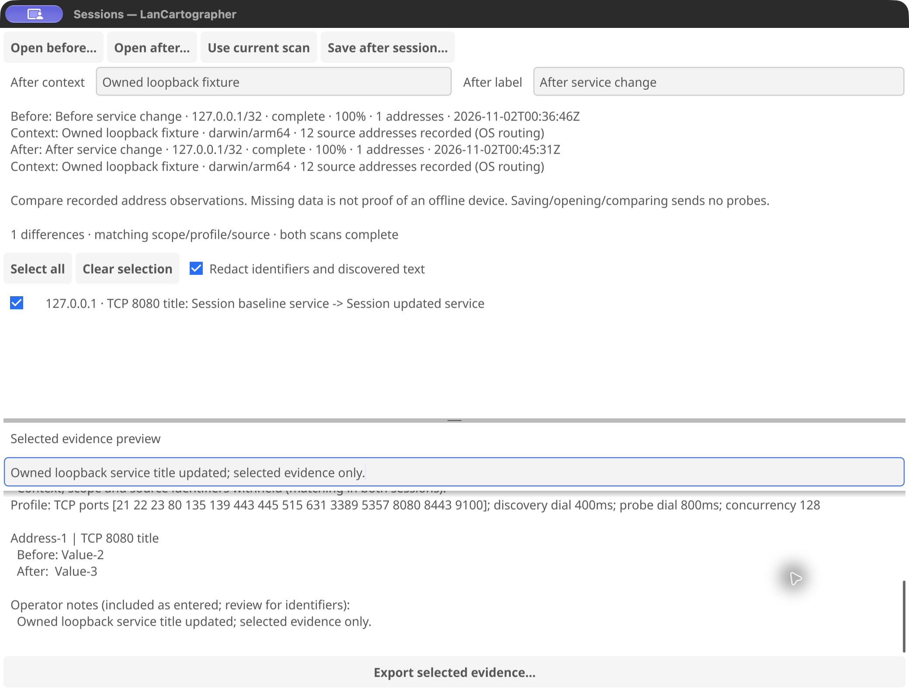
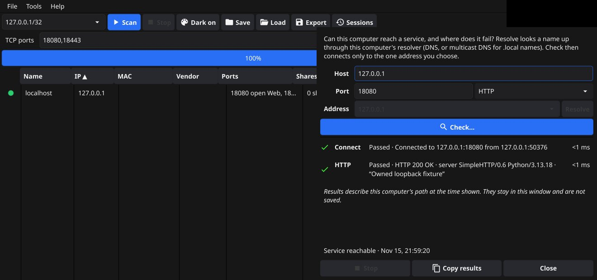

# LanCartographer

LanCartographer is a local network inventory and change-verification tool for
macOS and Windows. Use it to find a printer or NAS, inspect the TCP services a
lab host exposes, find out where a single service connection fails, or check
what changed after maintenance. Scan an authorized IPv4 range, save a baseline
in the GUI, and compare it with a later scan that used the same scope and port
profile. Select the changes you need and export a redacted report.

The desktop app streams results as it scans. The CLI shares the scan engine
and can write JSON to a file or a pipe. Both run on demand, with no
LanCartographer account, background service, or telemetry.

[Quick start](#quick-start) · [User Guide](USER-GUIDE.md) ·
[CLI reference](#cli-reference) · [Check a service](#check-a-service) ·
[Build from source](#build-from-source) · [Roadmap](#roadmap)


The screenshots show a fabricated sample inventory (192.168.1.0/24), not real
network data.

## Quick start

1. Get a build:
   - **Tagged releases** (when published) on
     [GitHub Releases](https://github.com/cgfixit/LanCartographer/releases).
     Windows assets are `LanCartographer.exe`, `lancartographer-cli.exe`,
     `LICENSE` and `SHA256SUMS.txt`. macOS assets are
     `LanCartographer-macos-arm64.zip` (Apple Silicon) and
     `LanCartographer-macos-amd64.zip` (Intel); each contains
     `LanCartographer.app`, `lancartographer-cli`, `LICENSE` and `SHA256SUMS.txt`.
   - **macOS `main-<commit SHA>` prereleases**, published automatically after a
     merge to `main` passes CI, gitleaks and CodeQL. Same ZIP layout. There is
     no Windows equivalent.
   - Or [build from source](#build-from-source).

   Keep the license with redistributed binaries; the app bundle also carries it
   in `Contents/Resources`.
2. On Windows, run the GUI executable. On macOS, extract the matching archive
   and open `LanCartographer.app`. The bundle is ad-hoc signed, **not
   Developer ID signed or notarized**, so macOS may block a downloaded build.
   Verify its provenance and approve it in Privacy & Security if you choose to
   trust it. Do not disable Gatekeeper.
3. Read the first-run notice, select or enter an authorized subnet, adjust
   **TCP ports** if needed (**Default ports** restores the standard list), and
   click **Scan**. Confirm if the range requires it. The status bar shows
   `Scanning · 3s`, then the finished duration or `Stopped · 2s`. **Stop**
   cancels the scan, including macOS `smbutil` share enumeration; on Windows an
   in-flight `NetShareEnum` call can finish in the background.
4. Select a row. Open ports come first, each with **Check…** to prefill
   [Check Service](#check-a-service). Use the panel buttons or right-click for
   Copy IP/MAC/name, Finder/Explorer, Browser, Remote Desktop (Windows), Ping,
   Wake-on-LAN and Check service….
5. Use **Export** for CSV/JSON, **File → Save Favorites** to keep a host list,
   and **Sessions** to save a baseline and compare a later scan.

Per-user data lives in `%AppData%\LanCartographer\` on Windows and
`~/Library/Application Support/LanCartographer/` on macOS:

- `settings.json` — theme preference
- `favorites.json` — saved host lists
- `names.json` — persistent MAC-keyed hostname cache
- `firstrun_seen` — first-run notice acknowledgment
- `sessions/` — default destination for saved sessions and evidence reports

An absolute `APPDATA` overrides this location (used by isolated verification
fixtures); the app never falls back to its working directory. On macOS, new
data directories use mode `0700` and files `0600`. Saves write a temporary file
and rename it into place; a failed save removes its temporary file and leaves
the previous file intact.

## Why LanCartographer

- **Find the right device.** Locate a printer or NAS on an authorized subnet
  by address, reported name or vendor, inspect its open ports, and jump to it
  with Browser or Finder/Explorer. Missing names or vendors are common when a
  device ignores an enrichment probe.
- **Diagnose one service.** When a NAS, printer or web app is unreachable,
  Check Service shows whether name resolution, the TCP connect, the TLS
  certificate or the HTTP answer failed, and why.
- **Verify maintenance.** Save a baseline before a firmware update or service
  move, scan the same scope afterward, and select just the port or host
  differences that matter. Preview the redacted report before attaching it to
  a ticket.
- **Run a repeatable inventory.** Pass an explicit range and port list to the
  CLI and pipe JSON into a script. The output records what the scanning
  computer observed; use GUI sessions when a handoff needs coverage,
  completion state and comparison context.

## Features

| Area | What you get |
|---|---|
| Live scan | Scan a selected or entered IPv4 range with an editable TCP port list. Hosts and open ports stream into the table with a progress bar and elapsed-time status |
| Inventory table | Sort by status, name, IP, MAC, vendor, ports or shares. The selected row stays highlighted, ports read compactly (`22 SSH, 443 Web`), and values the scan did not learn show a dim `—` |
| Host details | Open ports first, each with **Check…**; closed and unanswered ports collapse into one line each; action buttons for the selected host |
| Port states | Every probed port reports `open`, `closed` or `timeout`. Open ports carry a service label (smb, http, rdp, …); web and unrecognized ports get a bounded HTTP/HTTPS title probe that can identify additional web services |
| Share enumeration | Windows `NetShareEnum` or macOS `smbutil`; a host that denies enumeration shows an explicit "access denied" marker instead of an empty list |
| Name resolution | NetBIOS, mDNS and reverse DNS run concurrently; the highest-priority answer wins and cancels the rest. Names persist in a MAC-keyed cache, so silent devices keep them across scans |
| Quick actions | Copy, Finder/Explorer for hosts and shares, Browser on the detected web port (including custom ports identified as Web), Remote Desktop (Windows), Ping, and Wake-on-LAN after confirmation |
| Export and favorites | CSV or JSON from **Export** (the CLI has `--json`). CSV prefixes formula-like cells with an apostrophe; JSON keeps raw values. Favorites keep a host list for later viewing |
| Sessions and evidence | Explicitly save a scan with scope, port profile, source interfaces, timestamps and completion state; reopen it without probing; compare compatible completed sessions; export selected differences, redacted by default |
| Check Service | **Tools → Check Service…** (Windows and macOS): one confirmed host and port, checked in separate resolve, connect, verified-TLS and HTTP stages |
| Internet Quality (macOS) | Apple's `networkQuality` capacity and responsiveness test, plus a Wi-Fi before/after comparison of signal, noise, channel, link rate and gateway latency |
| Themes and first run | A toolbar toggle switches light/dark and persists; the authorization notice appears on first launch |
| Elevation (Windows) | An unelevated process offers an **Elevate** button and marks MAC lookups that need elevation; macOS reads the ARP cache without it |

## How it works

- **Subnet discovery:** local IPv4 subnets come from Windows adapter APIs or
  macOS network interfaces and expand into candidate host addresses.
- **Host liveness:** each address is dialed on 445, 80, 443, 135, 139, 22,
  3389, 8080 and 8443, plus the scan's selected ports (duplicates skipped).
  The first successful connect marks the host alive and cancels the other
  dials. ARP is the next fallback; on macOS, a host still undetected gets one
  ICMP echo through the system `ping` (one-second cap), so a host with no open
  TCP ports can still report alive.
- **Concurrency:** up to 64 host workers run at once, and a separate global
  dial budget (default 128, hard cap 256) bounds TCP dials in flight across
  liveness and port probes. Those are two different knobs.
- **Port probes:** a TCP connect per port with an exact result. HTTP/HTTPS
  probes are capped at one second and 32 KiB, follow no redirects, and verify
  TLS certificates.
- **Enrichment:** MAC from ARP, vendor from the embedded OUI database, SMB
  shares, and a name from NetBIOS, then mDNS, then DNS PTR, stored in the
  MAC-keyed cache.
- **Live events:** the engine streams per-host events over a channel, so the
  Fyne table fills in while the scan is still running.

## CLI reference

`lancartographer-cli.exe` (Windows) or `./lancartographer-cli` (macOS) drives
the same engine as the GUI and prints a table (IP, NAME, MAC, VENDOR, PORTS,
SHARES) to stdout. Diagnostics go to stderr. Any executable whose base name
contains "cli" (case-insensitive) starts in CLI mode; passing `--cli` as the
first argument does the same on either binary.

The table replaces control characters in discovered text with `�` so
network-supplied values cannot control the terminal or add rows. JSON keeps
the original values.

| Flag | Meaning | Default |
|---|---|---|
| `--range CIDR` | IPv4 prefix to scan, e.g. `192.168.1.0/24` | omitted: every local physical subnet |
| `--ports` | Comma-separated TCP ports to probe (1–65535) | `21,22,23,80,135,139,443,445,515,631,3389,5357,8080,8443,9100` |
| `--timeout` | Per-host dial timeout; the per-dial probe timeout is 2× this value | `400ms` |
| `--concurrency` | Global concurrent-dial budget (engine clamps to 256) | `128` |
| `--json PATH` | Also write JSON to `PATH`; `-` writes only JSON to stdout | off |
| `--i-am-authorized` | Confirm authorization for ranges that require confirmation | off |

A range requires confirmation, and therefore `--i-am-authorized`, when it is
outside your local subnets, **or** not RFC 1918 private space, **or** broader
than a `/22`. Every target is checked before anything is scanned, so a refusal
exits without touching the network.

Exit codes:

- `0` — scan completed (and any requested JSON export succeeded)
- `2` — bad arguments, an authorization refusal, a scan failure, or a failed `--json` export
- `3` — no usable local interfaces (only when `--range` is omitted)

Examples:

```bash
# Inventory every local subnet (no admin needed)
lancartographer-cli.exe

# Sweep one subnet, save JSON
lancartographer-cli.exe --range 192.168.1.0/24 --json inventory.json

# Wider sweep with explicit authorization
lancartographer-cli.exe --range 10.0.0.0/20 --i-am-authorized

# A few ports, faster timeout
lancartographer-cli.exe --range 192.168.1.0/24 --ports 22,80,443,3389 --timeout 250ms

# Same engine through the GUI binary
LanCartographer.exe --cli --range 192.168.1.0/24 --json inventory.json
```

Pipe a local development server's open ports into `jq`:

```bash
./lancartographer-cli --range 127.0.0.1/32 --ports 3000,5432,8080 \
  --i-am-authorized --json - | jq '.[].Ports[] | select(.State == "open")'
```

`--json -` prints one array after a successful scan (`[]` if no hosts were
observed), with no table and no file named `-` (use `--json ./-` for that
filename). It is the same unredacted inventory format as a JSON file, without
session coverage metadata. Scan and authorization failures leave stdout empty
and exit nonzero; a write failure can leave partial JSON, so check the exit
status (`set -o pipefail` helps in pipelines). See the
[verification record](docs/verification/cli-json-stdout-2026-11-13.md).

## Saved sessions and selected evidence

1. Complete an authorized GUI scan and open **Sessions**. Enter a site, project
   or network context and an optional label, then **Save after session…**.
   Nothing is saved automatically; replacing an existing file asks first.
2. Make the network or service change, scan the same scope with the same port
   list, choose **Use current scan**, enter the same context and save.
   **Open before…** loads the baseline; **Open after…** loads a saved second
   session instead of the current scan.
3. Select the relevant differences (**Select all** and **Clear selection**
   help), review the plain-text preview, add optional notes, and choose
   **Export selected evidence…**. The export writes exactly the preview you
   reviewed.



Comparison requires two completed sessions with matching context, requested
range, port profile, application version and recorded source
interfaces/platform; otherwise the view explains the mismatch and disables
export. An upgrade can therefore require a new baseline. Cancelled or failed
scans can be saved with partial observations but cannot supply a comparison.

How to read the results:

- Differences are observations **at an IP address**, not device identity. An
  address absent from a completed sweep is **not observed**, not proven
  offline; missing enrichment is **not recorded**, not proof a service was
  removed. Names may come from the cache.
- Source metadata is a local interface snapshot; routes and DNS settings are
  not captured. Session files are editable records, not authenticated
  attestations.
- Saved session JSON holds the **full unredacted inventory and local interface
  addresses**; keep it private. Report redaction (on by default) replaces
  identifiers and discovered text with report-local aliases but keeps
  timestamps, counts, port numbers and coverage, so it is not anonymization.
  Notes are included as entered.

Saving, opening, comparing and exporting never scan, contact a service or
upload anything. Files use a versioned schema with 8 MiB and 65,536-host
limits; malformed or inconsistent files are rejected. Favorites and CLI JSON
are not session files. Sessions are GUI-only.

## Check a service

Open **Tools → Check Service…** or the toolbar's **Check Service**, or
right-click a host and choose **Check service…** to prefill its address and
likely web port (prefilling sends nothing). Enter a name or address, a port
and a protocol: **TCP**, **TLS**, **HTTP** or **HTTPS**. For a name,
**Resolve** with this computer's resolver and pick one returned address (up to
16 shown). **Check…** asks for confirmation that names the exact address, port
and traffic, flags off-subnet or public addresses, and repeats the
authorization notice.



| Stage | Limit | Reports |
|---|---|---|
| Resolve | 5 s | Addresses returned, or a not-found/unreachable-resolver reason |
| Connect | 3 s | Source address used, or refused / no answer / no route |
| TLS | 3 s | Version, certificate names, issuer and expiry (warning within 14 days); untrusted, mismatched or expired certificates fail |
| HTTP | 1 s, 32 KiB | Status, `Server` header and page title; redirects are shown, not followed; 5xx is a warning |

Each stage reports Passed, Warning, Failed or Skipped with a plain-language
reason. The check opens one connection to the confirmed address, never
re-resolves the name, uses no proxy, and never skips TLS verification (the
entered name is the SNI and `Host`). Unlike the scan engine, it accepts IPv6,
including scoped link-local addresses. One check runs at a time; **Stop** or
closing the window cancels it. Results stay in the window and are copied only
with **Copy results**. See the [Check Service guide](USER-GUIDE.md#check-a-service).

## Internet Quality on macOS

**Tools → Internet Quality…** measures download and upload capacity, idle
latency and responsiveness under load (RPM). Confirm **Run Apple test…** to
send measurement traffic to Apple through the built-in `networkQuality`
utility; use an unmetered link. The run is capped at 45 seconds, and **Stop**
or closing the window ends it. **Open Cloudflare in browser…** is a separate
action with its own provider disclosure.

On the **Wi-Fi** tab, **Capture baseline**, make one change, then **Capture
after** to compare signal, noise, band, channel, transmit link rate and
gateway latency. Each capture sends up to five pings to the gateway through
the Wi-Fi interface.


Measurements and captures run one at a time and not during a scan; starting an
authorized scan ends the current measurement first. Results stay in the
window. See the [Internet Quality guide](USER-GUIDE.md#measure-internet-quality-on-macos).

## Build from source

Use the Go version and dependencies in [go.mod](go.mod) and a CGO C compiler
(both entry points include Fyne).

**macOS:** install Xcode Command Line Tools, then run:

```bash
bash deploy/build.sh
open dist/LanCartographer.app
# CLI example against your own machine:
./dist/lancartographer-cli --range 127.0.0.1/32 --i-am-authorized --ports 8080
```

The script uses system clang with a macOS 13 deployment target, builds the
native architecture, packages an app bundle with icon and local-network usage
description, verifies its ad-hoc signature, and creates
`dist/LanCartographer-macos-<arch>.zip`. It moves the checked-in Windows COFF
resource aside during the build and restores it on exit.

**Windows:** install MSYS2 ucrt64 gcc and the version-resource generator,
then build from Git Bash:

```bash
pacman -S mingw-w64-ucrt-x86_64-gcc
go install github.com/josephspurrier/goversioninfo/cmd/goversioninfo@v1.7.0
bash deploy/build.sh
```

This regenerates the icon and Windows version resources and builds
`dist/LanCartographer.exe` (GUI subsystem) and `dist/lancartographer-cli.exe`
(console subsystem) with an `asInvoker` manifest. Build output stays under
`dist/` and is not committed. To replace an existing build, see the
[update guide](update-guide.md).

## Security model

- **TCP connect scans only.** Probes use `net.Dialer.DialContext` against
  specific ports; no SYN scans or crafted packets. Fallbacks are the documented
  Windows `SendARP` API and, on macOS, `/sbin/ping` for one ICMP echo, so the
  app itself stays unelevated.
- **Fail-closed authorization gate.** A target outside your local subnets,
  non-RFC 1918, or broader than a `/22` needs confirmation: a dialog in the
  GUI, `--i-am-authorized` in the CLI. Refusal means nothing is scanned. The
  engine also refuses IPv6 and anything broader than a `/12` outright.
- **Bounded probes.** The HTTP, dial-budget and worker limits in
  [How it works](#how-it-works) are fixed invariants, and TLS verification is
  never disabled.
- **Single-endpoint service checks.** Check Service connects only after a
  confirmation that names the address, port and traffic, to that one pinned
  address, with every stage bounded by time and size.
- **No application credential store.** Share enumeration uses the current
  Windows token or macOS SMB session; Finder and Explorer handle
  authentication when you open shares.
- **Bounded external actions.** Arguments are passed separately. Windows uses
  `cmd /c start` for Browser and Ping; macOS uses `open` for URLs and a
  Terminal AppleScript for Ping. Ping targets come only from parsed IP
  literals, macOS share names are URL-escaped, and Wake-on-LAN sends its UDP
  packet only after confirmation.
- **No phone-home.** No telemetry, analytics or runtime downloads; the OUI
  database is embedded and current as of generation. Traffic beyond the scan
  comes only from configured resolvers (which may be off-LAN) and explicit
  actions: Ping, Wake-on-LAN, Check Service, desktop launches, and the
  confirmed Apple or Cloudflare measurements. Opening or comparing sessions
  sends nothing.
- **Unelevated by design.** The Windows manifest is `asInvoker` (never
  `requireAdministrator`) and its Elevate button is optional. macOS needs no
  root for the inventory workflow.

Report vulnerabilities as described in [SECURITY.md](SECURITY.md).

## Platform notes

- **Targets:** Windows 10/11 (and Server equivalents) and macOS 13+. Windows 7
  and 8.1 are unsupported; the manifest declares only the Windows 10/11
  `supportedOS` GUID.
- **macOS:**
  - Bundles are ad-hoc signed for integrity, without Developer ID signing or
    notarization; local execution does not prove downloaded Gatekeeper acceptance.
  - Remote Desktop is Windows-only (it launches `mstsc`) and hidden on macOS.
  - `smbutil` share lists can differ from what a Windows client reports for
    the same host.
  - Peer MACs come from the ARP cache; a host silent since its entry expired
    shows no MAC or vendor instead of failing.
  - The ICMP fallback shares the scan's concurrency budget and can add up to a
    second per unresponsive address. Devices that block TCP and ICMP and lack
    an ARP entry can still be missed: a completed sweep is not a complete
    device census.
- **Windows:**
  - `SendARP` MAC lookups may need an elevated process; the app shows an
    explicit "needs elevation" marker and offers Elevate rather than failing
    silently.
  - Release builds should be Authenticode-signed so SmartScreen and AV
    heuristics do not flag an unsigned network scanner. Recommended, not a
    build blocker.

## Repository layout

All application code is under `internal/` (Go's convention for "not importable
from outside this module").

| Path | Role |
|---|---|
| `cmd/lancartographer` | `main` entry point plus `go:generate` directives (icon, manifest, version resources) |
| `internal/discover` | Platform-specific local subnet enumeration, host-address expansion, liveness probing |
| `internal/probe` | TCP connect scans, HTTP title detection, dial limiter, MAC lookup, mDNS/NetBIOS/DNS name probes, share listing |
| `internal/scan` | The sweep engine: worker pool, event stream, enrichment, name-cache lifecycle |
| `internal/model` | Inventory records (`Host`, `Port`, `Share`) and the CSV/JSON writers |
| `internal/authz` | The authorization notice and the scan-range confirmation policy |
| `internal/oui` | Embedded MAC-vendor database, generated from `data.csv` |
| `internal/winutil` | Typed Windows API wrappers (`NetShareEnum`, `SendARP`, elevation check) with macOS implementations and other-platform stubs |
| `internal/gui` | The Fyne GUI: toolbar, live table, side panel, menus, sessions, Check Service, Internet Quality and Wi-Fi windows |
| `internal/cli` | Flag parsing, authorization gate, table output, JSON export, exit codes |
| `internal/session` | Bounded saved-session files, coverage-aware comparison and selected plain-text evidence |
| `internal/servicecheck` | One confirmed endpoint: bounded name lookup, then connect, verified TLS and HTTP on a pinned address |
| `internal/wol` | Wake-on-LAN magic-packet construction and broadcast send |
| `internal/appdata` | Native per-user paths shared by the GUI and CLI |
| `internal/favorites` | Atomic favorites persistence |
| `internal/hostcache` | The persistent MAC-keyed hostname cache (`names.json`) |
| `internal/export` | File export dispatch (CSV/JSON) |
| `tools/icongen` | Icon generator run by `go generate` to produce `app.ico` |
| `deploy/`, `packaging/macos/` | Native build script and the macOS bundle `Info.plist` |
| `tests/` | Windows CI gate and the packaged macOS smoke check |
| `docs/` | Roadmap and dated verification records |

## Verification

CI runs a Windows gate and native macOS gates on Apple Silicon and Intel
runners: generation/build, vet, race tests, and a packaged CLI loopback smoke
check. CodeQL (GitHub default setup) and gitleaks run on pull requests and on
`main`. For a local change, run the changed behavior plus relevant formatting,
lint, vet and focused regression checks; broad regression coverage runs in
GitHub Actions. For dependency updates, follow the
[maintenance checklist](CONTRIBUTING.md#dependency-maintenance).

On macOS, after building:

```bash
python3 tests/macos-smoke.py dist
```

This owns a loopback HTTP fixture on port 8080, exercises both packaged entry
points, checks authorization refusal, discovers an open port and its HTTP
title, and verifies JSON export in a temporary data directory. An occupied
port fails the check without stopping another service.

Native GUI workflows (scan and cancellation, host details, themes, favorites,
export, sessions, Check Service, Internet Quality, Wi-Fi comparison and the
main window flow) are recorded against owned loopback services. The
[verification index](docs/README.md) links each record to the revision,
artifact and platform it exercised and states what was not verified. CLI/CI
evidence is kept separate from native GUI evidence.

## License

MIT — see [LICENSE](LICENSE). LanCartographer is an independent
implementation inspired by Advanced IP Scanner (Famatech), Angry IP Scanner
and Nmap, with no affiliation to those projects.

For development and issue reporting, see [CONTRIBUTING.md](CONTRIBUTING.md)
and [SUPPORT.md](SUPPORT.md).
