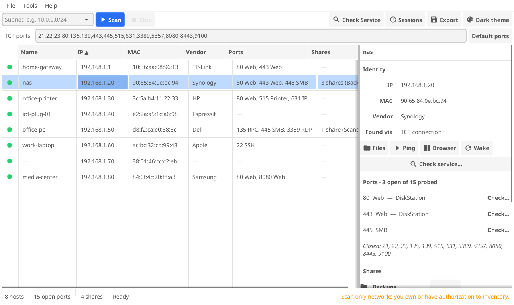
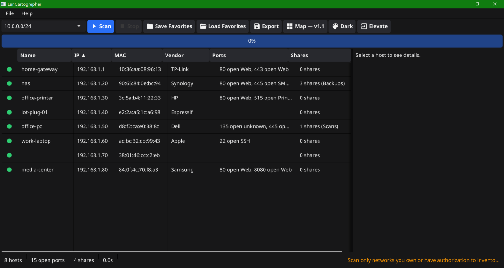

# LanCartographer

LanCartographer is a Windows and macOS LAN inventory tool written in Go (1.27) with a
Fyne v2.8.1 GUI. It discovers the hosts on your local network and inventories
what each one exposes — open TCP ports, service identities, SMB shares, names,
MAC vendors — and presents the result as a live, sortable table with a CLI for
scripting. Windows builds are portable `.exe` files; macOS builds include a native `.app`
and a CLI, in separate Apple Silicon and Intel archives. There is no installer,
background service, or telemetry.



*Dark theme, one toggle away:*



The screenshots above show a fabricated sample inventory (192.168.1.0/24) —
no real network data.

## Authorized use only

Scan only networks you own or have explicit authorization to inventory. Unauthorized access or scanning may violate the Computer Fraud and Abuse Act, 18 U.S.C. § 1030, and similar laws.

LanCartographer is an inventory aid for your own infrastructure. It is not a
vulnerability scanner, an exploitation framework, or a reconnaissance tool for
networks you do not control.

## Features

| Area | What you get |
|---|---|
| Live scan | Scan the selected IPv4 subnet (or an explicitly entered range); hosts and open ports appear in the table while the scan is still running, with a progress bar and per-host events |
| Sortable table | Seven columns (status, Name, IP, MAC, Vendor, Ports, Shares); click any header to sort; column widths are computed from window width with per-column minimums |
| Port states | Every probed port reports `open`, `closed`, or `timeout`; open ports carry a service label (smb, http, rdp, …), web ports receive a bounded HTTP/HTTPS title probe; unrecognized services receive an HTTP probe that can identify additional web devices |
| Share enumeration | SMB shares listed via Windows `NetShareEnum` or macOS `smbutil`; a host that denies the enumeration shows an explicit "access denied" marker instead of an empty list |
| Name resolution | NetBIOS, mDNS, and reverse DNS (PTR) run at the same time. The highest-priority answer wins (NetBIOS, then mDNS, then PTR) and the slower lookups are cancelled. Resolved names are persisted in a MAC-keyed cache so silent devices keep their names across scans |
| Right-click actions | Open host or share in Explorer (Windows) or Finder (macOS), open its web interface with the detected port, start Remote Desktop (Windows), run Ping, or send Wake-on-LAN (confirmation required) |
| Export | Save the inventory as CSV or JSON from the File menu (the CLI has a `--json` flag); CSV prefixes formula-like cells with an apostrophe for spreadsheet import, while JSON preserves raw values |
| Favorites | Save and reload the current host list as favorites |
| Themes | The toolbar button next to Stop reads "Light on" or "Dark on" for the theme that is active. The choice is saved and restored on the next launch |
| First-run notice | The authorization notice is shown in a dialog on first launch; a marker file records that you have seen it |
| Elevation button | Windows only: an unelevated process offers an Elevate button and marks failed MAC lookup as needing elevation; macOS reads the ARP cache without this button |

## How it works

- **Subnet discovery:** local IPv4 subnets are enumerated from your adapters via Windows adapter APIs or macOS network interfaces, then expanded into candidate host addresses.
- **Host liveness:** each address is dialed on ports 445, 80, 443, 135, 139, 22, 3389, 8080, and 8443, plus any extra ports selected for the scan. Duplicate ports are skipped. The first successful connect marks the host alive and cancels the other dials. If none connect, the ARP cache is the fallback.
- **Concurrent sweep:** the sweep runs up to 64 host workers at once, and a separate global dial budget (default 128, hard cap 256) bounds how many TCP dials may be in flight. Those are two different knobs.
- **Port probes:** each port gets a TCP connect with an exact result — `open`, `closed`, or `timeout`; open ports carry a service label, known web ports get an HTTP/HTTPS title probe, and unrecognized ones get an HTTP probe that can identify a web service. Each request is capped at one second and 32 KiB, follows no redirects, and verifies TLS certificates.
- **Enrichment:** SMB shares are listed via Windows `NetShareEnum` level 1 or macOS `smbutil`. Names come from NetBIOS, then mDNS, then DNS PTR. A higher-priority answer cancels the lookups still running. The chosen name is stored in a MAC-keyed cache.
- **Live events:** the engine streams per-host events over a channel, so the Fyne GUI table fills in while the scan is still running.

## Why LanCartographer

- **Offline-first, zero telemetry:** no analytics, no phone-home, no runtime downloads — the only traffic is the scan you asked for.
- **Native packaging:** portable Windows executables and a macOS app bundle plus CLI; no background service.
- **No admin required to start:** Windows uses an `asInvoker` manifest with optional elevation; macOS runs as the current user.
- **Authorization-gated ranges:** out-of-scope, non-RFC1918, or overly broad targets require explicit confirmation before a single packet is sent.
- **Original UI:** a purpose-built live table and workflow, not a reskin of an existing scanner.

## CLI reference

`lancartographer-cli.exe` (Windows) or `./lancartographer-cli` (macOS) drives the same engine as the GUI and prints a table
(IP, NAME, MAC, VENDOR, PORTS, SHARES) to stdout. Diagnostics go to stderr.
The CLI build auto-detects from its own file name (any executable whose base name
contains "cli", case-insensitive); passing `--cli` as the first argument also
selects CLI mode and is accepted on both binaries.

| Flag | Meaning | Default |
|---|---|---|
| `--range CIDR` | IPv4 prefix to scan, e.g. `192.168.1.0/24` | omitted: every local physical subnet |
| `--ports` | Comma-separated TCP ports to probe (1–65535) | `21,22,23,80,135,139,443,445,515,631,3389,5357,8080,8443,9100` |
| `--timeout` | Per-host dial timeout; the per-dial probe timeout is 2× this value | `400ms` |
| `--concurrency` | Global concurrent-dial budget (engine clamps to 256) | `128` |
| `--json PATH` | Also write the inventory as JSON to `PATH` | off |
| `--i-am-authorized` | Confirm authorization for ranges that require confirmation | off |

A range requires confirmation — and therefore `--i-am-authorized` — when it is
outside your local subnets, **or** not RFC 1918 private space, **or** broader
than a `/22`. Every target is checked before anything is scanned, so a refusal
exits without touching the network.

Exit codes:

- `0` — scan completed (JSON export, if requested, succeeded)
- `2` — bad arguments, an authorization-gate refusal, a scan failure, or a failed `--json` export
- `3` — no usable local interfaces (only reachable when `--range` is omitted)

Examples:

```bash
# Inventory every local subnet (no admin needed)
lancartographer-cli.exe --cli

# Sweep one subnet, save JSON
lancartographer-cli.exe --cli --range 192.168.1.0/24 --json inventory.json

# Wider sweep with explicit authorization
lancartographer-cli.exe --cli --range 10.0.0.0/20 --i-am-authorized

# Just a few ports, faster timeout
lancartographer-cli.exe --cli --range 192.168.1.0/24 --ports 22,80,443,3389 --timeout 250ms

# Same invocations via the GUI binary's --cli token
lancartographer.exe --cli --range 192.168.1.0/24 --json inventory.json
```

## Quick start

1. Build from source below, or download an available version's assets from
   [GitHub Releases](https://github.com/cgfixit/LanCartographer/releases).
   Windows assets are `LanCartographer.exe` and `lancartographer-cli.exe`.
   macOS archives are `LanCartographer-macos-arm64.zip` for Apple Silicon and
   `LanCartographer-macos-amd64.zip` for Intel. Each Mac archive contains
   `LanCartographer.app`, `lancartographer-cli`, and `SHA256SUMS.txt`.
2. On Windows, run the GUI executable. On macOS, extract the matching archive
   and open `LanCartographer.app`. The Mac bundle is ad-hoc signed, **not
   Developer ID signed or notarized**; macOS may block a downloaded build.
   Verify its provenance and follow macOS Privacy & Security approval if you
   choose to trust it. Do not disable Gatekeeper.
3. Read the first-run notice, select or enter an authorized subnet, and click
   **Scan**. The GUI scans the selected range; the CLI discovers all local
   subnets when `--range` is omitted. **Stop** cancels an active scan.
4. Select a row for details, use Finder/Explorer or Browser actions, save
   favorites, or use **File → Export…** for CSV/JSON.

Per-user data lives in `%AppData%\LanCartographer\` on Windows and
`~/Library/Application Support/LanCartographer/` on macOS:

- `settings.json` — theme preference
- `favorites.json` — saved host lists
- `names.json` — persistent MAC-keyed hostname cache
- `firstrun_seen` — first-run notice acknowledgment

An explicit absolute `APPDATA` overrides this location, including for isolated
verification fixtures. The app does not fall back to writing in its working
directory. New data directories use mode `0700` and files `0600` on macOS.

## Build from source

Use the Go version in `go.mod` (currently Go 1.27.1) and a CGO C compiler.

**macOS:** install Xcode Command Line Tools, then run:

```bash
bash deploy/build.sh
open dist/LanCartographer.app
# CLI example against your own machine:
./dist/lancartographer-cli --range 127.0.0.1/32 --i-am-authorized --ports 8080
```

The script uses system clang with a macOS 13 deployment target, builds the
native architecture once, packages an
app bundle with icon and local-network usage description, verifies its ad-hoc
signature, and creates `dist/LanCartographer-macos-<arch>.zip`. It temporarily
moves the checked-in Windows COFF resource aside and restores it on exit.

**Windows:** install MSYS2 ucrt64 gcc and the version-resource generator,
then build from Git Bash:

```bash
pacman -S mingw-w64-ucrt-x86_64-gcc
go install github.com/josephspurrier/goversioninfo/cmd/goversioninfo@v1.7.0
bash deploy/build.sh
```

This regenerates the icon and Windows version resources and builds
`dist/LanCartographer.exe` (GUI subsystem) and `dist/lancartographer-cli.exe`
(console subsystem). The manifest remains `asInvoker`. Both platforms use
CGO because both entry points include Fyne. Build output stays under `dist/`
and is not committed.

## Security model

- **TCP connect scans only.** Probing is `net.Dialer.DialContext` against
  specific ports — no SYN scans, no raw sockets, no crafted packets. The
  closest thing to "raw" is `SendARP` for MAC lookup, which is a documented
  Windows API call.
- **Fail-closed authorization gate.** A scan target must be confirmed when it
  is outside your local subnets, non-RFC1918, or broader than a `/22` — in the
  GUI via a confirmation dialog, in the CLI via `--i-am-authorized`. Refusal
  means nothing is scanned. The engine also refuses IPv6 and anything broader
  than a `/12` outright.
- **No application credential store.** Share enumeration uses the current
  Windows token or macOS SMB session; the app does not collect or save
  passwords. Finder and Explorer handle authentication when you open shares.
- **Bounded external actions.** Browser and file-manager actions pass
  arguments separately. Windows uses `cmd /c start` for browser/Ping; macOS
  uses `open` for URLs and a Terminal AppleScript for Ping. Ping targets come
  only from parsed IP literals, and macOS share names are URL-escaped.
  Wake-on-LAN sends a UDP packet only after confirmation.
- **No phone-home.** Zero telemetry, zero analytics, no OUI-database downloads
  at runtime — the MAC-vendor (OUI) database is embedded in the binary and was
  current when generated. The only network traffic the tool generates is the
  scanning you asked for.
- **Runs unelevated by design.** The Windows manifest requests `asInvoker`
  (never `requireAdministrator`); its elevation button is optional. macOS
  does not require root for the inventory workflow.

## Platform notes

- **Target:** Windows 10 and Windows 11 (and Windows Server equivalents), and
  macOS 13+. The Windows application manifest declares only the Windows 10/11
  `supportedOS` GUID.
- **macOS caveats:**
  - Bundles are ad-hoc signed for integrity, but have no Developer ID signature
    or notarization. Local execution does not prove downloaded Gatekeeper acceptance.
  - The **Remote Desktop** right-click action is Windows-only (it launches
    `mstsc`); it is unavailable/hidden on macOS.
  - Share enumeration uses `smbutil` instead of `NetShareEnum`, so the share
    list can differ from what a Windows client would report for the same host.
  - Peer MAC addresses come from the local ARP cache; hosts that have been
    silent since the cache entry expired may show no MAC (and therefore no
    vendor) — the table degrades to an empty MAC instead of failing.
- **Windows 7 / 8.1:** best-effort only. Go 1.21+ dropped support for those
  releases, so Go-built binaries — including this one — cannot support them;
  the manifest intentionally does not claim Windows 7 compatibility.
- **Authenticode:** release builds should be code-signed so SmartScreen and AV
  heuristics do not flag an unsigned network-scanning binary. Recommended, not
  required — signing is not a build blocker.
- **Windows elevation:** some lookups (MAC via `SendARP`) only return data from an
  elevated process. LanCartographer degrades to an explicit "needs elevation"
  marker rather than failing silently, and offers an Elevate button.

## Repository layout

One line per top-level package; all application code is under `internal/`
(Go's convention for "not importable from outside this module").

| Path | Role |
|---|---|
| `cmd/lancartographer` | `main` entry point plus `go:generate` directives (icon, manifest, version resources) |
| `internal/discover` | Platform-specific local subnet enumeration, host-address expansion, liveness probing |
| `internal/probe` | TCP connect port scans, HTTP title detection, rate limiter, MAC lookup, mDNS/NetBIOS/DNS name probes, share listing |
| `internal/scan` | The central sweep engine: worker pool, event stream, enrichment, MAC-keyed name cache |
| `internal/model` | Inventory records (`Host`, `Port`, `Share`) and the CSV/JSON writers |
| `internal/authz` | The authorization notice and the scan-range confirmation policy |
| `internal/oui` | Embedded MAC-vendor database, generated from `data.csv` |
| `internal/winutil` | Typed Windows API wrappers (`NetShareEnum`, `SendARP`, elevation check) with macOS implementations and other-platform stubs |
| `internal/gui` | The Fyne GUI: toolbar, live table, side panel, context menus, dialogs, settings |
| `internal/cli` | Flag parsing, authorization gate, table output, JSON export, exit codes |
| `internal/wol` | Wake-on-LAN magic-packet construction and broadcast send |
| `internal/appdata` | Native per-user paths shared by the GUI and CLI |
| `internal/favorites` | Atomic favorites persistence in the per-user directory |
| `internal/export` | File export dispatch (CSV/JSON) |
| `internal/hostcache` | The persistent MAC-keyed hostname cache (`names.json`) |
| `tools/icongen` | Icon generator run by `go generate` to produce `app.ico` |

## Verification

CI runs the existing Windows gate and native macOS gates on Apple Silicon and
Intel runners: generation/build, vet, race tests, and a packaged CLI loopback
smoke check. For a local change, run the affected behavior plus relevant
formatting, lint, vet, and focused regression checks; broad regression coverage
runs in GitHub Actions.

On macOS, after building:

```bash
python3 tests/macos-smoke.py dist
```

This owns a loopback HTTP fixture on port 8080, exercises both packaged entry
points, checks authorization refusal, discovers an open port and its HTTP
title, and verifies JSON export in a temporary data directory. An occupied
port fails the check without stopping another service.

Native Computer Use on macOS 27.0.1/arm64 verified authorization dialogs,
loopback discovery, cancellation followed by a successful new scan, host
details, theme switching/persistence, favorites, CSV export, and a Browser
action preserving port 8080. See [the verification record](docs/macos-verification.md)
for evidence and limits. Intel GUI interaction, macOS 13 execution,
authenticated SMB, and downloaded Gatekeeper acceptance were not verified on
this machine. CLI/CI evidence is separate from native GUI evidence.

## Roadmap

- **No 3D.** A 3D visualization is intentionally absent: it adds GPU/driver
  complexity and installer weight for zero inventory value.

## Inspiration and similar tools

LanCartographer's feature set was inspired by well-known tools in the LAN
scanning space — thank you to their authors and communities:

- [Advanced IP Scanner](https://www.advanced-ip-scanner.com/) (Famatech)
- [Angry IP Scanner](https://angryip.org/)
- [Nmap](https://nmap.org/)

LanCartographer is an independent, original implementation. No code, artwork,
branding, or layout is borrowed from these projects, and LanCartographer is
not affiliated with, sponsored by, or endorsed by any of them.

## In short

The Fyne 2.8.1 GUI and the CLI are one Go 1.27.1 program, and both call `scan.Run`.
A sweep uses at most 64 host workers and one dial limiter, 128 by default and 256 at the cap.
Liveness dials the discovery ports and the selected scan ports, then falls back to the ARP cache.
Each port probe is a TCP connect that records `open`, `closed`, or `timeout`.
A prefix that is off-link, outside RFC 1918, or wider than a `/22` does not scan until the operator confirms it.
The binary keeps its config in the per-user directory and does not send telemetry.

Replace an existing build by following [update-guide.md](update-guide.md).

## License

MIT — see [LICENSE](LICENSE).
