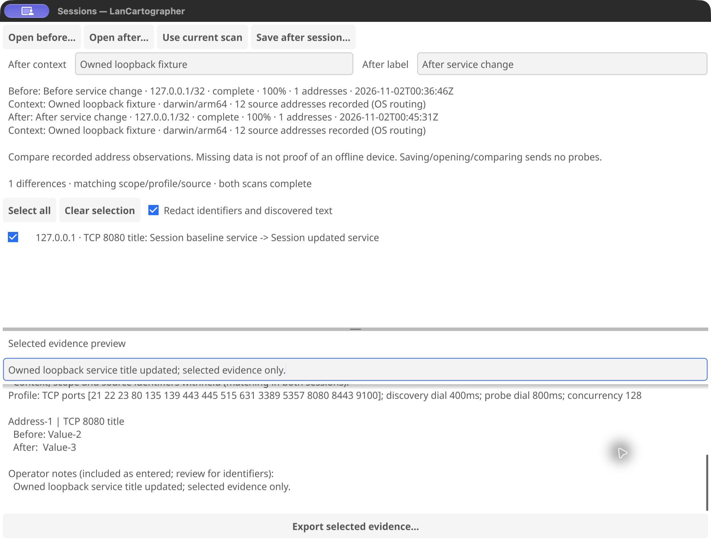

# LanCartographer User Guide

Use the native GUI for an authorized inventory, saved before/after sessions,
and selected evidence reports. The CLI shares the scan engine; its flags and
examples are in the [README](README.md#cli-reference). Build and update steps
are in [README](README.md#build-from-source) and [update-guide.md](update-guide.md).
The second half of this guide is a code tour for Python and PowerShell users.

## Scan and inspect

> Scan only networks you own or have explicit authorization to inventory. Unauthorized access or scanning may violate the Computer Fraud and Abuse Act, 18 U.S.C. § 1030, and similar laws.

1. Open the Windows executable or macOS app, read the first-run notice, and
   select or enter an authorized IPv4 range. Click **Scan** and confirm if the
   range requires it. **Stop** cancels an active scan; partial results are not
   evidence of complete coverage.
2. Select a host to inspect its ports, titles and SMB shares. Right-click for
   available Browser, Finder/Explorer, Ping and Wake-on-LAN actions; Remote
   Desktop is Windows-only. These actions are explicit and may cause network
   traffic or open another application.
3. Use **File → Export…** for a raw inventory in CSV or JSON. Favorites save a
   host list for later viewing. Neither contains the coverage metadata needed
   for session comparison; loading favorites also clears the current scan's
   session snapshot and is blocked while a scan is running.

## Save a baseline and compare a change

1. Finish an authorized GUI scan, then open **Sessions** from the toolbar or
   File menu. The finished scan is copied into **After**. Enter **After
   context** (a site/project/network name) and an optional **After label**.
   Click **Save after session…** and review the absolute file path. Nothing is
   saved automatically, and replacing an existing file requires confirmation.
2. Make your intended network or service change and scan the same range again.
   Return to the Sessions window and choose **Use current scan**; an already
   open window does not automatically replace its copy. Set the same context
   and save the new session. **Open before…** loads your saved baseline;
   **Open after…** loads a saved second session if needed. Opening a session
   does not alter the live inventory or send probes.
3. Read the compatibility result before selecting changes. Both sessions must
   be complete and have matching context, range, probe profile, application
   version and available source-interface/platform snapshots. After must not
   predate Before. The context is your explicit label, not detected network
   identity; keep it consistent only when the two scans belong together.
4. Check the relevant differences, or use **Select all**. Review **Selected
   evidence preview**, add optional notes and click **Export selected
   evidence…**. The plain-text file contains that preview: selected changes
   plus coverage context. **Clear selection** disables export. Reopening a
   session or changing its context resets the selection.



The comparison is by IP address. A newly absent address is **not observed**,
not proven offline; an empty field is **not recorded**, not proof of removal.
A host missing from one scan does not imply its individual ports closed.
Names can come from the MAC-keyed cache. The source snapshot records local
interfaces, including other active interfaces; sockets still follow OS routes.
Routes and DNS configuration are not captured, and addresses are not permanent
device identities. Session JSON is editable, not authenticated evidence.

### What is saved and what is shared

Full session JSON includes the unredacted inventory, target, context/label,
application version, effective ports/timeouts/concurrency/methods, local source
addresses/platform, timestamps, completion state and progress. Cancelled,
failed and incomplete scans may be saved, but cannot form a completed comparison.
Files use schema version 1, with an 8 MiB and 65,536-host limit; unsupported or
inconsistent files are rejected. Favorites and CLI JSON cannot be imported as
sessions. Session save/compare/export is currently GUI-only.

**Redact identifiers and discovered text** is on by default for evidence
reports. It withholds site/scope/source identifiers and replaces selected
addresses and discovered values with aliases local to that report. It retains
timestamps, counts, port numbers and numeric probe settings; this is not
anonymization. The comparison list and saved JSON remain unredacted. Turning
redaction off includes selected discovered values and source/site metadata.
Notes are included as entered (with control characters sanitized); inspect
notes and screenshots before sharing. Reports are plain text with no remote
assets or active HTML. See [SECURITY.md](SECURITY.md#saved-sessions-and-evidence).

Default storage is `%AppData%\LanCartographer\sessions\` on Windows and
`~/Library/Application Support/LanCartographer/sessions/` on macOS. An absolute
`APPDATA` override changes the per-user root; each save also lets you choose
another absolute path. Files are written through a temporary file and rename;
new directories/files use modes `0700`/`0600` on macOS. Back up files you want
to keep, including saves outside the default folder. There is no autosave,
background monitoring, automatic upload or session migration.

### When comparison or export is unavailable

| Message or condition | What to do |
|---|---|
| No finished scan | Finish or stop a GUI scan, then choose **Use current scan**, or open saved sessions. Favorites are not a scan. |
| Missing site/context | Enter the real site/project context in After, then save. Before retains the context in its file. |
| Incomplete scan | Keep the partial session if useful, then run a fresh authorized scan to completion for comparison. |
| Scope/profile/source mismatch | Read the stated reason. A changed VPN, local address, interface or platform can change the source snapshot. Take a new baseline appropriate to the investigation; do not relabel unrelated scans just to enable export. |
| After predates Before | Reopen the files on the correct sides. |
| Zero differences or none selected | Export requires at least one selected difference. A compatible pair with no differences has nothing to select. |
| Unsupported/invalid file | Use a saved session from a compatible build, within the file limits. Raw inventory JSON is not a session. |
| Notes too long | Keep report notes within 2,000 UTF-8 bytes. |

## Code tour for Python and PowerShell users

The rest of this guide connects Go concepts to familiar Python and PowerShell
ideas, then follows the actual scan and session boundaries.

## Analogy map

| Go construct | You know it as |
|---|---|
| `go.mod` / `go.sum` | `go.mod` declares the module, Go version and dependency requirements; `go.sum` verifies downloaded module content with checksums, rather than acting as a complete lockfile. The module path is `github.com/local/lancartographer`, and `internal/` packages can only be imported by this module — like a `src/` layout with an enforced boundary. |
| goroutine (`go func()`) | A thread or PowerShell runspace that costs almost nothing to start. Thousands, not tens. `go f()` is roughly `Start-ThreadJob { f }` with microsecond overhead and no job object to clean up. |
| channel (`chan Event`) | `System.Collections.Queue` with blocking handoff built in. Sending blocks when it's full; receiving blocks when it's empty. The compiler and runtime own the locks — you never write them. |
| `context.Context` | A `CancellationToken`. Passed through the scan to cancel dials and stop waiting for work; OS calls may have separate timeout/cancellation limits. |
| `struct` | A Python `@dataclass` or a `PSObject` with typed fields and no ceremony: `type Host struct { IP netip.Addr; Name string; ... }`. |
| `interface` | Python duck typing, but declared and checked at compile time. A function that takes `io.Writer` accepts anything with a `Write` method — like a protocol/ABC, enforced before runtime. |
| struct embedding | Mixin / inheritance-lite. Embedding `sync.Mutex` in a struct promotes its methods — the Go idiom for "this struct has a lock," comparable to `$this.Lock()` conventions you'd hand-roll. |
| pointer (`*Host`) | Passing a list by reference instead of a copy. Go is pass-by-value everywhere; a pointer is how a function mutates the caller's struct. Most of this codebase passes structs by value unless mutation is the point. |
| `cgo` | `ctypes` / `CDLL` — calling C from Go. This project deliberately avoids cgo for OS APIs; see "Talking to the OS without .NET" below. |
| single compiled exe | PyInstaller output, but first-class: one static-ish binary, no interpreter, no venv, no DLL hell, ~instant startup. |

## What happens when you click Scan

The walk below is the actual call chain in the code, starting at
`internal/scan/engine.go` (`scan.Run`).

1. **Target selection.** The GUI asks `internal/discover` for your local
   usable subnets through Windows `GetAdaptersAddresses` or macOS
   `net.Interfaces()`, filtering virtual adapters and masking addresses to
   their on-link prefixes. The GUI uses the selected/entered range; the CLI
   uses `--range` or, when omitted, all discovered local physical subnets.

2. **Address expansion.** `discover.HostsIn` enumerates every usable host
   address in the prefix — for a `/24`, the 254 addresses between the network
   and broadcast addresses. The engine rejects IPv6 and anything broader than
   a `/12` before this step, so a typo can't materialize a billion-address
   list and OOM your own machine.

3. **Worker pool.** The addresses are pushed onto a `jobs` channel (a
   queue with blocking handoff), and **64 goroutines** consume them — a
   worker pool, like 64 runspaces pulling from a shared `BlockingCollection`.
   The pool sizes down automatically for small ranges. This is why a `/24`
   can overlap waiting on different hosts; elapsed time still depends on
   responses, timeouts and enrichment, not only the number of addresses.

4. **Per-host liveness.** Each worker first asks "is anything there?"
   (`discover.Alive`): it dials `DiscoveryPorts`
   (`445, 80, 443, 135, 139, 22, 3389, 8080, 8443`, ordered by expected hit
   rate) plus the selected scan ports. Duplicates are skipped. The dials share
   the scan limiter. The first success wins and cancels the rest. If no port
   answers, an ARP lookup (`SendARP` on Windows, the ARP cache on macOS) is
   the next fallback. On macOS, a host still undetected gets one ICMP echo
   request through `/sbin/ping`, using the same concurrency limiter and a
   one-second timeout that Stop can cancel. A host can be alive with every
   probed TCP port closed or filtered. The result is recorded as `FoundVia`:
   `"tcp"`, `"arp"`, or `"icmp"`. Port states still describe the TCP probes.
   No liveness answer → the worker moves on; the address is not reported.
   This does not establish that a device is powered off.

5. **Port probe.** For each live host, `probe.ScanHost` dials every port in
   the port list (the 15 defaults live in `internal/gui/actions.go` as
   `specPorts` and in `internal/cli/cli.go` as `defaultPorts`) with a plain
   TCP connect — `net.Dialer.DialContext`, the Go equivalent of
   `socket.create_connection()` with a timeout. Each result is classified
   `open`, `closed`, or `timeout` (`internal/model/model.go`). The per-dial
   budget is 800 ms by default (the CLI's `--timeout` sets a 400 ms
   liveness budget; the probe budget is 2×).

6. **Service identification.** Open ports get a label from a classifier
   (`internal/probe/classify.go`): 445 → `smb`, 3389 → `rdp`, and so on. If
   the label is `Web`, known web ports receive HTTP/HTTPS title enrichment
   (HTTPS on 443/8443). An `unknown` port receives an HTTP `GET /` and can
   be promoted to `Web`. Requests have a one-second/32-KiB cap, no redirects
   and verified TLS; titles are capped at 80 runes. Failure to obtain a title
   does not change an open port to closed.

7. **Share enumeration — only if 445 answered.** `probe.ListShares` calls
   `winutil.NetShareEnum`: the Windows implementation walks native
   `ShareInfo1` records; macOS runs `smbutil view` with a five-second cap.
   Both return name, type (`disk`/`print`/`ipc`) and remark. The host
   may answer "access denied" under your existing token/session;
   the engine synthesizes a single marker share with remark
   `"shares: access denied"` so the UI can say so honestly. Other failures
   (RPC refused, host vanished) degrade silently to an empty share list.

8. **Name resolution, three ways at once.** `resolveName` fires NetBIOS,
   mDNS, and reverse-DNS (PTR) lookups in three goroutines and takes the
   highest-priority non-empty answer: NetBIOS → mDNS → PTR. The engine gives
   NetBIOS/mDNS a 900 ms context and PTR 1.5 s; the UDP probes also have an
   800 ms internal deadline. A winning answer cancels lower-priority lookups, so a slow PTR need not hold up a NetBIOS
   result. Names can also come from the persistent MAC-keyed cache.

9. **Enrichment.** MAC address via Windows `SendARP` or the macOS ARP cache;
   vendor by looking the OUI prefix up in an **embedded** database (compiled
   into the binary from
   `internal/oui/oui_data.go` — no runtime download). On Windows, a failed
   MAC lookup while unelevated becomes the sentinel `"needs elevation"`; the
   GUI offers optional elevation. macOS leaves a missing MAC empty.

10. **Events stream to the GUI.** Scan observations reach the UI through
    one event channel: `EventPortFound` and
    `EventShareFound` stream live during probing, `EventHostFound` carries
    the single canonical, fully-enriched record per alive host,
    `EventProgress` drives the progress bar, and `EventDone` marks full
    completion. Cancellation returns a context error instead of a normal
    completion result. The GUI records status and progress separately, so a
    cancelled scan is not treated as complete even if progress reached 100%.

### Why events on a channel instead of a shared list?

Because of the GUI thread rule. Fyne, like WPF or WinForms, requires that UI
objects be touched from exactly one thread. In Go the marshaling primitive is
`fyne.Do(func(){ ... })` — functionally `Dispatcher.Invoke` in C# or
`$Dispatcher.Invoke()` in PowerShell WPF: "run this on the UI thread."

The engine runs on background goroutines and must never touch widgets
directly. So it sends immutable `Event` values down a channel; the GUI side
has one goroutine receiving them and forwarding each to `fyne.Do`, which is
the path used for live scan updates. Favorites and session controls also run
on the UI thread; keep worker code behind that boundary.

## Concurrency, in your terms

**The rate limiter is a semaphore.** `internal/probe/limiter.go` implements a
`Limiter` as a buffered channel of size *n* — think `SemaphoreSlim(n, n)`.
To run work you "park" a token (`l.sem <- struct{}{}`), do the dial, then
release it. The whole scan shares one limiter, created in `scan.Run`, for
discovery and selected-port work across the host workers:

```go
lim := probe.NewLimiter(opts.Concurrency) // default 128, hard cap 256
```

`NewLimiter` clamps: ask for 0 or negative → 128; ask for more than 256 →
256. The limiter bounds the concurrent work using it; it is not a
packets-per-second limit and does not cover every enrichment or external desktop action.

**Cancellation reaches in-flight TCP dials.** TCP dials take
the sweep's `context.Context`. Clicking Stop cancels that context; every
`DialContext` in flight can return, workers see `ctx.Err() != nil`
and exit instead of taking new jobs, and blocked channel sends bail out via
`select { case ch <- ev; case <-ctx.Done() }`. In PowerShell terms: one
`CancellationTokenSource.Cancel()` that every `Wait-Any` in the system
respects — including the ones queued behind the semaphore. This does not
mean every OS operation is interruptible: the engine can stop awaiting SMB
enumeration while the native call finishes; macOS `smbutil` has its own timeout.

The `emitter` type (engine.go) deserves a mention: it wraps the outbound
event channel in a mutex so concurrent workers can't interleave sends, and
its send is `select`-ed against ctx so a cancelled sweep never wedges a
worker on a dead consumer.

## Talking to the OS without .NET (Windows and macOS)

You know P/Invoke: `Add-Type` a C signature, marshal structs by hand, hope
the packing matches. Go's `golang.org/x/sys/windows` is the same idea
shipped as a typed, maintained library — the Win32 prototypes already
declared and tested, so `internal/winutil` reads like a thin adapter rather
than a FFI project.

LanCartographer deliberately does **not** use cgo (the `ctypes` path) for
these calls. cgo would drag a C toolchain into every build and complicate
cross-compilation; the `x/sys/windows` approach compiles with plain `go build`.
That's why the build needs gcc *only* for Fyne (the GUI library), not for
Windows APIs.

On macOS the same seam exists, filled by different tools. Local subnets come
from the stdlib `net.Interfaces()` instead of `GetAdaptersAddresses`; peer
MAC addresses are read from the ARP cache (the equivalent of running
`arp -a`) instead of `SendARP`; share enumeration shells out to `smbutil`
(argv list, never a shell string) instead of calling `NetShareEnum`; and
Browser/Finder actions use `open`, Ping uses Terminal via `osascript`, and
the Windows-only Remote Desktop action is unavailable. Build tags keep the
split clean:
`internal/winutil` provides `_windows.go`, `_darwin.go` and other-platform
fallbacks. Shared APIs let the engine compile across platforms; native behavior
and OS-specific tests still need their respective platforms.

One raw-memory boundary is the `NetShareEnum` buffer walk
in `internal/winutil/share_windows.go`: Windows hands back a pointer to a
packed array of `ShareInfo1` structs plus a count, and the code steps
by the size of each struct, reading through `unsafe.Pointer`. Think
`struct.unpack_from` on a `ctypes` buffer — same risks (offset arithmetic,
alignment, lifetime), same discipline required. That is exactly why it is
isolated in `internal/winutil`, behind a typed Go API returning
`[]ShareInfo1`, with a macOS implementation and other-platform stub
(`share_other.go`), so ordinary callers do not handle the native buffer. Treat
that package like you would treat memory-unsafe code anywhere: change it rarely,
review it hard.

## The security model in plain terms

- **Fail-closed gate.** `internal/authz/authz.go` asks one question:
  does this range need confirmation? Yes if **any** of: outside your local
  subnets, not RFC 1918 private space, or broader than a `/22`. It's an OR,
  not an AND — any suspicious property triggers the gate. The GUI shows the
  notice in a confirmation dialog; the CLI requires `--i-am-authorized`.
  Refuse, and nothing is scanned at all (the CLI checks every target before
  the first packet).
- **Shares use existing access.** Enumeration uses the current Windows token
  or macOS SMB session. The app does not collect or store passwords; Finder or
  Explorer handles authentication when opening a share. An access-denied
  marker is reported without retrying alternate credentials.
- **Bounded desktop launches.** Actions build argument arrays. Windows Browser
  and Ping use `cmd /c start`; macOS Ping uses a Terminal AppleScript. Their
  targets are constructed from parsed IP literals and validated ports; macOS
  share names are URL-escaped. Passing argv does not itself eliminate every
  shell boundary: preserve the target builders when changing these actions.
- **No telemetry.** No analytics, crash reporting or runtime OUI download.
  Scans include DNS/name-resolution traffic that can reach off-LAN resolvers.
  Explicit Ping, Wake-on-LAN and desktop actions can also send traffic. Saved
  session open/compare/export adds no probes or uploads.
- **Local evidence has privacy limits.** Full session JSON is unredacted;
  selected reports default to redaction. Notes and screenshots need separate
  review. See the session workflow above and [SECURITY.md](SECURITY.md).

## Session ownership in the code

`internal/gui/gui.go` starts a session with the scan's actual options and tracks
progress/completion on the UI thread. `endSession` in `internal/gui/sessions.go`
clones the finished inventory and records complete/cancelled/failed/incomplete
status. Each Sessions window works on its own copies; importing a file does
not replace the active table. Loading favorites invalidates the current scan
snapshot so an old coverage claim cannot attach to a different host list.

`internal/session` owns schema validation, bounded reads, explicit file writes,
comparison and plain-text report generation. It reads local interface metadata
when capturing a scan, but does not invoke discovery or network probes. The
GUI freezes the displayed report before asking for an export path, so changes
made while a save dialog is open do not change the file being approved.

## Where to tweak things

| You want to change… | Edit |
|---|---|
| Default port list (GUI) | `specPorts` in `internal/gui/actions.go` |
| Default port list (CLI) | `defaultPorts` in `internal/cli/cli.go` |
| Liveness / probe timeouts | defaults flow from `--timeout` (400 ms) in `internal/cli/cli.go`; GUI/CLI callers set `probe.Options.ProbeTimeout` to 2× the discovery timeout |
| Discovery ports (liveness) | `DiscoveryPorts` in `internal/discover/liveness.go` |
| Column widths / minimums | `colFractions` / `colMins` in `internal/gui/table.go` — fractions must sum to 1.0 |
| OUI vendor data | update `internal/oui/data.csv`, then run `go generate ./internal/oui` (rewrites `oui_data.go`) |
| Icon / manifest / version resources | `tools/icongen`, `cmd/lancartographer/app.manifest`, `versioninfo.json`; `go generate ./...` rebuilds `resource.syso` on Windows |
| Session schema, comparison and redaction | `internal/session`; GUI ownership and dialogs in `internal/gui/sessions.go` |
| Authorization policy | `NeedsConfirmation` in `internal/authz/authz.go` |
| Dial concurrency cap | `DefaultConcurrency` / `MaxConcurrency` in `internal/probe/limiter.go` |

## Reading the tests

Checks use a mixture of fakes, loopback listeners and real network/OS calls.
Do not assume the whole suite is hermetic:

- **Loopback fixtures.** Where a test needs a real answering socket, it
  starts an HTTP server on `127.0.0.1:18080` (e.g.
  `internal/cli/cli_test.go`). Loopback is in-process, deterministic, and
  uses your own host. Full CLI scans may also invoke name resolution; a
  loopback target alone does not isolate every side effect.
- **Negative network cases.** Some probe tests call real dial, MAC or name
  lookup functions with `192.0.2.1`. A documentation address is not a fake
  transport and does not guarantee that no packets or DNS queries are sent.
  Inspect the selected check and its dependencies before running it.
- **Fakes at the seam.** Both the engine and the CLI define a `deps` struct
  — a bundle of function fields binding every external effect (dial, ARP,
  share enumeration, name lookups, MAC lookup, OUI, cache I/O):

  ```go
  type deps struct {
      dial       discover.DialFunc
      arp        func(netip.Addr) bool
      scan       func(context.Context, netip.Addr, probe.Options, *probe.Limiter, func(model.Port))
      listShares func(context.Context, netip.Addr) ([]model.Share, error)
      // ...
  }
  ```

  Production wires the real functions; tests wire fakes. If you know Python's
  `unittest.mock.patch`, this is the same idea — but instead of monkeypatching
  after the fact, the seam is a designed-in constructor parameter. No test
  framework magic, no patching builtins; the compiler checks both sides.

  That's also why `context.Context` shows up in every signature: a test can
  cancel it and assert the engine unwinds, the same way you'd assert a
  runspace stops on token cancellation.

For a local change, run the affected behavior and focused checks. For example,
the session parser/comparison/report checks use synthetic records and temporary
files:

```bash
go test -race ./internal/session -run '^TestSession' -count=1
```

This checks library behavior, not native dialogs. GUI changes also need actual
native interaction; see the [session verification record](docs/verification/sessions-2026-11-01.md)
for the exercised workflow and limits, and
[issue #24](https://github.com/cgfixit/LanCartographer/issues/24) for pending
platform and size-limit acceptance. Fyne builds need CGO and the platform
C toolchain. Use `bash deploy/build.sh` for packaging, especially on macOS where
the checked-in Windows resource must be moved aside and restored.

Hosted [CI](.github/workflows/ci.yml) runs the broad Windows and native
arm64/Intel macOS build, vet and race checks, plus packaged CLI smoke checks on
macOS. A cross-compile or packaged CLI pass does not verify native GUI behavior.
For dependency/toolchain updates, follow
[dependency maintenance](CONTRIBUTING.md#dependency-maintenance) and record
new results against the actual rebuilt artifact.
