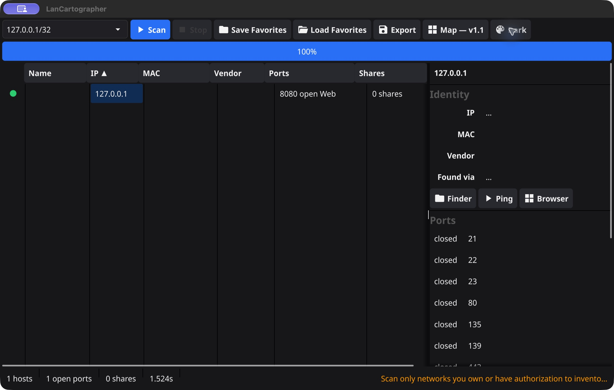
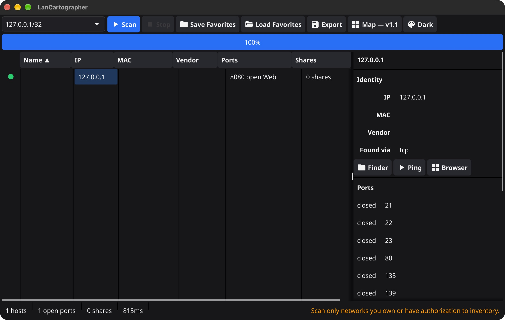
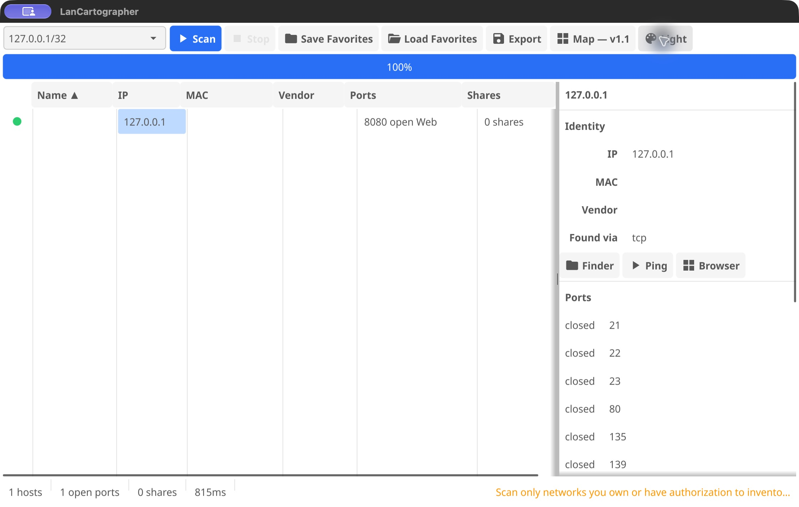

# macOS verification record

Verified on 2026-10-08 with Go 1.27.1, Fyne 2.8.1, system clang,
macOS 27.0.1, and Apple Silicon. The starting revision was
`ce5a8d8906a2dbdf3ef6407bfb3591a2581789f1`.

## Failure and correction

[The failing main CI run](https://github.com/cgfixit/LanCartographer/actions/runs/37370800784)
built and vetted successfully on macOS, then failed `TestRun_DeadHosts`:
`progress = [1 0.5], want [0.5 1]`. Windows passed that run. An atomic
increment happened before acquiring the event-send lock, allowing workers to
publish completion counts in reverse order. The fix counts and emits under
the same lock. A local repeated baseline check reproduced the same failure;
the candidate passed the focused race-enabled progress/cancellation checks.

Native interaction also exposed actual product problems: configuration fell
back to the working directory without Windows APPDATA; missing Mac ARP
entries incorrectly displayed an elevation requirement; panel values collapsed
to ellipses; headings did not follow the dark theme; Browser discarded port
8080; and known web ports did not receive HTTP title enrichment. These were
fixed without changing the authorization policy or Windows API wrappers.

## Native Computer Use

The built Fyne application was exercised as a native macOS app, not in a web
browser or Fyne's test driver. Only loopback addresses were scanned. A local
HTTP fixture listened on `127.0.0.1:8080`.

| Interaction | Observed result |
|---|---|
| First launch / authorization | Notice visible and acknowledged; refusing the scan confirmation left the inventory empty |
| Scan `127.0.0.1/32` | Completed at 100%, with the fixture port displayed |
| Stop during a loopback `/16` scan | Returned to enabled Scan / disabled Stop while progress remained incomplete |
| Scan again after Stop | `/32` completed at 100% (815 ms observed, not a benchmark) |
| Select host | Full IP and `tcp` discovery method visible; Finder and Browser actions present |
| Theme | Light/dark toggle worked; saved dark preference survived restart; headings stayed readable |
| Favorites | Saved and reloaded the loopback inventory, including after restart |
| CSV export | File produced with header and a `127.0.0.1` row containing `8080 open Web` |
| Browser | Firefox opened the fixture title at `http://127.0.0.1:8080` |
| Native data location | Files persisted under `~/Library/Application Support/LanCartographer/`, with mode 0600 |

Computer Use intermittently lost mouse targeting while native keyboard and
menu actions remained usable. A copy of the candidate bundle was given a
unique QA bundle identifier/executable name and re-signed ad hoc to distinguish
it from an earlier process. No application logic was changed in that copy.
The QA executable SHA-256 was
`3a4c61a4883609df4d80d188a32e474ad090f6a52ecfd22318319bebf729d3a9`.
Subsequent source edits were comments/import grouping, a Windows-specific path
test correction, documentation, and smoke-check coverage.

The screenshots show only a saved loopback fixture, with no real LAN inventory.
The “before” image predates the panel corrections; it already includes the
Finder label from the intermediate Mac candidate.

| Before: collapsed values and dark headings | After: readable values and headings |
|---|---|
|  |  |



## Packaged runtime and focused checks

Commands run locally (CGO enabled, Go 1.27.1):

```bash
bash build.sh
# Extracted the newly built ZIP to an owned scratch directory, then:
shasum -a 256 -c SHA256SUMS.txt
codesign --verify --deep --strict LanCartographer.app
python3 tests/macos-smoke.py .smoke/extracted

go test ./internal/scan -race -run 'TestRun_(DeadHosts|ProgressOrdered|MACNeedsElevationWhenNotElevated|Stop)' -count=100
go test -race ./internal/appdata ./internal/favorites ./internal/hostcache ./internal/gui -run 'Test(Path|LoadSettings|SaveThenLoadSettings|LoadMissing|SaveLoad|SaveOverwrites|LoadCorrupt|Load_|Save_|ExplorerPath|ArgvBuilders)'
go test ./internal/probe -race -run 'TestHTTP|TestExtract|TestScanHost_OpenWebPort'
go test ./internal/gui -race -run 'Test(BrowserURL|ArgvBuilders|ExplorerPath|Theme|Panel)'
go test -race ./internal/appdata
go vet ./internal/appdata ./internal/scan ./internal/gui ./internal/probe ./internal/favorites ./internal/hostcache
actionlint .github/workflows/ci.yml .github/workflows/release.yml
bash -n build.sh
git diff --check
```

All above checks passed. The workflow YAML also parsed successfully. Targeted
race checks were used because the CI defect is scheduling-dependent; no full
local test suite was run, per the requested verification policy. The existing
full race gates remain in hosted CI on Windows and both Mac architectures.

The extracted archive's app and CLI both refused unconfirmed loopback scans
with exit 2 and no HTTP request to the fixture. Authorized runs each exported
one host with open port 8080 and its exact HTTP title. Checksums and bundle
signature verification passed after extraction.

Final locally built app executable SHA-256:
`999579d5b4f1851c07b62551739328012eb4917e014a84d7616d78f03b3b16b2`.

## Security, performance, and limits

- Authorization and its notice remain unchanged. Existing TLS verification,
  redirect refusal, one-second/32-KiB HTTP limits, and bounded scan concurrency
  remain enforced. Share URL metacharacters are escaped; persistence no longer
  silently writes relative to cwd.
- The Mac build compiles once and copies the identical executable for CLI
  dispatch. No runtime scan-speed improvement is claimed.
- Repeated ARP subprocess/cache traversal remains a possible performance
  follow-up. A five-run local timing sample (about 1.95 ms for `arp -a` versus
  1.75 ms for numeric targeted lookup) did not establish a material gain, so
  that implementation was left unchanged.
- Intel desktop interaction, macOS 13 runtime compatibility, authenticated
  SMB access, remote-host MAC/vendor resolution, and Wake-on-LAN against a
  sleeping device were not exercised here. Loopback evidence does not prove
  those live-network behaviors.
- The app is ad-hoc signed, not Developer ID signed or notarized. Local launch
  and signature checks do not prove downloaded Gatekeeper acceptance.
- No release tag was created and no release was published. The release
  workflow was linted; its native Mac build/smoke commands were run locally.
  Hosted CI results belong to the exact PR head, separately from this record.
