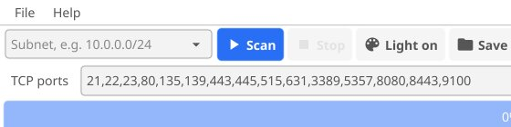
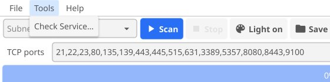
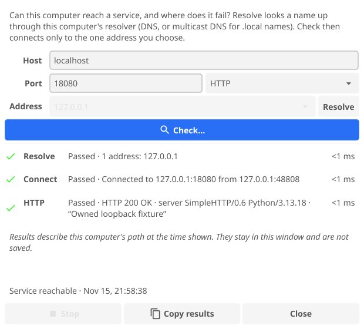
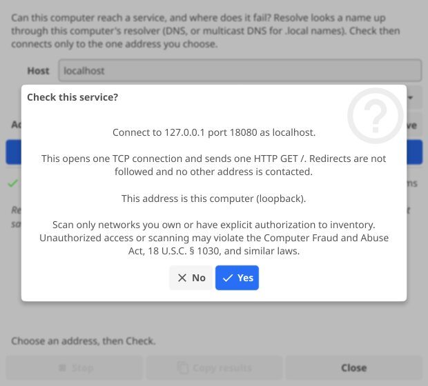
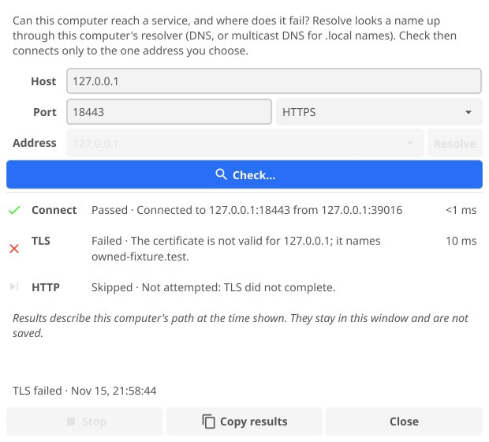
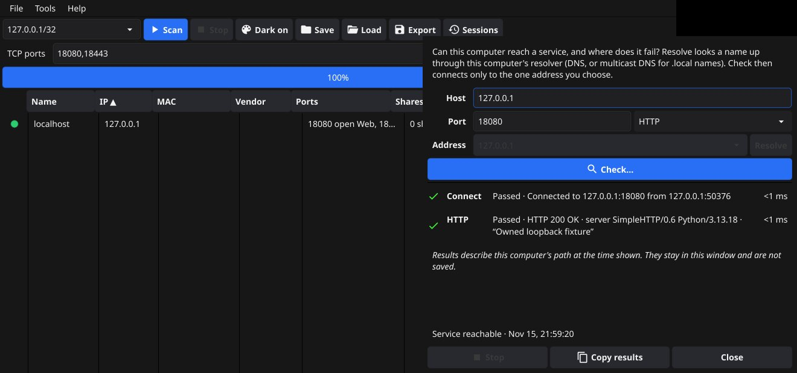

# Check Service verification

Source: branch `claude/affectionate-bell-l75qlr` on `main` at `ba08bf1`,
built with Go 1.27.3 and Fyne 2.8.2. Environment: Linux x86_64 container,
Xvfb X11 display with Mesa software rendering, driven with `xdotool` mouse and
keyboard input. Linux is not a supported GUI target; to render the window, the
local build added an uncommitted file with the five desktop-launch helpers
that only `actions_windows.go` and `actions_darwin.go` provide. No other code
differed from the branch.

| `main` at `ba08bf1` (non-macOS menu) | This branch |
| --- | --- |
|  |  |

| Hostname, connect and HTTP | Confirmation |
| --- | --- |
|  |  |

| Certificate failure | Inventory prefill, dark theme |
| --- | --- |
|  |  |

## Owned fixtures

All endpoints were loopback services started for this run: a Python
`http.server` on 18080, a Python TLS server on 18443 with a self-signed
certificate for `owned-fixture.test`, a listener on 18444 that accepts and
never answers, and a closed port. The inventory scan target was
`127.0.0.1/32`, confirmed through the existing out-of-subnet dialog.

## Rendered GUI interaction

- **Tools** shows **Check Service…**; Internet Quality stays macOS-only.
- `localhost` → **Resolve** → one address; **Check…** → confirmation named
  `127.0.0.1 port 18080 as localhost`, the traffic, the loopback scope and the
  authorization notice verbatim.
- **No** produced zero requests in the fixture access log; **Yes** produced
  exactly one `GET /`. Pressing Return in the host field opened the
  confirmation without contacting the fixture.
- HTTPS to the self-signed fixture failed at TLS with the certificate name
  mismatch and skipped HTTP. A closed port reported *Refused*. TLS to the
  silent listener reported *No TLS answer within 3 s* at 3000 ms.
- **Stop** during a TLS handshake showed *Cancelled*; no result appeared after
  the 3-second deadline. The app side of the socket moved from ESTABLISHED to
  FIN_WAIT2 (fixture side CLOSE_WAIT).
- Closing the window during a handshake closed the socket within 0.5 s and no
  late window or result appeared. **File → Quit** during a handshake exited
  the process in 0.02 s with no remaining connection.
- Right-click on the scanned host → **Check service…** prefilled `127.0.0.1`,
  port 18080 and HTTP (the scan had classified 18080 as Web) and sent nothing.
- **Copy results** placed the target and stage text on the X clipboard, read
  back with `xclip`.
- Light and dark themes rendered; the regular scan of the owned target still
  completed with one host and two open ports.

## Engine run against fixtures

A scratch driver (not committed) called `servicecheck.Check` directly:
HTTP 200 with title; HTTP 302 reported and not followed (the redirect target
received no request); refused; untrusted certificate; HTTPS against a plain
HTTP port (*did not answer with TLS*); TLS and HTTP timeouts at 3 s and 1 s;
cancellation at 300 ms; a 40 KB header block stopped by the 32 KiB cap; HTTP
503 as a warning; a title containing ESC, a right-to-left override and a
newline rendered as printable single-line text; `ParseHost` rejecting schemes,
paths, ports, user info, multicast, broadcast, IPv4 zones and unknown IPv6
zones.

## Commands

```bash
gofmt -l .                                         # no output
CGO_ENABLED=0 go vet ./...                         # also GOOS=windows and GOOS=darwin
go vet ./internal/gui/ ./internal/servicecheck/    # cgo, GUI included
go test -race ./internal/gui/ ./internal/servicecheck/ -count=3
CGO_ENABLED=0 go build -o "$TMPDIR/lc-cli" ./cmd/lancartographer
APPDATA="$(mktemp -d)" "$TMPDIR/lc-cli" --range 127.0.0.1/32 --i-am-authorized --ports 18080,18443
bash .claude/skills/lan-guard/check.sh
```

The servicecheck tests were checked against two mutations: sending the IP as
the TLS server name failed three tests, and enabling `InsecureSkipVerify`
failed all three certificate-failure cases.

## Independent review

A separate review pass, which did not see this record, read the engine and window
code and probed loopback fixtures. It found no path to an address other than the
confirmed one, no way to skip TLS verification and no unbounded resource use.
It reported six minor issues, all fixed with regression tests: an interim
`100 Continue` hid the final status (interim answers are now skipped, and `101`
is a warning); numeric IPv6 zones, the Windows form, were refused; a zone on
an IPv4-mapped address was silently dropped; a control character in a zone
gave a misleading message; a prefill could change the form while the
confirmation was open (prefill now waits and the resolve stage is captured
when the dialog opens); and 169.254/16, 100.64/10 and private IPv6 got
imprecise scope wording.

## Limits

- No Windows or macOS native run. Hosted CI provides the Windows gate and the
  macOS builds and race tests. The refused/unreachable mapping on Windows uses
  Winsock error codes and was compiled, not exercised.
- `internal/probe` `TestScanHost_TimeoutPort` fails in this container with or
  without this change: the sandbox refuses TEST-NET-1 instead of dropping it.
- `lan-guard` reported one failure that predates this branch:
  `release-main-macos.yml` declares top-level `permissions: {}`, which the
  script does not recognize. Every probe, TLS, redirect, listener and notice
  check passed. `actionlint` was not run because no workflow changed.
- The live checks used loopback only. LAN, VPN, IPv6 and `.local` resolution
  remain native acceptance items.
