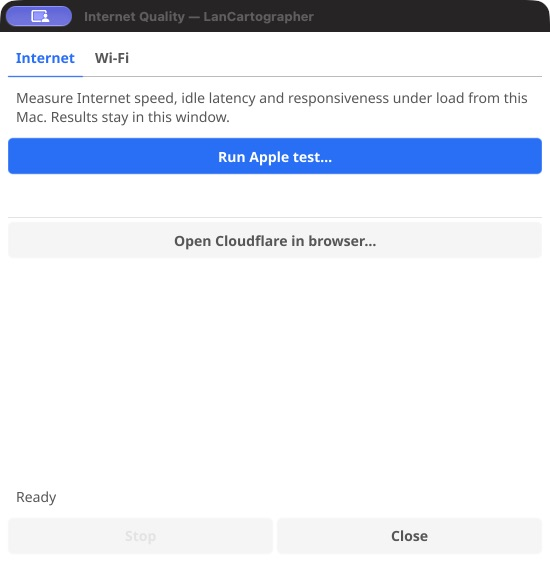
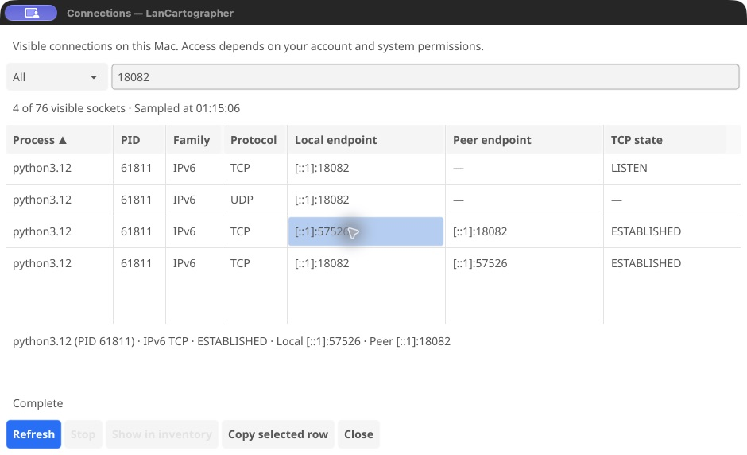
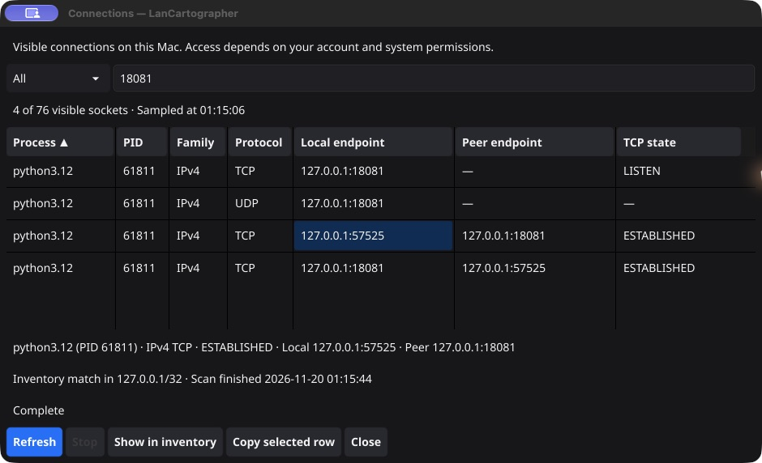

# macOS Connections verification

Verified on macOS 27.2.1 (26B131), Apple Silicon, with Go 1.27.4,
Apple clang 21.0.0 and the system lsof 4.91. The candidate used
`origin/main` at `2f1ec83` plus the Connections changes.

## Helper qualification

- `/usr/sbin/lsof -nP -iTCP -iUDP -F0pcftPnT` sampled the unelevated
  system three times in 46–47 ms. It returned 68 visible rows and about
  5.1 KB of stdout per run. The PID-scoped fixture returned nine socket
  records in 43 ms, including IPv4/IPv6 TCP listeners, four established
  endpoints and two UDP binds.
- An owned absent port query returned exit 1 with empty stdout and stderr.
  A root-owner query from the same unelevated account also returned no
  rows. The tool reports visible results, with partial and failed states
  for warning and parsing failures that the helper exposes.
- The candidate imposes a 2 s deadline, a per-stream 1 MiB cap and a
  10,000-row cap. Focused tests cover scoped IPv6 and wildcard binds,
  malformed, truncated and capped output, timeout and both output streams.
  [lsof field documentation](https://github.com/lsof-org/lsof/blob/master/docs/manpage.md)

## Packaged desktop

Computer Use inspected the baseline Tools menu and the Connections candidate
in light and dark themes. With a disposable profile and owned loopback
sockets, the app displayed the expected fixture rows. A filter for
`127.0.0.1:18083` showed zero rows until the fixture opened a UDP bind and
the operator selected **Refresh**. An authorized `127.0.0.1/32` scan found
the fixture's HTTP port. The host action prefilled the exact address and
**Show in inventory** selected the matching row from the completed scan.
Safari rendered the owned HTTP fixture through the inventory's Browser action.

| Baseline Internet Quality | Connections light, IPv6 | Connections dark, IPv4 inventory match |
| --- | --- | --- |
|  |  |  |

Commands run from the candidate worktree:

```sh
go vet ./internal/macdiag ./internal/gui
go test ./internal/macdiag ./internal/gui -run 'Test(Connections|DiagnosticCommand|InternetQuality|WiFi)' -count=1
bash deploy/build.sh
python3 tests/macos-smoke.py dist
```

The build and smoke passed for both packaged entry points. The exercised
bundle executable SHA-256 was
`542c39d418e735817fe41629d84dfd825adbccc8d0ecaa9546185db922e678fb`.
Cancelled and partial helper outcomes were exercised in focused tests.
The local runtime was macOS 27.2.1 arm64. The macOS 14 deployment floor
was checked in the Mach-O headers and bundle metadata.
