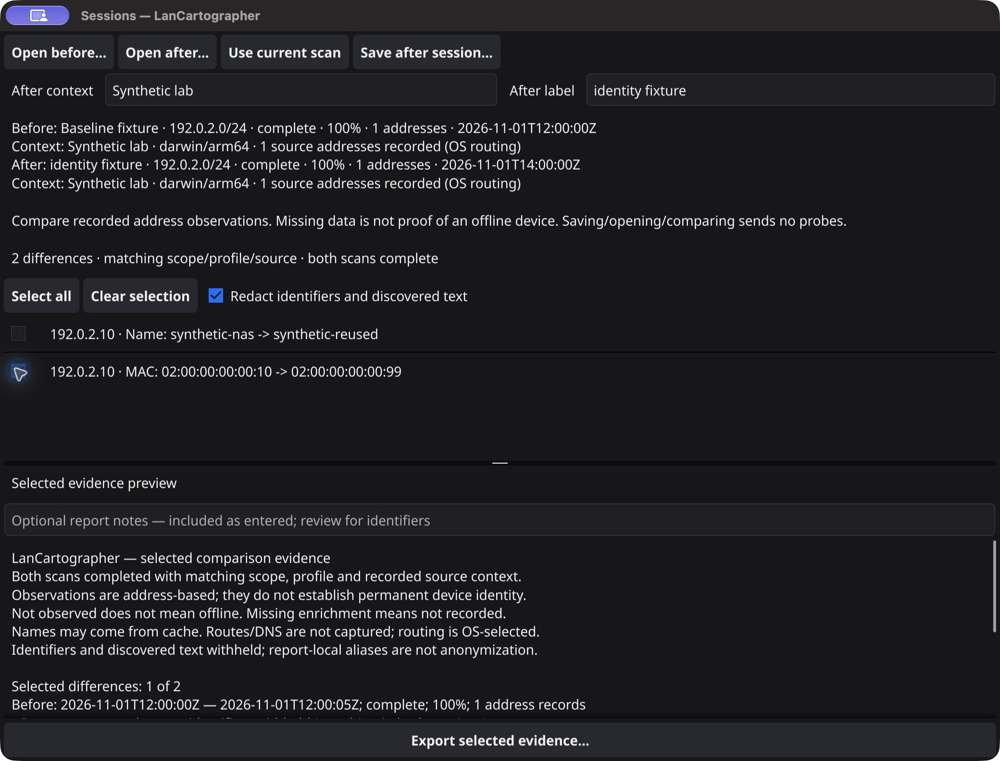
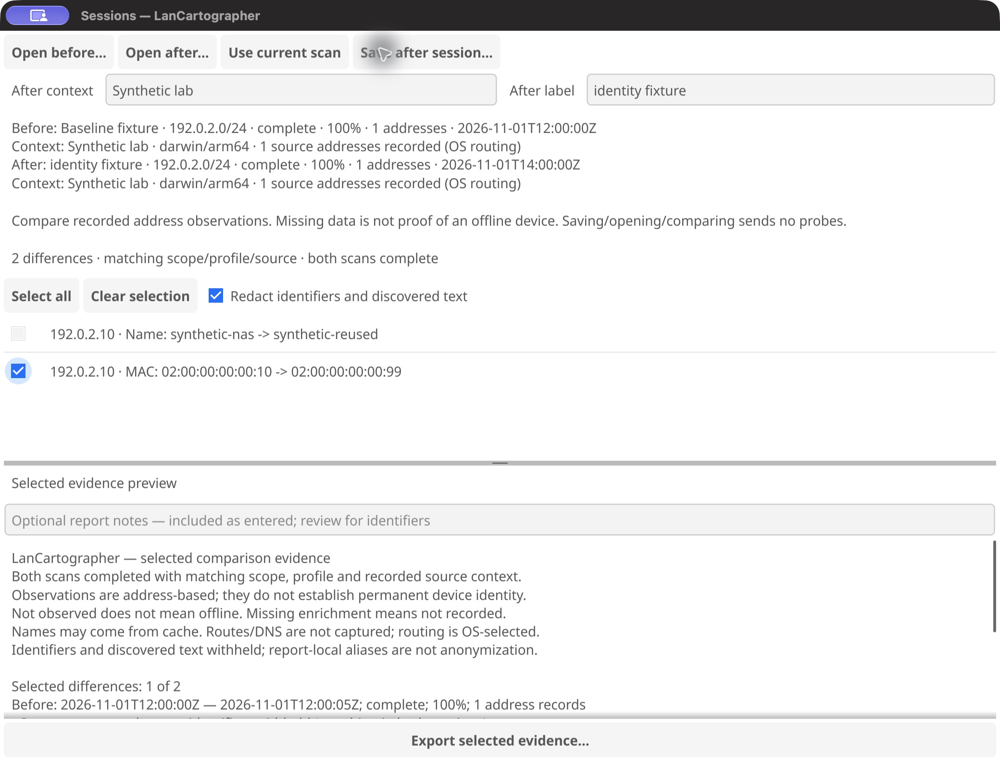
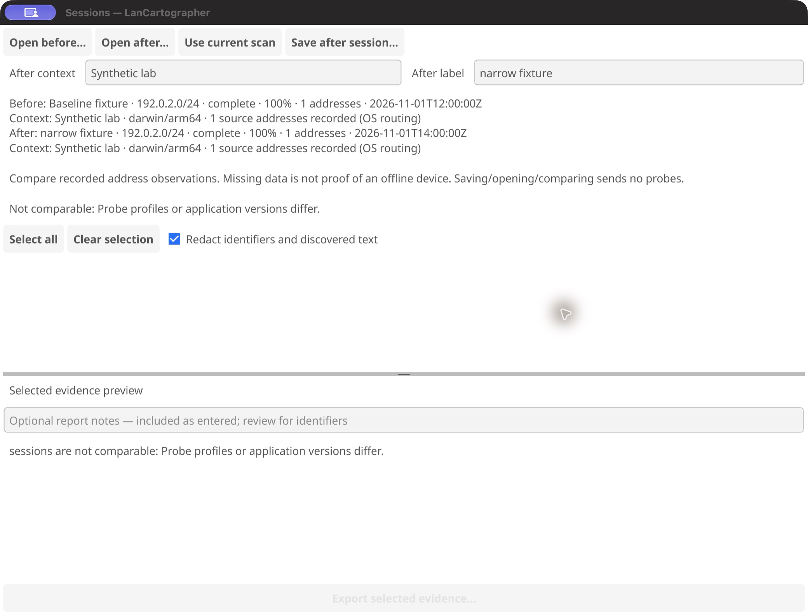

# Dependency refresh — 2026-11-01

The updated native macOS package passed owned CLI smoke checks and session
file-dialog, comparison, theme and selected-export checks. This record covers
the dependency refresh on top of [draft #23](https://github.com/cgfixit/LanCartographer/pull/23).
Earlier [session evidence](sessions-2026-11-01.md) retains its original versions
and limits.

## Source, versions and artifact

The candidate was built from `85252ebc28f7ca16d721af4f76f6ee3130c5f966` plus
the dependency/documentation changes on `cx/docs-dependencies`. Application Go
sources, workflows, the Windows resource and OUI database are unchanged. The
executable embeds that base revision and `vcs.modified=true`; the manifest
hashes below identify the actual dependency inputs exercised.

| Input | Before | Exercised |
| --- | --- | --- |
| Go | 1.27.1 | 1.27.3 |
| Fyne | 2.8.1 | 2.8.2 |
| `golang.org/x/sys` | 0.48.0 | 0.49.0 |
| `github.com/fyne-io/oksvg` | 0.2.0 | 0.2.1-0.20260918172519-a9af55fa95d9 |
| `github.com/go-gl/glfw/v3.4/glfw` | 0.1.0-pre.1.0.20260707082822-2a407d02d01a | 0.1.0-pre.2 |
| `github.com/go-text/typesetting` | 0.3.4 | 0.3.5 |

The graphics/text changes follow [Fyne's v2.8.2 requirements](https://github.com/fyne-io/fyne/blob/v2.8.2/go.mod).
`go mod tidy` also refreshed the required typesetting-utils checksums. The
[Go release history](https://go.dev/doc/devel/release) records security fixes
in the intervening patch releases; the [Fyne changelog](https://github.com/fyne-io/fyne/blob/v2.8.2/CHANGELOG.md)
includes file-dialog and rendering fixes. These release notes motivate the
refresh; they do not establish a reproduced LanCartographer vulnerability.
Other indirect versions and action-major migrations remain in
[issue #25](https://github.com/cgfixit/LanCartographer/issues/25).

- `go.mod` SHA-256: `44748fc93606e6036e015a19dbb9e143344c5f5a3701a821112cdf2d2be1806b`.
- `go.sum` SHA-256: `19aa47d3dd422d173292c41f722fbca27c0be83c37261a8685ec3cf5c3bb9ed2`.
- Packaged executable SHA-256: `6d9530de977e248c01a358774137b9f9664b06aa482b514581c7a7a0cfa17730`.
- Host: macOS 27.2 arm64, Apple clang 21.0.0, CGO enabled; actionlint 1.7.12.
- `go version -m` confirmed Go 1.27.3 and the updated runtime modules in the
  executable. A task-specific build cache and `GOTOOLCHAIN=go1.27.3` were used.

## Focused verification

```sh
go mod tidy
go mod verify
# PASS: all modules verified
go mod tidy -diff
# PASS: no output

go vet -mod=readonly ./internal/gui ./internal/session ./internal/probe ./internal/winutil
# PASS: no diagnostics

go test -race ./internal/session ./internal/gui ./internal/probe \
  -run '^TestSession|^TestLoadFavoritesAllows|^TestApplyEvent|^TestHTTPTitle' -count=1
# PASS: session 1.363s; gui 1.913s; probe 1.175s

bash deploy/build.sh
# PASS: native app/CLI, bundle checks, ad-hoc signature and architecture ZIP
python3 tests/macos-smoke.py dist
# PASS: license in app/archives, Mach-O deployment target 13, both packaged
# entry points, authorization refusal, owned loopback HTTP title and JSON export

bash .claude/skills/lan-guard/check.sh
# LAN-GUARD: PASS, including actionlint on all three existing workflows
bash -n deploy/build.sh
git diff --check
# PASS
```

The focused regression checks were chosen for the session file dialogs changed
upstream in Fyne and the Go HTTP/TLS library update. No full local suite was run.
The first restricted package build compiled successfully but failed in
`iconutil`; the unchanged build command passed with approved native access.
The existing duplicate `-lobjc` linker warning remained.

The changed Markdown files also passed relative-link/anchor, balanced-fence and
verbatim authorization-notice checks. The generated Windows resource and OUI
database remained unchanged after packaging.

## Native session interaction

The new package ran with disposable app data and the saved dark theme. Native
Computer Use loaded the same synthetic before/identity/narrow fixtures described
in the [independent session pass](sessions-2026-11-01.md#independent-native-acceptance-follow-up).
No scan was started during this GUI check; the separate packaged CLI smoke used
only its owned loopback fixture.

1. Opened the before and after session files through the Fyne file dialogs.
   The changed name and MAC at `192.0.2.10` produced two differences. Selecting
   only MAC produced a redacted preview of **1 of 2** differences.
2. Switched the main window from dark to light while keeping Sessions open.
   The existing comparison and selection remained, and the session widgets
   rendered in the new theme.
3. Exported the selected evidence through the save dialog. The fresh file had
   mode `0600` and exactly matched the previous synthetic
   [selected-only report](sessions-2026-11-01/identity-selected.txt), SHA-256
   `f55ea1f804c50419c90e1c15860d23b7f9455a3b127adf31070b358b116015e6`.
   Raw fixture IP/MAC/name values and the unselected Name row were absent.
4. Loaded the narrower profile. Its incompatibility reason replaced the old
   comparison/preview, selection cleared, and export was disabled.

The app exited successfully, its log was empty, and the light-theme setting
persisted. Screenshots contain only synthetic inventory. The matching report
is linked instead of committing another identical copy.

Before the update: [Go 1.27.1/Fyne 2.8.1 dark-theme comparison](sessions-2026-11-01/dark-identity.jpg).







## Remaining coverage

This maintenance branch depends on draft #23. Existing CI and Gitleaks workflows
filter pull requests to `main`, so they do not run while this draft targets
`cx/saved-sessions`. Retarget and verify the integrated candidate after #23 is
accepted; the parent's passing checks do not verify these dependency updates.

Native Windows/Intel macOS UI, macOS 13 execution, near-limit session performance,
authenticated SMB and downloaded Gatekeeper acceptance were not exercised.
[Issue #24](https://github.com/cgfixit/LanCartographer/issues/24) tracks native
session and size-limit gaps. Signing here is ad-hoc, not Developer ID signing
or notarization. No vulnerability scan or release publication was performed.
