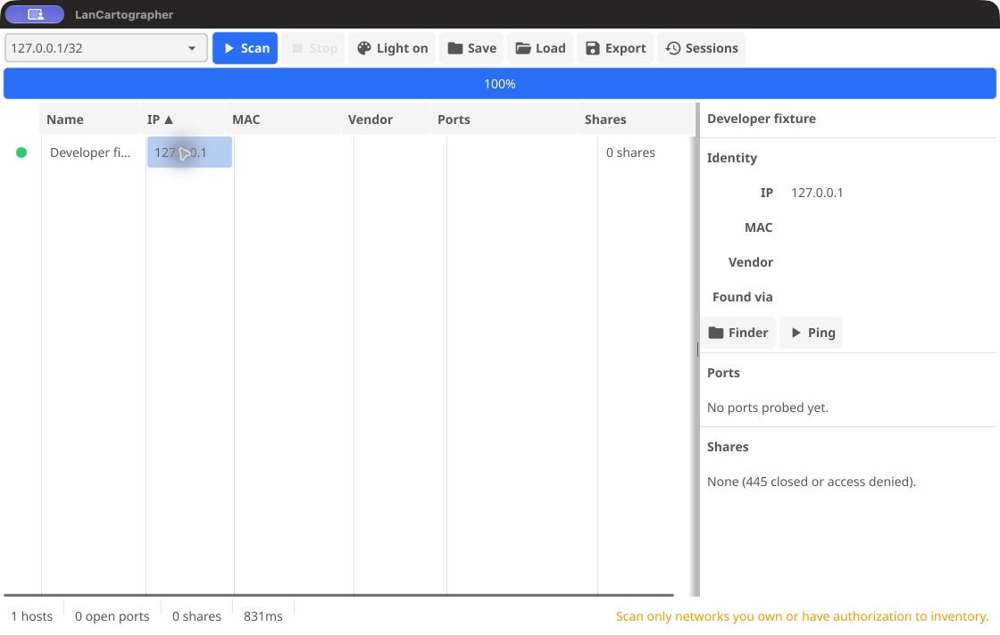
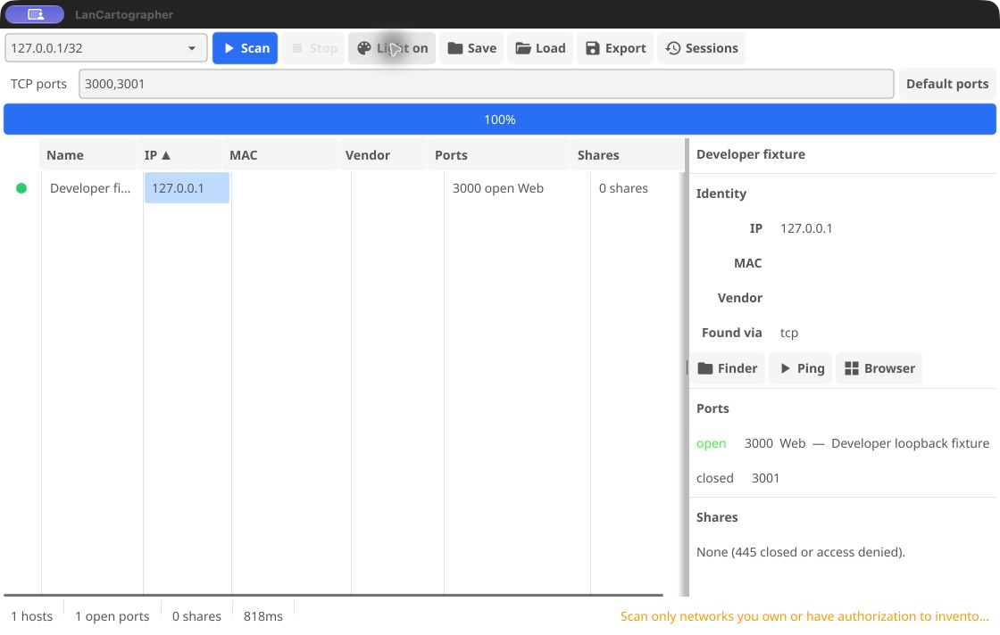
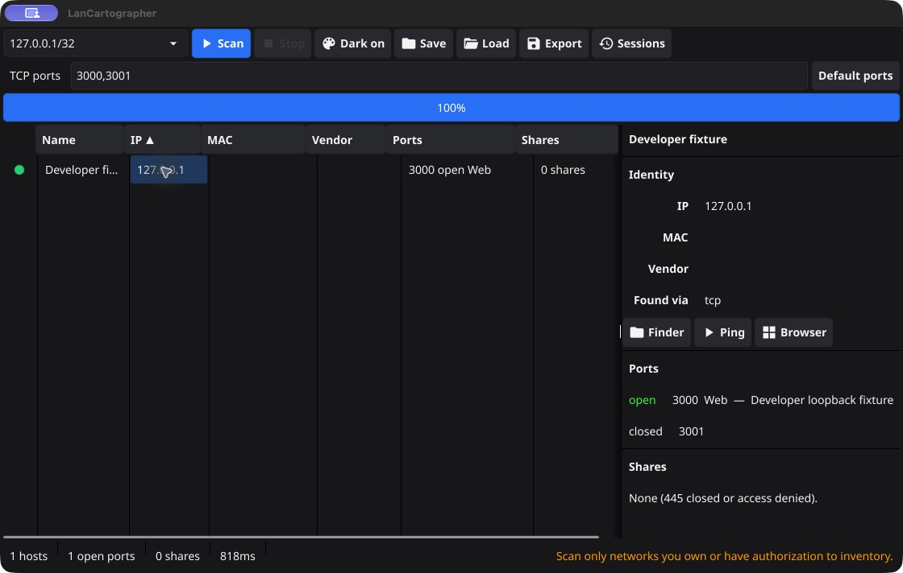
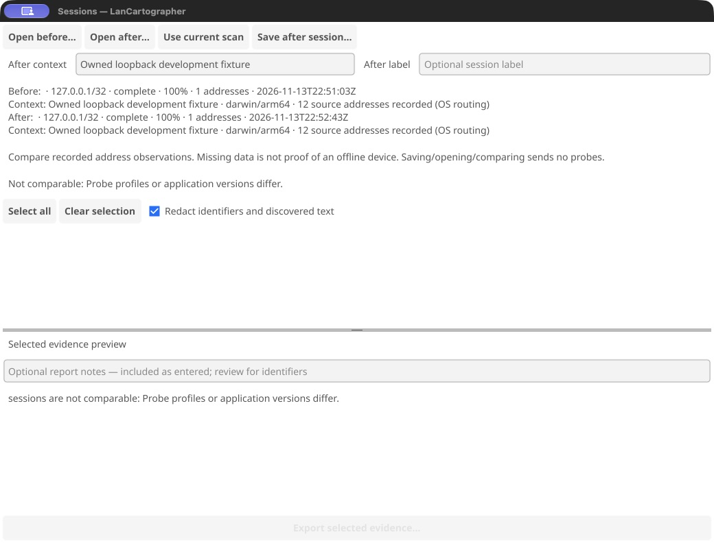
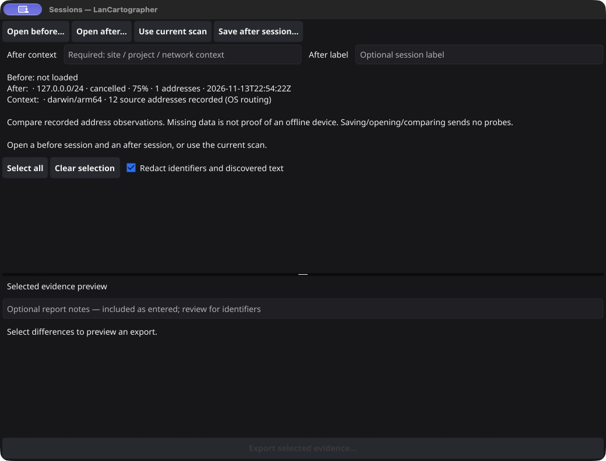

# Developer service ports — 2026-11-13

## Source and artifact

Base `8caf2489b23c82d73d8f6ab589c1d96ed8f192ee`; port-selection change
`5a1b37d938ef4998a52a59c1b2b82a03ff541708`; final application source
`17714f205966e5363a783f58edddb97948574cc9` adds the detected-web shortcut. Built with Go 1.27.3,
Fyne 2.8.2 and Apple clang 21.0.0 on macOS 27.2.1 arm64. Dependencies unchanged.
The first native pass used the port-selection sources immediately before their
commit (metadata: base plus modified sources). The final pass was rebuilt from
`17714f2`. Later evidence/docs edits do not change the application source. The
build temporarily moves the tracked Windows resource aside, so build metadata
marks the tree modified even for committed application sources.

Signed `.app/Contents/MacOS/LanCartographer` SHA-256:
- Initial port-selection pass: `ab4b1a4d3297e4626041be5a65a45c06439f293d1f5f115d25d50ca4cd943540`.
- Final detected-web pass: `3bdbdc6b34d2f27bcea95b5fa50812660e67aae044c1a4c46cf21cda5fa4fbcc`.
The running process was verified against the isolated candidate bundle path.
The baseline was separately built from `8caf248`.

## Executed checks

- `gofmt` on the changed Go files and `git diff --check`: clean.
- `go test ./internal/gui -run 'Test(BrowserURL|ScanPortControls|InvalidScanPortsPreserveInventory|InternetQualityScanWaitsForMeasurement)$' -count=1`: pass.
- `go vet ./internal/gui`: pass.
- `bash deploy/build.sh`: pass, including bundle signature verification and ZIP.
  The unchanged baseline's icon packaging failed inside the outer sandbox;
  the same `iconutil` call succeeded with approved access. Native packaging
  used that execution context without changing product code.
- `python3 tests/macos-smoke.py dist`: pass through the packaged CLI and
  `.app --cli`: authorization refusal, owned HTTP title/JSON, license and
  Mach-O minimum target checks.

Computer Use drove the actual Fyne app with disposable `APPDATA`. Desktop 4
was prepared by the operator after programmatic desktop switching failed.
A temporary coordinate-input failure was recovered using native keyboard and
Window-menu navigation. No real LAN sweep or external speed test was run.

1. Loaded synthetic favorites, entered `3000,`, and pressed Scan: the UI
   displayed `TCP ports: invalid port ""`; the prior inventory stayed visible.
2. Scanned owned `127.0.0.1/32` with `3000,3001`: 3000 was open with the HTTP
   title `Developer loopback fixture`; 3001 was closed. Native details showed
   both outcomes. Port controls were disabled while scanning and restored on
   completion.
3. Saved the session through the native dialog. A local assertion inspected
   the saved file: complete state, profile `[3000,3001]`, exactly those host
   ports, and the expected title/states. Raw sessions with source-interface
   metadata were kept outside the repository.
4. Scanned only `3000`, opened the saved baseline, and supplied the same
   context. The native comparison reported incompatible probe profiles and
   disabled evidence export.
5. Started an owned loopback `/24` scan and clicked Stop. Controls recovered;
   Sessions reported `cancelled` at 75%, preserving incomplete coverage.
6. Inspected light/dark port controls and host details. Favorites were loaded
   with a synthetic display name for the screenshots below; these screenshot
   fixtures are separate from the live scan and saved-session assertions.
7. The live review found that detected Web on port 3000 lacked a Browser
   shortcut. After extending the existing URL selector, rebuilt the app,
   rescanned `3000,3001`, selected the host, and clicked Browser. Safari opened
   `127.0.0.1:3000/` with title `Developer loopback fixture`. Standard-port
   precedence, closed/unknown ports, invalid imported ports and IPv6 URL
   brackets were checked by the focused URL test. Final light/dark screenshots
   show this final build, including its Browser button.

## Screenshots

Before (baseline controls, synthetic favorites):

After (candidate controls and synthetic host details):

Coverage mismatch and cancellation:

## Limits

No full local suite. Windows 10/11, Intel macOS and minimum macOS 13 native UI
were not exercised. Default-width light/dark rendering was checked; smaller
window sizes were not qualified. The Internet Quality handoff was covered by
a focused test, not another live Apple traffic run. This Fyne product has no
browser web app. Hosted CI and downloaded-release/signing acceptance are
separate. Existing wider session acceptance remains tracked in #24.
