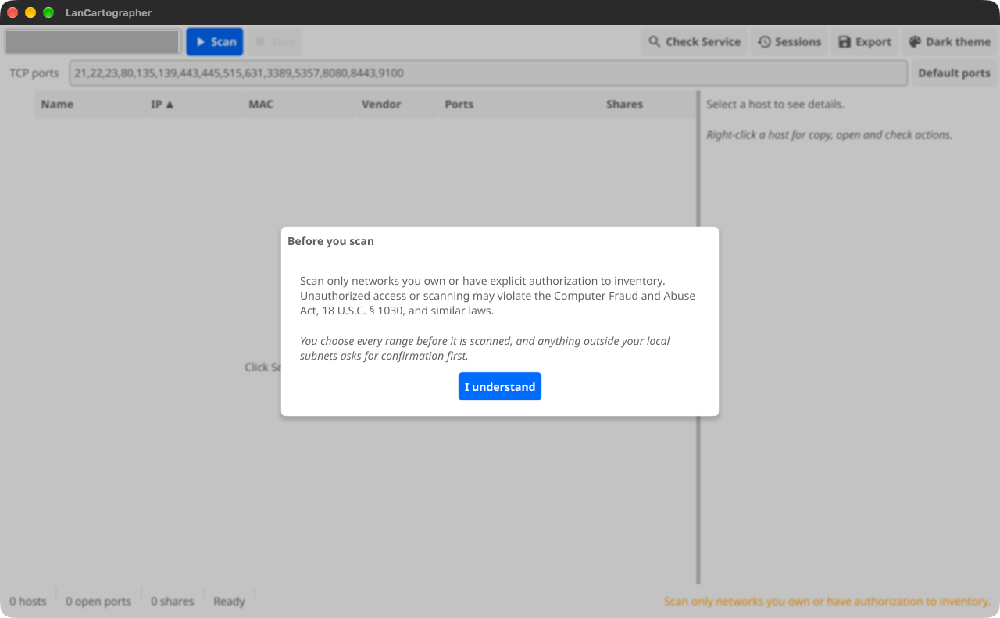
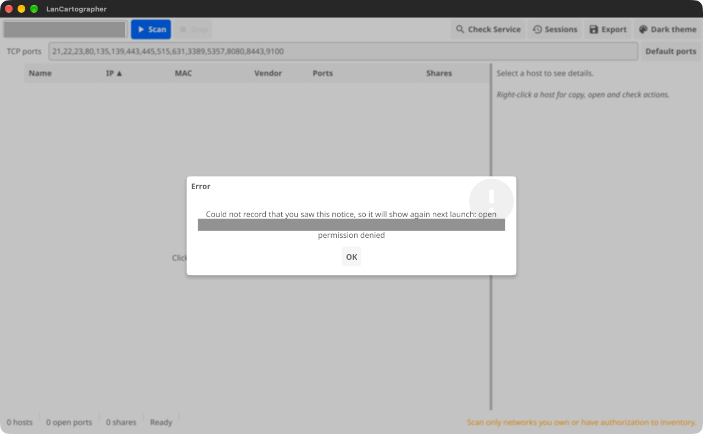
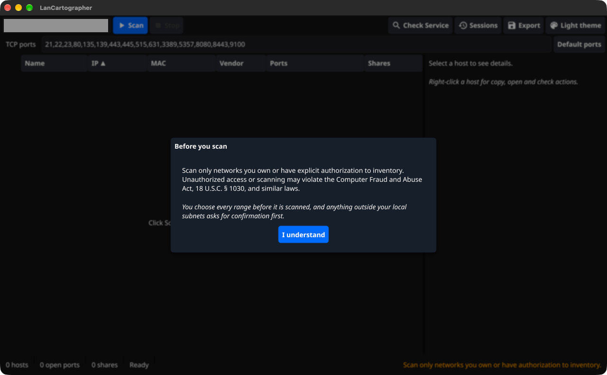
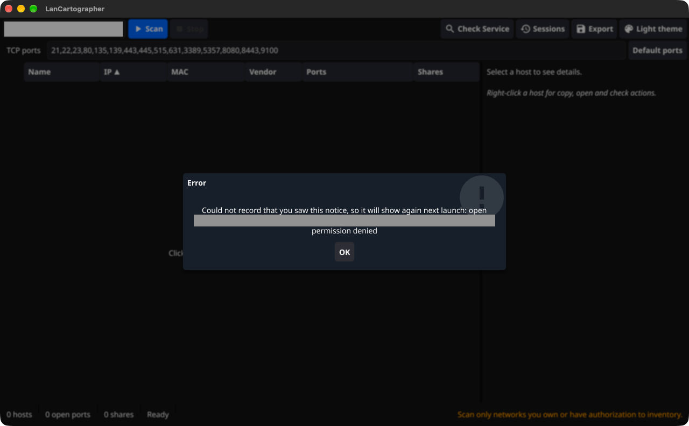
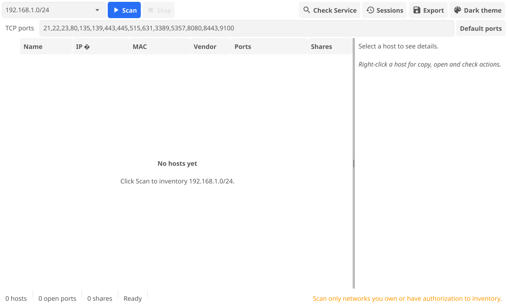
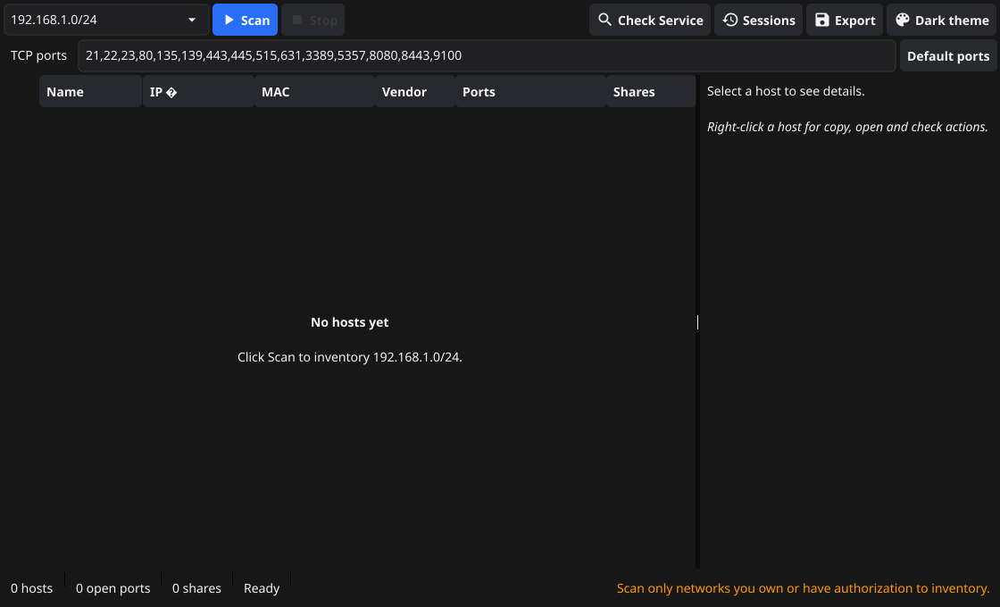

# First-run marker write failure verification

Source: branch `claude/optimize-firstrun-write`, cut from `main` at `8b39101`,
built with Go 1.27.3 and Fyne 2.8.2 on macOS 27.0.1 (Apple M5 Pro).

Evidence tiers: **native GUI** (this branch only), **focused tests**, and
**Fyne software rendering** (the `main` comparison).

## Native GUI (this branch)

The packaged-equivalent binary (`go build ./cmd/lancartographer` from a clean
export of this branch, `resource.syso` moved aside) ran natively on the
desktop. `APPDATA` held a `LanCartographer/` folder with mode `0500` and a
`settings.json` that selected the theme, so settings loaded but writing
`firstrun_seen` failed. The operator clicked **I understand** by hand; a
script captured only the app's own window (`screencapture -l`, located by PID
via CoreGraphics). Afterwards, the folder still held only `settings.json`.
The range field (a real local subnet) and the absolute path in the error are
redacted with gray boxes; the visible error ends in `permission denied`.

| Before the click | After **I understand** |
| --- | --- |
|  |  |
|  |  |

## Software render: `main` compared with this branch

The images below come from `u.win.Canvas().Capture()` on Fyne's test driver
after tapping the real "I understand" button, using a throwaway test file
that was not committed. `APPDATA` pointed below a regular file, so creating
`LanCartographer/` fails with `not a directory`. `main` was not run natively.

| `main` at `8b39101` | This branch |
| --- | --- |
|  |  |
|  |  |

## Commands

```
CGO_ENABLED=1 go test ./internal/gui/ -run TestFirstRunMarkerWrittenOrErrorShown -race -count=1 -v
```

Both subtests pass on this branch. On `main`, the `unwritable` subtest fails
with `expected an error dialog explaining the marker could not be saved`.

## Not covered

- Native Windows interaction, and a native run of `main` (its behavior, a
  silently closed notice, is shown in the software render above).
- The `IP �` header glyph in these renders appears on both sides and comes
  from the test driver's font, not from this change.
