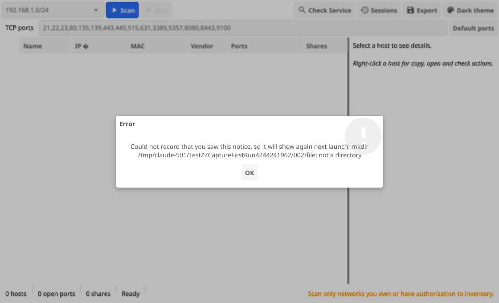
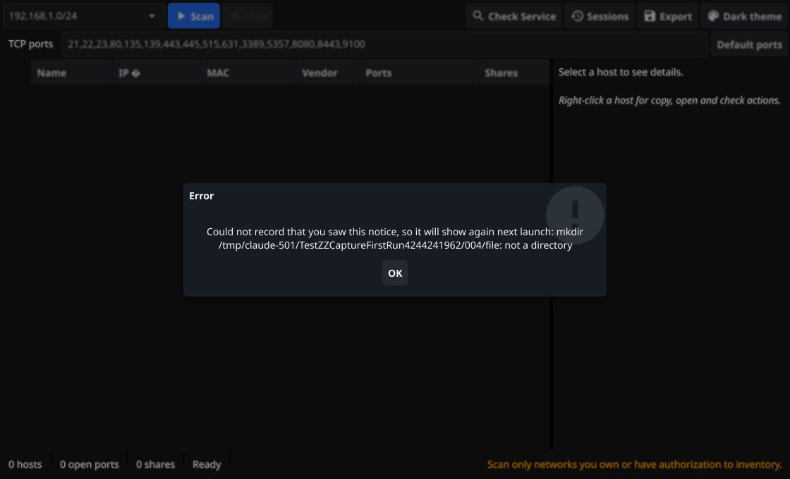

# First-run marker write failure verification

Source: branch `claude/optimize-firstrun-write`, cut from `main` at `8b39101`,
built with Go 1.27.3 and Fyne 2.8.2 on macOS 27.0.1 (Apple M5 Pro).

Evidence tier: **focused tests and Fyne software rendering**, not native GUI.
The agent session had no computer-use access, so nothing was clicked in a
native window. The images come from `u.win.Canvas().Capture()` on Fyne's test
driver after tapping the real "I understand" button, using a throwaway test
file that was not committed. `APPDATA` pointed below a regular file, so
creating `LanCartographer/` fails with `not a directory`.

| `main` at `8b39101` | This branch |
| --- | --- |
|  |  |
|  |  |

## Commands

```
CGO_ENABLED=1 go test ./internal/gui/ -run TestFirstRunMarkerWrittenOrErrorShown -race -count=1 -v
```

Both subtests pass on this branch. On `main`, the `unwritable` subtest fails
with `expected an error dialog explaining the marker could not be saved`.

## Not covered

- Native macOS or Windows interaction with the packaged app.
- The `IP �` header glyph in these renders appears on both sides and comes
  from the test driver's font, not from this change.
