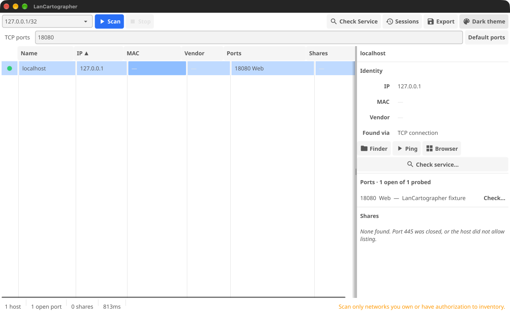
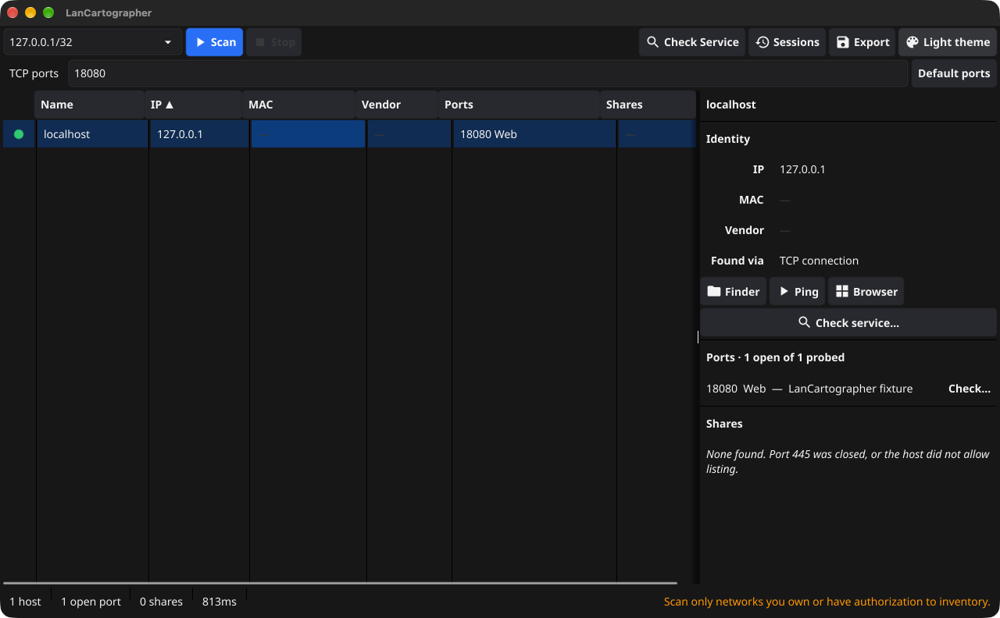

# golang.org/x dependency update verification

The candidate updates the `golang.org/x` group: `x/sys` v0.49.0 → v0.50.0
(direct; Windows APIs in `internal/winutil`), and the indirect `x/image`
v0.43.0 → v0.48.0, `x/net` v0.55.0 → v0.62.0 and `x/text` v0.38.0 →
v0.44.0 that Fyne uses for image decoding, text shaping and localization.
Fyne v2.8.2 and its other transitive modules are unchanged
([CONTRIBUTING](../../CONTRIBUTING.md#dependency-maintenance)).

Source: `main` at `0d42c5b` plus commit `3ff545e` (`go.mod`/`go.sum` only),
built with Go 1.27.4 on macOS 27.2 arm64 (Apple Silicon).

## Why

`govulncheck` v1.9.0 with the Go vulnerability database of 2026-11-11 found
no **reachable** vulnerability on `main`, but listed 11 in required modules:
eight in `x/net` v0.55.0 (fixed by v0.62.0), two in `x/text` v0.38.0 (fixed by
v0.41.0) and one in `x/image` v0.43.0 (fixed by v0.45.0). After the update it
reports `No vulnerabilities found.`

## Checks

| Check | Result |
| --- | --- |
| New `go.sum` lines vs `sum.golang.org/lookup` | all 8 identical |
| `go mod verify`, `go mod tidy -diff` | verified, no diff |
| `gofmt -l .`, `go vet ./...` | clean |
| `govulncheck ./...` (CGO, darwin) | no vulnerabilities |
| `bash deploy/build.sh` | exit 0; ad-hoc-signed bundle, CLI, ZIP |
| `python3 tests/macos-smoke.py dist` | both entry points pass: authorized loopback scan, HTTP title, JSON export, refusal exits 2, `--json -` matches the file |
| `bash tests/ci-gate.sh` | PASS, all 7 steps; race: 17 packages ok, 0 failed |

Executable SHA-256 from that build:

```
7e1e42fa091d373fb570e1986cd8919a71981c29387b825649bf5fb04c61bcf7  dist/LanCartographer.app/Contents/MacOS/LanCartographer
f6e89caff9b08a92b5ac53f8a94baa33f53d54636bbcca50d06bd9018a153e54  dist/lancartographer-cli
79d0628f6acff7ad94f213a36aea3182fb2c9849b8e29bafcc02574cb8e4df25  dist/LanCartographer-macos-arm64.zip
```

## Native GUI

The packaged bundle executable above ran with a disposable `APPDATA` and was
driven with computer use. An owned `python3 -m http.server` on
`127.0.0.1:18080` was the only target. Its log shows exactly two requests:
one from Check Service and one from the scan's title probe.

- Help → About, File and Tools menus, light/dark theme toggle and the Check
  Service window render correctly.
- Check Service (HTTP, `127.0.0.1:18080`): the confirmation names the exact
  address, port and traffic; Connect passed, HTTP passed with `200 OK`, the
  `Server` header and the fixture's title.
- Scan of `127.0.0.1/32` with port 18080: the authorization gate asked for
  confirmation (outside local subnets, not private, or broader than /22);
  `localhost` was found via TCP, port 18080 was identified as Web with the
  fixture title, and the status bar read `1 host · 1 open port · 0 shares`.

| Light | Dark |
| --- | --- |
|  |  |

## Not covered

- Windows native build and GUI (`x/sys` is used by `internal/winutil`); the
  hosted Windows `gate` and `govulncheck` jobs cover the build and analysis.
- Intel macOS (hosted `macos-15-intel` job).
- Session save/compare dialogs and Internet Quality were not exercised.
