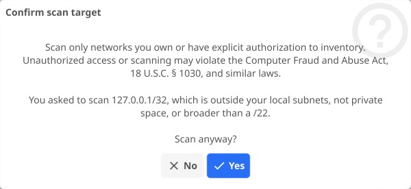
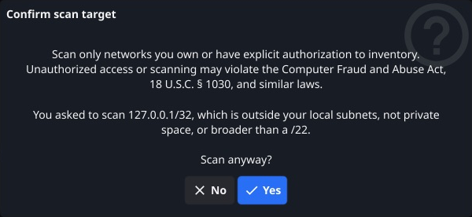

# GUI subnet authorization on macOS, 2026-11-24

The GUI test driver simulated a laptop changing physical subnets after launch.
On `0658a7c`, the former subnet skipped the scan prompt, the newly local private
subnet prompted, and the service dialog omitted the former subnet's caution.
A pending measurement held accepted scans in the queue during this comparison.

## Candidate

Code revision `eb434ad57b33ee699b7137c40662d8a41a23babb`. Apple Silicon,
macOS 27.2.1 (26B131), Go 1.27.4, Fyne 2.8.2, Apple clang 21.0.0.
The packaging script temporarily moves the Windows COFF resource during linking.
The Go build metadata therefore says `vcs.modified=true`. Git confirmed that
the resource, icon and generated OUI data matched the commit after packaging.

| Executable | SHA-256 |
| --- | --- |
| Baseline app | `f58e7b158e999a157243ebbb21dade7f7648ac9c27a77062b1343cfdcd35e535` |
| Candidate app | `b21d5610b89038cc2e62508a0a1a48745fd6a887db5d5720860e0511ba36225f` |
| Candidate CLI | `7f321b3e95fa2a73d033b2396c75b8ee4a34703c26bd18f1466358eedb3b6be7` |

## Results

- **GUI test driver.** Six focused tests passed. The former subnet required
  approval, the newly local subnet could queue, and failed discovery discarded
  even a partial interface list. Declining preserved idle inventory. Resuming a
  queued scan without explicit approval checked scope again, and declining
  enabled the controls. The service prompt used the current subnet list.
- **Packaged native UI.** Computer Use drove the app with disposable data.
  Declining a scan of `127.0.0.1/32` produced zero HTTP requests at the fixture.
  Approving it showed one host and one open port. Selecting the row showed
  `8080 Web — Authorization fixture`. Its **Check…** action prefilled the
  endpoint. **No** returned to Ready. **Yes** reported a successful TCP
  connection and HTTP 200 with the fixture title.
- **Browser.** The inventory's Browser action produced a fixture GET. An
  independent browser visit displayed “Loopback only” at the same URL.
- **Packaged CLI.** Both the CLI and app launched with `--cli` refused without
  authorization (exit 2, empty stdout, zero fixture requests). With approval,
  JSON file and stdout exports agreed on one open loopback service.
- **Scope.** Changed interfaces and discovery errors were simulated. The
  native run used the Mac's existing interface configuration. Windows desktop,
  Intel Mac hardware and downloaded-release acceptance require separate runs.

```sh
go test ./internal/gui -run '^(TestScanUsesCurrentSubnets|TestQueuedScanChecksScopeBeforeDispatch|TestServiceConfirmationRefreshesScope|TestServiceConfirmTextNamesEndpointScopeAndNotice|TestInternetQualityScanWaitsForMeasurement|TestInvalidScanPortsPreserveInventory)$' -count=1 -v
gofmt -l .
go vet ./...
bash build/build.sh
python3 build/macos-smoke.py dist
```

### Native confirmation dialog

The crops show the existing dialog for the same loopback target. The GUI test
driver above verifies when a network change causes that dialog to appear.

| Baseline | Candidate, light | Candidate, dark |
| --- | --- | --- |
|  |  |  |
