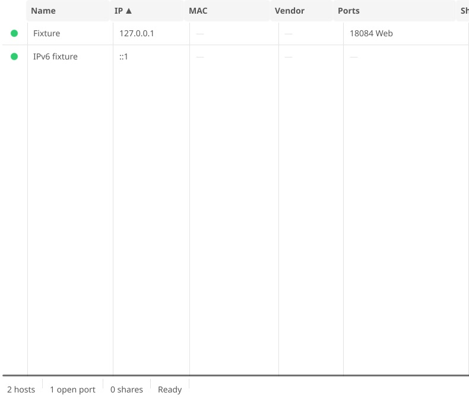
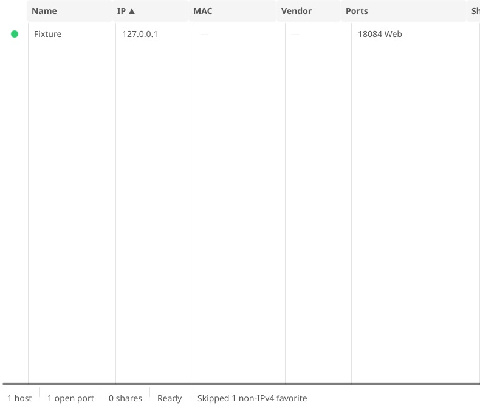
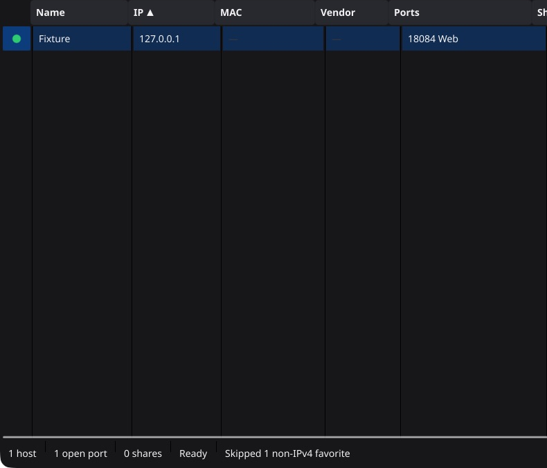

# Loading IPv4 favorites on macOS, 2026-11-25

Computer Use exercised **File → Load Favorites** in two locally built ARM64
packages on macOS 27.2.1 (26B131), with Go 1.27.4, Apple clang 21.0.0 and
Fyne 2.8.2. Both used disposable app data. The same file contained two
synthetic hosts, `127.0.0.1` with a web service on port 18084 and `::1`.

| Action | Baseline at `0658a7c` | Candidate at `e7a4015` |
| --- | --- | --- |
| Load the mixed file | Displayed both rows | Displayed the IPv4 row and “Skipped 1 non-IPv4 favorite” in light and dark themes. The file still matched its original bytes. |
| Move the file aside and load again | Cleared the table | Displayed “No saved favorites” and kept the selected row and its details. |
| Open Browser for the IPv4 row | Outside the baseline check | The owned HTTP fixture received a GET on port 18084 and returned 200. An independent browser visit displayed “IPv4 favorite opened”. |

The crops show the native inventory and status bar.

| Baseline | Candidate, light | Candidate, dark |
| --- | --- | --- |
|  |  |  |

## Reproduction and checks

```sh
bash build/build.sh
python3 build/macos-smoke.py dist
gofmt -l .
go vet ./...
GOTOOLCHAIN=local go run honnef.co/go/tools/cmd/staticcheck@v0.8.2 ./internal/gui ./internal/favorites
go test ./internal/favorites ./internal/gui -run '^(TestLoadMissingFileReturnsNilNil|TestSaveLoadRoundTrip|TestSaveOverwritesPrevious|TestLoadCorruptJSONReturnsError|TestLoadSkipsNonIPv4Favorites|TestBrowserURL|TestArgvBuilders|TestDesktopActionsRequireIPv4|TestLoadFavoritesPreservesStateWithoutIPv4Rows|TestLoadFavoritesAllowsReselectingSameCell|TestSessionCaptureCompletionCancellationAndFavorites|TestTableNameSortKeepsFavoritesInIPOrder)$' -count=1 -v
```

Both packaged entry points refused the unconfirmed scan with exit 2 and zero
fixture requests. After authorization, each reported one open loopback service
and produced matching file and stdout JSON. Formatting, vet, scoped staticcheck
and all 12 focused tests passed. The tests cover missing, empty, malformed,
mixed and IPv6-only favorites, saved-session ownership, status clearing, valid
IPv4 actions and refusal to construct Ping or Browser targets for unsupported
addresses. The Ping checks inspected arguments without opening a terminal.

| Binary | SHA-256 |
| --- | --- |
| Baseline app | `f58e7b158e999a157243ebbb21dade7f7648ac9c27a77062b1343cfdcd35e535` |
| Candidate app | `0b725a80fd192bffdb555db963537531895a7acb15c45545ef5c995e04895c7e` |
| Candidate CLI | `9e9d98c519b41610f3a39dd5a0a261f23254c89a509b43ee0802dcf13478f956` |

The CLI embeds revision `e7a40153d6fe0a08a21db0476f2d5e729030a0c0`.
Packaging temporarily moves the Windows resource during linking, so Go records
`vcs.modified=true`. The tracked resource, icon and OUI data matched Git
after packaging. Windows desktop, Intel Mac hardware and downloaded-release
acceptance were outside this local run. Issue #80 tracks Windows desktop
acceptance.
