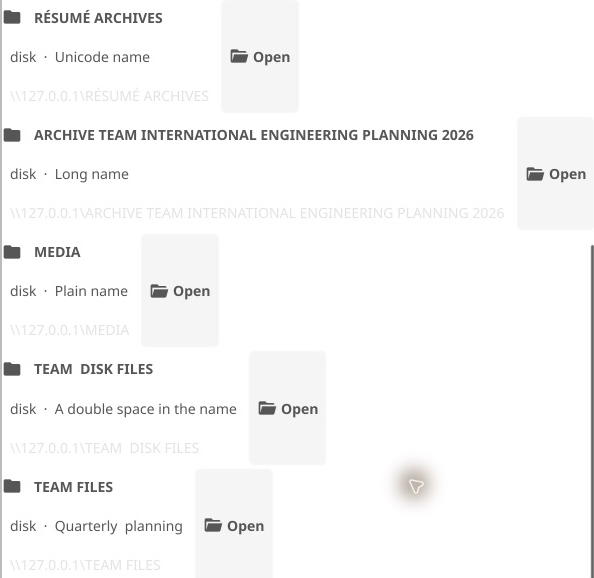
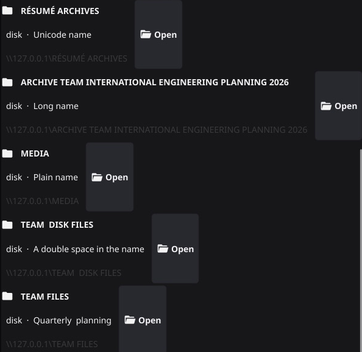

# macOS SMB share names, 2026-11-25

Both locally packaged builds scanned the same owned SMB and HTTP fixtures on
`127.0.0.1/32`. The Mac ran macOS 27.2.1 (26B131) on Apple Silicon with
Go 1.27.4, Apple clang 21.0.0 and Fyne 2.8.2. Each app used disposable
`APPDATA`.

| Live observation | Main at `7c43b71` | Candidate |
| --- | --- | --- |
| Packaged CLI on TCP 445 and 18080 | Both ports open. Three visible shares, including truncated `OFFICE` and `TEAM`. | Both ports open. Six visible shares with their full names. |
| `TEAM FILES` | Missing. | Disk share with the complete UNC path and remark. |
| Names with repeated spaces, Unicode, and more than 48 bytes | Missing or truncated. | The original name bytes reached CLI JSON. The native detail panel showed each full name. |
| Hidden entries `HIDDEN FILES$` and `IPC$` | Hidden from inventory. | Hidden from inventory. |
| Native UI | Status bar showed three shares after the scan. | Declining confirmation left inventory empty. Confirming showed six shares, with the fixture names visible in both themes. |

The screenshots show only the baseline status bar and candidate share rows.


| Candidate, light | Candidate, dark |
| --- | --- |
|  |  |

The read-only fixture used Impacket 0.13.1 in a disposable environment on
port 1445 and an operator-started, loopback-only forwarder on port 445.
For this fixture, a test-only `PATH` adapter passed `-g` to Apple's real
`smbutil` after checking the app's original arguments and loopback destination.
The adapter did not supply any output. The native app and CLI both ran their
usual scan, enumeration, filtering and result paths. Guest authentication
served the fixture. Existing authenticated SMB sessions were outside this run.

`/usr/bin/smbutil view -g -N //127.0.0.1` returned the real table, including
`ARCHIVE TEAM INTERNATIONAL ENGINEERING PLANNING 2026Disk` with no space
between the name and type. Apple's
[table formatter](https://github.com/apple-oss-distributions/SMBClient/blob/main/smbutil/view.c)
defines the 48- and 8-byte fields. The live fixture labeled its printer
entry `Disk`. Focused tests and a separate output replay covered a
`Printer` type emitted in the table and checked that it remains a printer
in the inventory.

## Commands and results

```sh
bash build/build.sh
python3 build/macos-smoke.py dist
dist/lancartographer-cli --range 127.0.0.1/32 --ports 445,18080 --i-am-authorized --json -
gofmt -l .
go vet ./...
staticcheck ./internal/winutil ./internal/probe
go test ./internal/winutil ./internal/probe -run '^(TestParseSMBUtilView|TestSharesFromInfos|TestSharesFromInfosEmpty|TestShareJSONShape|TestErrAccessDeniedSentinel)$' -count=1 -v
```

The live CLI command above ran for both builds with the fixture adapter on
`PATH`. The standard package smoke, which ran without the adapter, passed
for both shipped entry points. It covered refused and authorized scans,
HTTP title enrichment, and matching stdout and file JSON. Formatting,
vet, and staticcheck v0.8.2 built with Go 1.27.4 passed. The parser regression
failed with the old implementation and passed on the candidate. The browser
also rendered the owned HTTP fixture at `http://127.0.0.1:18080/`.

| Exercised artifact | SHA-256 |
| --- | --- |
| Baseline app executable | `55927d4b7111fbaa71947b8ffc48f9a8b5c828dbff858cedd397c393cb49218e` |
| Baseline CLI | `cbcf6aa516a64a0e044220f2fd2f9dee3fc04b7b49bacb801bba100dcdd2fdeb` |
| Candidate app executable | `74516b5ab656c7be9bb5be7d465be6d23d6ea785f597017bf5710941838d1d18` |
| Candidate CLI | `fb43bf60336af4412ddf3747950ca7c8b6b450618390e7abd30fbbeca70188eb` |

The candidate was built from `7c43b71` with the parser fix in the tree.
Windows desktop, Intel Mac hardware and downloaded-release acceptance
require their own runs. GitHub Actions provides cross-platform build and
regression coverage.
