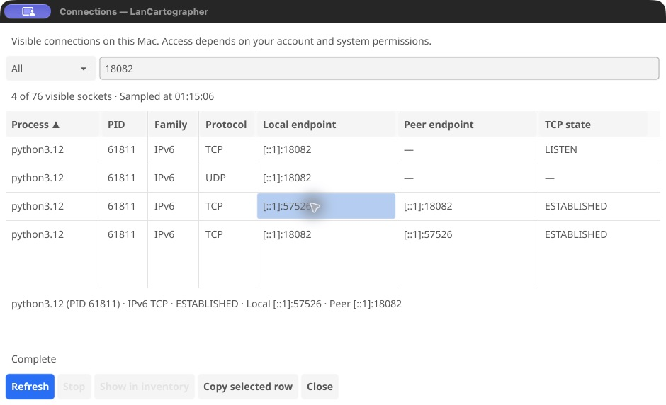
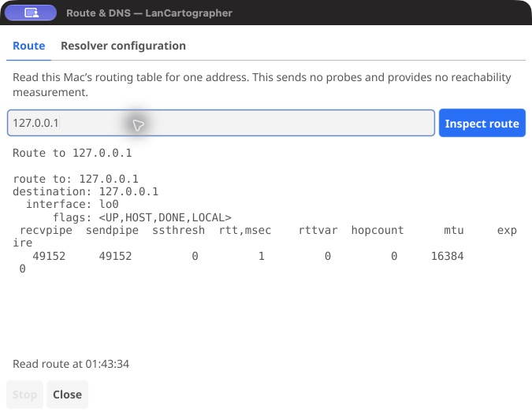
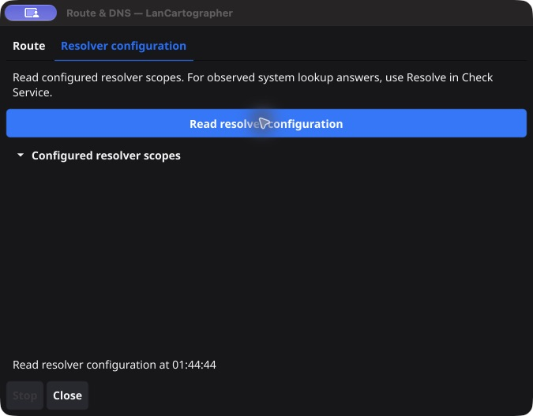

# macOS Route & DNS verification

Verified on macOS 27.2.1 (26B131) arm64 with Go 1.27.4 and Apple clang
21.0.0. The packaged candidate used the Connections parent at `765ac08`
plus the Route & DNS changes.

## Native package and helper output

- The packaged app rejected `localhost` as route input. Entering the numeric
  addresses `127.0.0.1` and `::1` showed `lo0` in each route. The installed
  helper also accepted a scoped IPv6 literal through `lo0`. Focused tests
  covered an unknown zone, an address with a port, missing routes,
  permission errors and control characters.
- **Read resolver configuration** completed in the independent resolver
  tab. A direct `scutil --dns` check found default and scoped sections.
  The screenshot keeps resolver details collapsed.
- The same app used Check Service to resolve `localhost` to `::1` and
  `127.0.0.1`. Declining the pinned endpoint left the result at Resolve.
  Confirming the owned `127.0.0.1:18080` endpoint showed separate TCP and
  HTTP 200 results. Focused service tests also exercised DNS answer bounds,
  TCP refusal and timeout, certificate verification and redirects.
- Computer Use checked light and dark rendering. Closing and reopening
  Route & DNS brought back an empty Ready view.

| Before, Connections | After, route | After, resolver configuration |
| --- | --- | --- |
|  |  |  |

```sh
go vet ./...
go test ./internal/macdiag ./internal/gui ./internal/servicecheck -run 'Test(Connections|Route|DiagnosticCommand|InternetQuality|WiFi|Check|Service)' -count=1
go test ./internal/servicecheck -run '^TestResolveFiltersAndBounds$' -count=1
bash deploy/build.sh
python3 tests/macos-smoke.py dist
codesign --verify --deep --strict dist/LanCartographer.app
```

The signed app and CLI both passed the loopback smoke and declare macOS
14.0 in their Mach-O deployment headers. Bundle executable SHA-256
`e1e884ff63aaabaf76366e26e2143b0a82eb254dedba2d4741b68327aa1faa75`.

The macOS 14 runtime and live Apple throughput calibration still require
their own environment and observations. The owner deferred native Windows
desktop acceptance. The package checks covered Apple Silicon on current
macOS. [Apple route manual](https://github.com/apple-oss-distributions/network_cmds/blob/main/route.tproj/route.8)
[Apple scutil manual](https://github.com/apple-oss-distributions/configd/blob/main/scutil.tproj/scutil.8)
