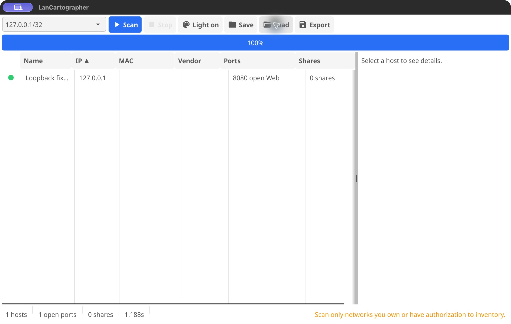
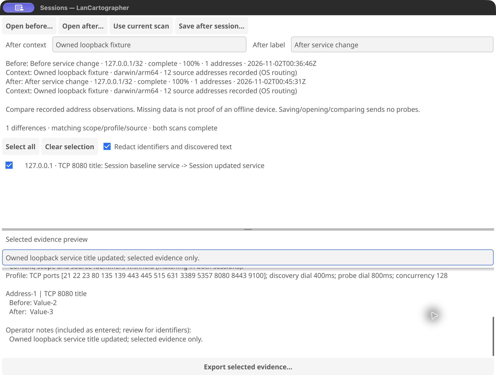
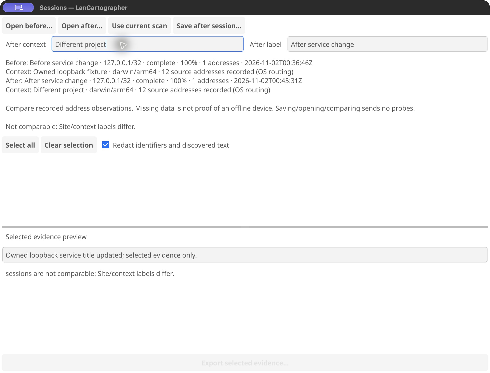
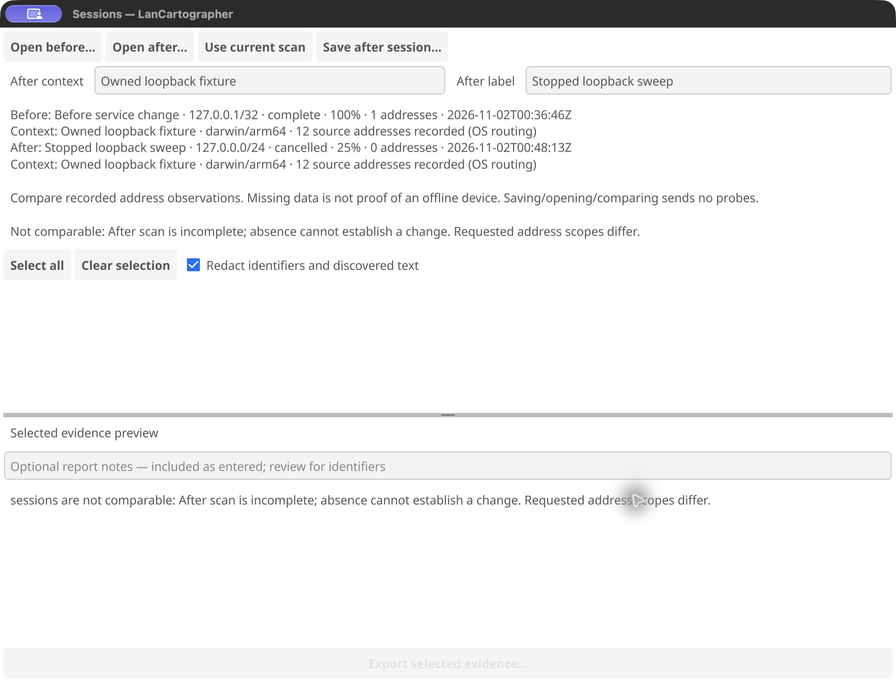
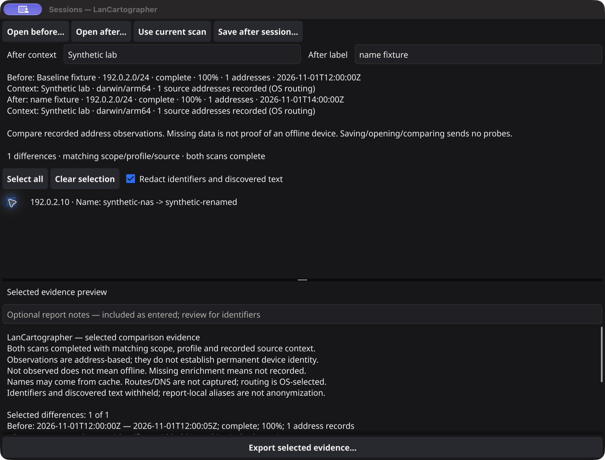
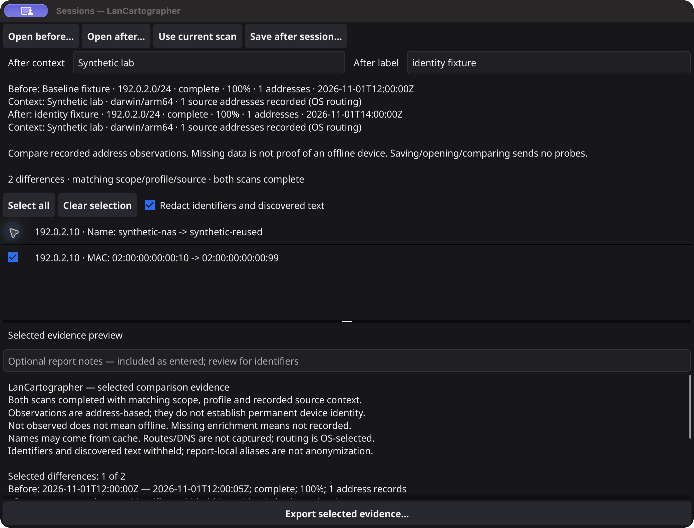
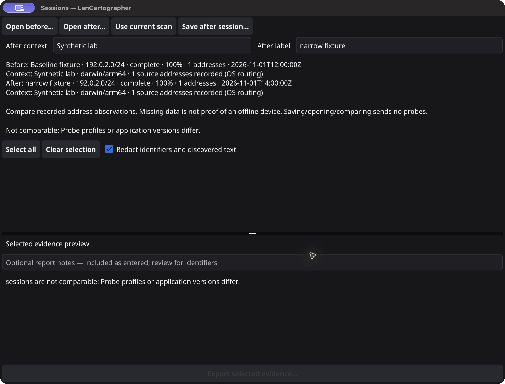
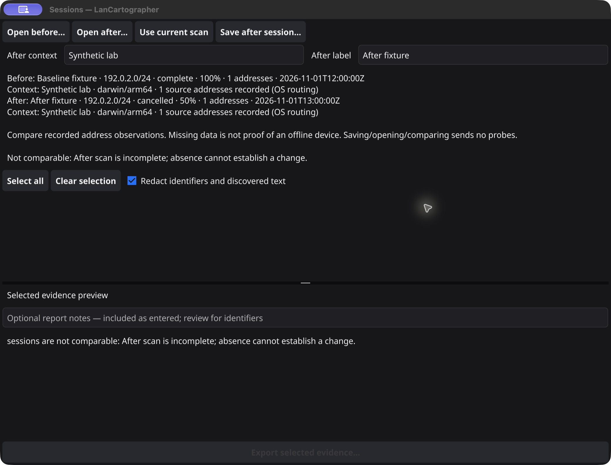

# Saved sessions and selected evidence — 2026-11-01

The native macOS session workflow passed against an owned HTTP service on
`127.0.0.1:8080`: capture/save, reload, before/after comparison, selection,
redaction, notes, evidence export, replacement confirmation and cancellation.
This is local verification for the first slice of
[issue #22](https://github.com/cgfixit/LanCartographer/issues/22), not release
acceptance or hosted CI evidence.

## Source and artifacts

- Base: `c40072206b57aace953618b79752a1efec9f9ec4`. A fresh clone of GitHub
  `main` was used; the final fetch still resolved to this commit. Open-PR
  search returned no open pull requests before local delivery.
- Implementation: `ddecb41d05a8d698cdc147f13182555d69daa720` on
  `cx/saved-sessions`. The exercised binary was built immediately before this
  commit from the identical Go sources. Its embedded VCS metadata therefore
  says `c400722...`, `vcs.modified=true`; subsequent changes are documentation
  and screenshots only.
- Candidate packaged executable SHA-256:
  `9eb11154e4e9fd7b13cbad60c9f13936af8ae2cdc02a2f4998e7d8e8a50d0f77`.
- Baseline executable SHA-256:
  `d10be17dd2a8e4ac3d93e8bc7a5b6a71b1f8d7c39570e803bc9cd6666799f70d`.
- macOS 27.2 (`26B123`), Apple Silicon; Go 1.27.1, Fyne 2.8.1,
  Apple clang 21.0.0, CGO enabled; actionlint 1.7.12.
- No dependency, workflow, Windows resource or OUI database changes.

## Focused local checks

With Go 1.27.1 on `PATH`, `GOTOOLCHAIN=local`, `CGO_ENABLED=1`:

```sh
go test -race ./internal/session ./internal/gui \
  -run '^TestSession|^TestLoadFavoritesAllows|^TestApplyEvent' -count=1
# PASS: internal/session 1.515s; internal/gui 1.864s
# Apple linker emitted the existing duplicate -lobjc warning.

go vet -mod=readonly ./internal/session ./internal/gui
# PASS, no diagnostics

gofmt -l internal/session internal/gui/gui.go \
  internal/gui/sessions.go internal/gui/sessions_test.go
# PASS, no output

bash deploy/build.sh
# PASS: native app/CLI, bundle checks, ad-hoc signature and architecture ZIP

bash .claude/skills/lan-guard/check.sh
# LAN-GUARD: PASS, including actionlint on all three existing workflows

git diff --check
# PASS
```

Focused regression coverage exercises bounded/strict session parsing, private
save modes, preservation of old files on failed saves, deep snapshot ownership,
incompatible and incomplete coverage, address-based absence semantics, selected
export/redaction, GUI selection invalidation and the file-open dialog. No full
local suite was run.

## Native execution

The packaged app ran with a disposable absolute `APPDATA` override under the
ignored verification directory. An owned Python HTTP server bound only to
`127.0.0.1:8080`; its title was changed from `Session baseline service` to
`Session updated service`. No LAN target was scanned.

1. Scanned `127.0.0.1/32` after the existing authorization confirmation. Saved
   the completed baseline with context `Owned loopback fixture` and label
   `Before service change`.
2. Changed the fixture title and scanned again. The final candidate captured
   a complete session at `2026-11-02T00:45:31Z` (November 1 local time), saved
   through the native form to the default sessions folder. Required context
   validation was also observed in the native error dialog.
3. Reloaded saved sessions through **Open before** and **Open after**. The final
   comparison against the new scan showed exactly one difference: TCP 8080's
   title. Other observations at the address did not become report rows.
4. Selected that row, reviewed the redacted preview, added a synthetic note and
   exported it. The final candidate's replacement confirmation was accepted
   only for the disposable prior report. The written file was inspected: mode
   `0600`, selected field and aliases present; raw IP, host name, titles and
   local interface addresses absent. The redaction opt-out also exposed source
   metadata in the native preview; it was switched back before export.
5. Changed the context to `Different project`. The row selection disappeared,
   the preview reset to the mismatch reason, and export was disabled.
6. Started and stopped an owned `127.0.0.0/24` sweep. The final candidate saved
   it as `cancelled`, 25.2% progress (25% displayed), with zero completed host
   records. Comparing it with the completed `/32` baseline produced both the
   incomplete-scan and scope-mismatch reasons, no differences and no export.
   Focused checks separately exercise incomplete state with matching scope.
7. File operations, comparison, selection and export made no additional HTTP
   requests to the fixture. Its total stayed at five, including earlier scan
   iterations. Source inspection confirms these actions have no probe/scan
   call path; this is not a packet-capture claim about every OS component.

The final native app log was empty, and the app exited successfully. The owned
fixture was stopped after verification. Raw saved sessions remain local and
untracked because they contain source interface addresses and host metadata.
Only the reviewed redacted report and safe screenshots are included here.

The [actual redacted export](sessions-2026-11-01/selected-evidence.txt) has SHA-256
`56a8149a159bee3c8756fc8df6f84b5a452819518249dce828b509177e59245e`.
It is an example of selected evidence, not a full session file.

## Screenshots

Before: baseline `main`, with a fabricated loopback favorites row loaded for the
screenshot so no real host name appears. This image illustrates the previous
UI, not a scan-results claim.



After: final candidate comparing an owned service change and previewing selected,
redacted evidence. Only loopback identifiers and synthetic labels/titles appear.







## Findings and limits

Native interaction caught a Fyne file-open crash caused by resizing the dialog
before showing it. The premature resize was removed and a focused regression
check added. The native pass also led to a readable scrolling preview, reset
scroll position when its contents change, and a file picker starting in the
default sessions folder. These fixes were included in the final build above.

The restricted environment initially aborted in GLFW initialization; the same
baseline ran with approved native access. A UI observation after Quit also
relaunched stale verification instances with the same bundle identity. Only
those task-owned instances were removed, and final evidence was collected from
the sole running candidate. No product permissions or network limits were
weakened to obtain a pass.

Windows and Intel macOS native UI, macOS 13 execution, authenticated SMB,
downloaded Gatekeeper acceptance, and large-session responsiveness were not
verified. This is light-theme native evidence. The existing CI `gate` job and
`macos` arm64/Intel matrix cover broad build/vet/race and packaged CLI checks
on pull requests; they do not supply interactive UI acceptance. No hosted
checks had run at the time of this local verification. The change was later
opened as [draft PR #23](https://github.com/cgfixit/LanCartographer/pull/23);
its current checks are separate evidence. Signing is ad-hoc, not Developer ID
signing or notarization.

Sessions deliberately require matching coverage/source metadata, so a changed
VPN/interface can block comparison. The source snapshot is not a bound network
vantage point or a route/DNS snapshot. Saved JSON is unredacted and editable;
report aliases are not anonymization, and operator notes need review.


## Final documentation reconciliation

After draft PR #23 was opened, README, USER-GUIDE, security/support/update and
contributor guidance, the bug-report template and agent package maps were
reconciled with the implementation. The guide now includes the session workflow,
compatibility troubleshooting, storage and sharing limits. Stale claims about
Windows-only behavior, hermetic tests, network locality and shell-free desktop
actions were corrected against their production callers. Older dated verification
records remain historical evidence.

A local Markdown self-check passed for the ten changed documents: 34 relative
links/anchors, balanced code fences and verbatim authorization notices. The
invariant guard (including actionlint) and `git diff --check` passed again.
A diff against implementation commit `ddecb41` confirmed unchanged Go sources,
dependencies, workflows and Windows resource. Native interaction and focused
checks above were not repeated for this documentation-only follow-up.

## Independent native acceptance follow-up

An independent checkout at `c72a2dc773ee8601ca77d2b25d9b1810f316c9c8`
was built and exercised, then fast-forwarded to
`036f9eb5f0259e17d8f7cc133f293591c4eb0767`. A diff confirmed identical
Go sources, dependencies, workflows, packaging and build scripts between those
revisions. The packaged executable SHA-256 was
`0a52df491764fe9b7bb05f3ac57435ec325044461f073b0fa89d48af85d22688`.
The host was macOS 27.2 arm64 with Go 1.27.1 and Fyne 2.8.1.

The same focused race command above passed independently (`session` 1.358s,
`gui` 1.882s), as did the listed vet/gofmt checks and native package build.
The restricted build first failed in `iconutil`; the unchanged build command
passed with approved native access. The existing duplicate `-lobjc` warning
remained. No full local suite was run.

Native Computer Use loaded synthetic session files with disposable app data and
the saved dark theme. No scan was started during this follow-up. The baseline
recorded one address, `192.0.2.10`, in `192.0.2.0/24`, context `Synthetic lab`,
ports `[80, 443]`, dial/probe budgets `400/800ms`, concurrency `128`, and a
synthetic `fixture0` source. Before/after files had distinct ordered timestamps.
The controlled changes and observed outcomes were:

| Case | Native result |
| --- | --- |
| TCP 80 title changed from `Fixture before` to `Fixture after` | Exactly one selectable title difference; redacted preview/export used aliases. |
| Only name changed from `synthetic-nas` to `synthetic-renamed` | Exactly one Name difference. Preview retained the statement that observations do not establish permanent device identity. |
| Same IP, name changed to `synthetic-reused` and MAC from `02:00:00:00:00:10` to `02:00:00:00:00:99` | Two separate Name/MAC differences, with the identity caveat. Loading this file cleared the prior name-only selection. Selecting only MAC exported **1 of 2** differences; no Name row or raw identifiers appeared. |
| Port 443 removed from both the requested profile and recorded ports | Explicit profile/version incompatibility; prior selection and preview cleared, no differences listed, export disabled. No closed/removed-port claim was produced. |
| Matching scope/profile/source, but state `cancelled` and progress `0.5` | Explicit incomplete-coverage reason; previous evidence cleared and export disabled. This isolates incompleteness from the earlier live cancellation's scope mismatch. |

The [actual one-of-two export](sessions-2026-11-01/identity-selected.txt) was
written by the native app. File inspection confirmed `0600`, the selected MAC
field and aliases, and absence of raw IPs, MACs, names, site and interface
identifiers. Both native app runs exited successfully with empty logs. The
synthetic files exercise comparison behavior, not live DHCP/device identity.









Issue #22's first-slice acceptance coverage now has the following boundaries:

| Acceptance item | Evidence and remaining limit |
| --- | --- |
| Save/reload an owned service change and review/export selection | Live loopback native pass above; independent synthetic dark-theme pass also inspected the saved report. |
| Preserve narrower and cancelled coverage | Native profile-mismatch and matching-scope cancelled cases above; live cancellation and focused state tests cover capture. |
| Reused address and independent name change | Native imported fixtures above retain address/identity uncertainty; no live DHCP reassignment was performed. |
| File operations send no probes; cancellation stays bounded | Original HTTP request-count/source-path inspection and live cancellation above; this is not packet capture. |
| Native themes, selection and stale results | macOS light/dark rendering and selection invalidation observed. Native Windows and Intel UI remain unverified. |
| Focused checks, documentation and draft delivery | Focused local checks and README/guide updates are recorded above; draft PR #23 contains this slice. |

Hosted results are separate: at source `036f9eb`,
[CI run 41369875879](https://github.com/cgfixit/LanCartographer/actions/runs/41369875879)
passed the Windows gate and macOS arm64/Intel jobs, and
[Gitleaks run 41369875795](https://github.com/cgfixit/LanCartographer/actions/runs/41369875795)
passed. Those results belong to that revision; any subsequent evidence-only
commit has its own PR checks. Hosted platform jobs do not close the native
Windows UI gap. This follow-up changes only documentation and synthetic
evidence; the implementation and later roadmap scope are unchanged.
