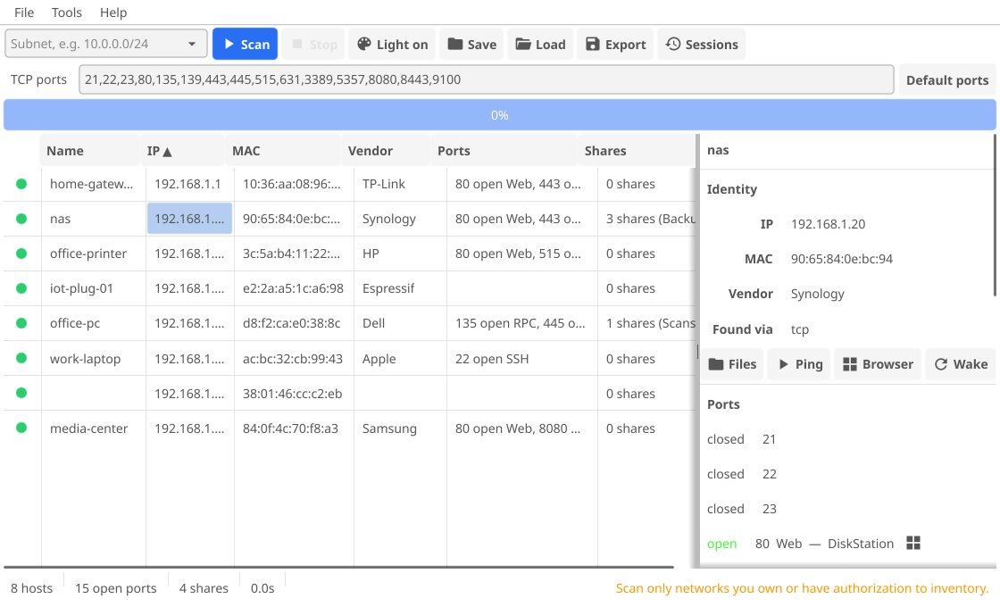
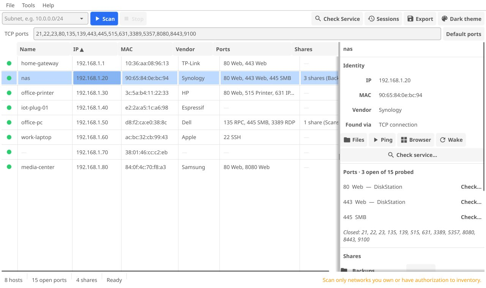
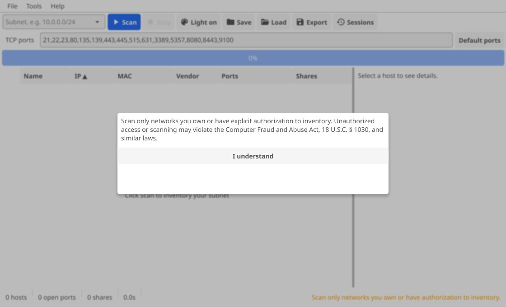
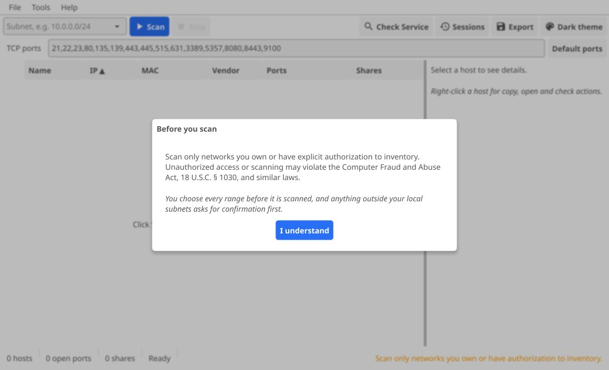

# Main window flow verification

Source: branch `claude/affectionate-bell-l75qlr` on `main` at `67ea3cd`
(Check Service merged), Go 1.27.3 and Fyne 2.8.2. Environment: Linux x86_64
container, Xvfb X11 display with Mesa software rendering, driven with
`xdotool` mouse and keyboard input. Linux is not a supported GUI target; the
local build added an uncommitted file with the five desktop-launch helpers
that only the Windows and macOS action files provide.

The change is presentation and flow only. Scan, probe, authorization,
session, favorites and export logic are unchanged; the CLI keeps its table
text.

## Same data, before and after

Both images load the same fabricated sample favorites (192.168.1.0/24, no
real network data; loading favorites sends no probes) and select `nas`.

| `main` at `67ea3cd` | This branch |
| --- | --- |
|  |  |

| First-run notice before | First-run notice after |
| --- | --- |
|  |  |

## What changed

| Area | Before | After |
| --- | --- | --- |
| Toolbar | Subnet, Scan, Stop, `Light on`, `Save`, `Load`, Export, Sessions | Scan controls left; Check Service, Sessions, Export and a `Dark theme` / `Light theme` action right. Favorites stay in the File menu |
| Progress | A `0%` bar at all times and `100%` after a scan | Shown only while scanning |
| Status | `0.0s`, `828ms`, `1 hosts`, a second orange `Scanning…` label | `Ready`, `Scanning · 3s`, the duration, `Stopped · 2s`; singular counts |
| Selection | One highlighted cell | The whole row, in the theme's selection color |
| Table text | `18080 open Web, 18…`, `0 shares`, empty cells | `18080 Web, 18443`; dim `—` for unknown values |
| Columns | IP 11.5 %, MAC 14.5 %; 1120×680 default window | IP 14 % (min 125 px), MAC 16.5 %, Ports 23.5 %; 1280×760 default |
| Panel | All probed ports in scan order (closed first), green state words, unexplained icons, `Found via tcp` | `Ports · 3 open of 15 probed`, open ports with **Check…**, `Closed:` and `No answer:` summary lines, `TCP connection`, a **Check service…** action |
| Empty states | `Click Scan to inventory your subnet` in every idle case | Idle guidance, `Hosts appear here as they answer.` while scanning, and `No hosts answered in <range>` after an empty scan |
| First run | Untitled pop-up with blank space | Titled `Before you scan` dialog; only **I understand** records the marker, as before |
| Reminder | Truncated to `invento…` after a runtime switch to dark | 12 px slack keeps the sentence whole in both themes |

## Rendered interaction

- First launch with an empty data directory showed the titled notice;
  **I understand** wrote `firstrun_seen`.
- Authorized loopback scans of `127.0.0.0/29` and `127.0.0.0/24` (owned
  fixture services on `127.0.0.1`–`127.0.0.4`) passed through the existing
  confirmation dialog and showed `Scanning · 1s` with the progress bar. The
  `/24` scan finished with four hosts and `851ms`, with the bar hidden.
- Stop immediately after confirming a `/24` scan ended with `Stopped · 104ms`
  and kept the partial results.
- Selecting a row highlighted every column in light and dark themes. The
  panel's **Check…** on 443 opened Check Service with `127.0.0.3`, 443 and
  HTTPS and contacted nothing.
- Right-click on a row still offered the copy, open, Ping and Check service
  actions. **File → Save Favorites** wrote four hosts and **Load Favorites**
  restored them. **Export** wrote a JSON file with four hosts.

## Commands

```bash
gofmt -l .                                         # no output
CGO_ENABLED=0 go vet ./...                         # also GOOS=windows and GOOS=darwin
go vet ./internal/gui/                             # cgo
go test -race ./internal/gui/ ./internal/model/ ./internal/cli/ ./internal/servicecheck/
CGO_ENABLED=0 go build -o "$TMPDIR/lc-cli" ./cmd/lancartographer
APPDATA="$(mktemp -d)" "$TMPDIR/lc-cli" --range 127.0.0.0/29 --i-am-authorized --ports 22,80,443,445,3389,8080,18080,18443
bash .claude/skills/lan-guard/check.sh            # PASS
```

The CLI table still prints `18080 open Web, 18443 open unknown`. New GUI
tests cover the toolbar and File menu, idle progress and status text,
singular counts, the post-scan empty state, the row-wide highlight (it fails
when the highlight is disabled), the panel's port ordering and Check
actions, and that **Check…** only prefills.

## Limits

- No native Windows or macOS run. Hosted CI covers the Windows gate and the
  macOS builds and race tests. Fyne draws the same widgets on each platform,
  but menu placement (macOS uses the system menu bar) and font metrics were
  not observed here.
- `internal/cli` `TestLoopbackEndToEnd` binds `127.0.0.1:18080`; it failed
  while this run's fixture held that port, on this branch and on `main`
  alike, and passed once the fixture stopped.
- The Sessions window and the Check Service and Internet Quality windows
  were not redesigned.
