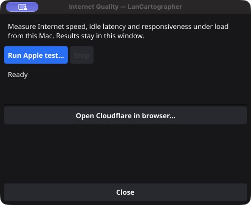
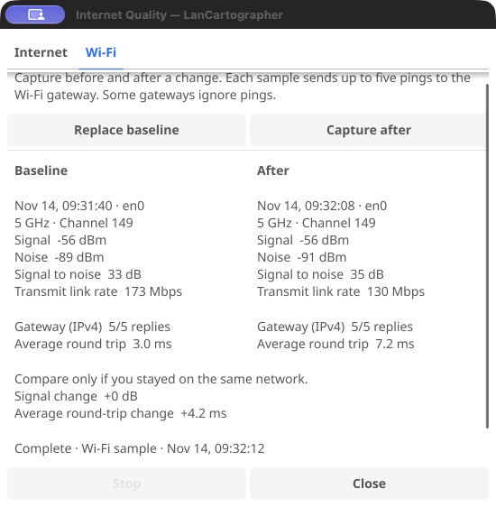

# Wi-Fi diagnostics verification

The screenshots show the published macOS prerelease at `89b115e` and the
ad-hoc signed Apple Silicon candidate built from `7ea4c66` using Go 1.27.3
and Fyne 2.8.2 on macOS 27.2.1. [Draft PR #45](https://github.com/cgfixit/LanCartographer/pull/45)

| Published Internet Quality window | Candidate Wi-Fi comparison |
| --- | --- |
|  |  |

Using Computer Use, the candidate captured two samples with five IPv4 gateway
replies each and displayed the signal and latency deltas. Stop preserved the
previous completed samples. Closing and reopening cleared the comparison. The
Apple test completed, and a separate authorized loopback scan appeared in
Sessions. Both screenshots were captured during verification. The candidate
screenshot shows two samples taken on the same network with the same settings.

The packaged smoke check exercised both CLI entry points against an owned
loopback HTTP fixture. Focused GUI tests covered route and ping parsing,
comparison, and the existing Apple measurement lifecycle. Live gateway
verification covered IPv4. IPv6 had fixture coverage. Intel, Windows, and a
runtime on macOS 13 were outside this local verification.
